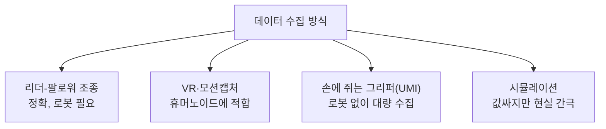

# 원격조종 데이터

> 사람이 로봇을 직접 조종하며 보여 준 동작을 기록한 학습 데이터. 인터넷 글·사진처럼 쌓여 있지 않은 "로봇 행동 데이터"가 부족해서, 이를 모으는 일이 로봇 AI의 가장 큰 병목으로 꼽힌다.

## 쉽게 말하면
요리를 배우는 신입에게 레시피 글은 인터넷에 넘치지만, "손목을 이렇게 꺾어서 팬을 흔든다"는 몸의 기록은 거의 없다. 선배가 옆에서 직접 시연해 보이는 수밖에 없다. 로봇도 사람이 대신 조종하는 시연을 수천~수만 번 모아야 배운다. 이 시연 기록이 원격조종(teleoperation) 데이터다.

## 자세히
- **왜 병목인가**: LLM은 인터넷의 글로 학습하지만, 로봇이 팔을 어떻게 움직였는지의 데이터(카메라 영상 + 관절·그리퍼 명령)는 직접 만들어야 한다. 로봇마다 몸이 달라 데이터를 그대로 공유하기도 어렵다.
- **수집 방식**
  - **리더-팔로워 원격조종**: 사람이 조종용 팔을 움직이면 로봇 팔이 따라 움직이고 그 동작이 기록된다. ALOHA(2023)는 저가 하드웨어와 맞춤 조종 인터페이스로, 약 10분 분량의 시연만으로 컵 열기·배터리 끼우기 등 어려운 실제 작업 6가지를 80~90% 성공률로 학습했다고 보고했다(ACT 알고리즘, arXiv 2304.13705).
  - **VR·모션캡처**: 사람의 손·몸 움직임을 추적해 로봇에 옮긴다(휴머노이드에서 흔함).
  - **UMI(Universal Manipulation Interface, 2024)**: 로봇 없이 **손에 쥐는 그리퍼**로 사람이 시연을 모으고, 학습된 정책이 여러 로봇에 이전되는 방식. 지연 시간 보정과 상대 궤적 행동 표현으로 하드웨어에 종속되지 않게 했고, 다양한 사람 시연으로 새로운 환경·물체에 제로샷 일반화를 보였다(논문 주장). 데이터만 바꿔도 새 과제를 가르칠 수 있다.
  - **시뮬레이션·합성 데이터**: [시뮬레이션→현실](#sim-to-real)로 보완.
- **데이터 공유**: Open X-Embodiment(2023)는 21개 기관이 22종 로봇의 데이터를 표준 형식으로 모아 527개 기술을 담았고, 여러 로봇 데이터를 합쳐 학습한 모델(RT-X)이 한 로봇 경험만 쓴 모델보다 낫다는 "긍정적 전이"를 보고했다.
- **품질 이슈**: 조종자의 숙련도·습관에 따른 편차, 실패 시연 처리, 라벨링(언어 지시 붙이기), 사람이 조종하다 보니 생기는 지연.
- **비용**: 숙련 조종자의 시간이 핵심 비용. 그래서 휴머노이드 회사들은 전담 조종 팀을 운영하거나 사람 영상으로 우회하려 한다.

## 그림으로 보기

## 예시
- 물류 로봇 도입 회사가 숙련 작업자 5명이 하루 두 시간씩 원격조종으로 박스 포장 시연을 모아, 한 달 뒤 로봇 정책을 학습시킨다.
- 가정용 로봇 연구실이 UMI형 그리퍼를 여러 가정에 보내 설거지·정리 시연을 수집한다.

## 헷갈리는 것과 비교
| 개념 | 차이 |
|---|---|
| 원격조종 데이터 | 사람이 로봇 몸으로 직접 시연한 기록(정확, 비쌈) |
| 사람 영상 데이터 | 사람이 자기 몸으로 한 영상. 몸이 달라 변환 필요 |
| 합성·시뮬레이션 데이터 | 값싸고 많지만 현실과 차이([sim-to-real](#sim-to-real)) |
| [VLA 모델](#vla-model) | 이 데이터로 학습되는 모델 유형 |

## 더 읽을거리
- [Learning Fine-Grained Bimanual Manipulation with Low-Cost Hardware (arXiv 2304.13705)](https://arxiv.org/abs/2304.13705) — ALOHA·ACT
- [Universal Manipulation Interface (arXiv 2402.10329)](https://arxiv.org/abs/2402.10329) — 로봇 없는 시연 수집
- [Open X-Embodiment (arXiv 2310.08864)](https://arxiv.org/abs/2310.08864) — 다기관 로봇 데이터 공유
