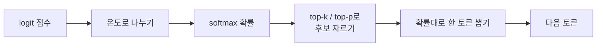
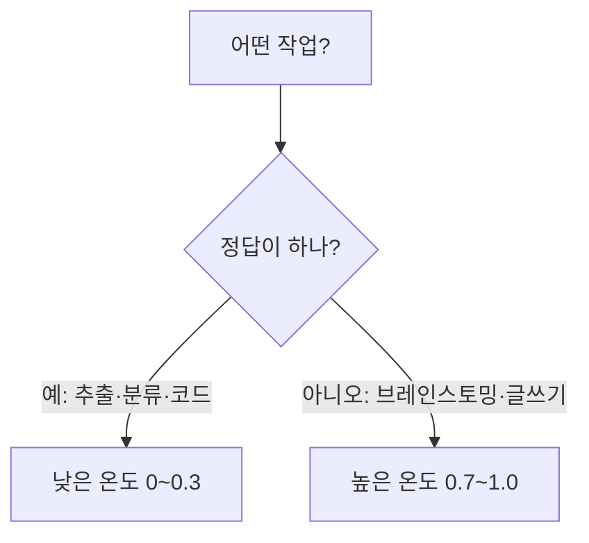

# 온도와 샘플링 (Temperature · top-p · top-k)

> LLM은 다음 토큰마다 "후보별 확률표"를 만들고 그중 하나를 뽑는다. 온도(temperature)·top-p·top-k는 그 **뽑는 방식**을 조절하는 다이얼이다.

## 쉽게 말하면
룰렛 판을 떠올려 보자. 모델이 "다음 단어"마다 칸 크기가 다른 룰렛을 만든다. 온도를 낮추면 큰 칸이 더 커져서 거의 항상 가장 그럴듯한 단어가 나온다(일관·보수적). 온도를 높이면 칸 크기가 비슷해져 엉뚱한 단어도 자주 나온다(다양·창의적, 때로는 헛소리). top-p·top-k는 룰렛에서 아예 **가능성 낮은 칸을 잘라 내는** 장치다.

## 자세히
- 모델의 출력은 토큰별 점수(logit)이고, [softmax](#softmax)로 확률이 된다. **온도 T**는 softmax 전에 logit을 T로 나눈다. T<1이면 분포가 뾰족, T>1이면 평평해진다. T→0이면 항상 최고 확률만 고르는 탐욕 디코딩(greedy)과 같다.
- **top-k**: 확률 상위 k개 토큰만 남기고 그 안에서 뽑는다.
- **top-p(핵 샘플링, nucleus)**: 확률이 큰 순서로 누적해 합이 p(예: 0.9)가 되는 최소 집합만 남긴다. 후보 수가 상황에 따라 자동으로 변한다.
- Anthropic Messages API 기준(일반 문서 설명, 모델별 세부는 원문 확인): `temperature` 범위 0.0~1.0, 기본 1.0이고 `top_p`·`top_k`는 기본 미설정. Anthropic은 보통 temperature와 top_p 중 **하나만** 조절하라고 안내한다. 최신 일부 모델은 이 파라미터 지정을 제한할 수 있으니 모델별 문서를 확인한다.
- 온도 0이어도 병렬 연산 오차 등으로 완전히 같은 출력이 보장되지는 않는다(주장 아닌 널리 알려진 관찰이지만 모델·서비스별로 다름).
- 추론(reasoning) 모델은 생각하는 부분에서 샘플링 설정을 고정·제한하는 경우가 있다 → [추론 모델](#reasoning-models).

## 그림으로 보기



## 예시
```python
import anthropic
c = anthropic.Anthropic()
r = c.messages.create(model="<모델 id>", max_tokens=300,
    temperature=0.2,   # 요약·추출: 낮게
    messages=[{"role":"user","content":"이 계약서에서 날짜만 뽑아줘"}])
```
아이디어 20개가 필요하면 온도를 1.0 가까이 올리고, 같은 요청을 여러 번 돌려 다양성을 얻는다.

## 헷갈리는 것과 비교
| 개념 | 차이 |
|---|---|
| 온도 | 확률분포 전체를 뾰족/평평하게 |
| top-k | 상위 k개 고정 개수만 남김 |
| top-p | 누적확률 p까지만 남김(개수 가변) |
| [반복 페널티](#repetition-penalty) | 이미 나온 토큰 점수를 깎음 |
| 환각 | 온도를 낮춰도 사라지지 않음(모르는 걸 자신 있게 말하는 문제) |

## 더 읽을거리
- [Anthropic Messages API 레퍼런스](https://platform.claude.com/docs/en/api/messages) — temperature·top_p·top_k 파라미터 정의(이번에 열어 봤으나 페이지가 길어 일부만 확인).
- [The Illustrated Transformer](https://jalammar.github.io/illustrated-transformer/) — logit이 softmax를 거쳐 확률이 되는 출력 단계 그림.
