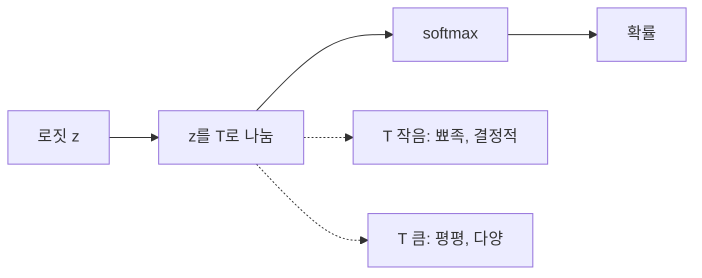
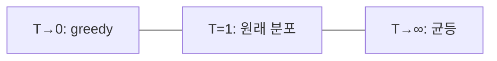

# 온도 스케일링

> 로짓을 온도 T로 나눈 뒤 softmax를 적용해, 확률분포의 뾰족함(무작위성)을 조절하는 방법. T가 작으면 1등이 두드러지고 T가 크면 평평해진다.

## 쉽게 말하면
요리 중 불 조절이다. 약불(T 작음)이면 한 가지 맛이 또렷하게 우러나고, 센 불(T 큼)이면 재료가 마구 섞여 예측하기 어렵다. 재료(로짓 순위)는 그대로이고 "얼마나 과감하게 1등을 고를지"만 바뀐다.

## 자세히
- 식: softmax(zᵢ/T) = exp(zᵢ/T) / Σ exp(zⱼ/T). Softmax 위키(확인 2026-11-12)는 β=1/kT에서 k=1이면 T로 나누는 것과 같다고 설명한다.
- **T→0**: argmax(원-핫)로 수렴, 즉 항상 최고 점수 선택(greedy). 단, 거의 동점인 입력은 천천히 수렴한다.
- **T→∞**: 균등분포(모두 1/n).
- T<1은 무작위성 감소, T>1은 증가. HF 문서: `temperature=0`은 최빈 토큰에 몰아주는 것과 같고 `do_sample=True`가 있어야 효과가 있다(0.0001일 땐 두 시퀀스가 동일).
- 같은 식이 강화학습의 Boltzmann 행동 선택(τ)에도 쓰인다.
- 로짓 [2.0,1.0,0.1]: T=1이면 약 [0.66,0.24,0.10], T=0.5면 [0.86,0.12,0.02](직접 계산).
- 또 다른 의미: 분류 모델 보정(calibration)에서 확률의 과신을 줄이는 temperature scaling이 있다(이 노드의 범위 밖, 확인 못 함).

## 그림으로 보기

## 예시
- 코드 생성·사실 질의: T를 낮게(0~0.3)해 일관된 답.
- 아이디어 브레인스토밍: T를 높여(0.8~1.2) 다양한 후보를 얻는다.

## 헷갈리는 것과 비교
| 개념 | 차이 |
|---|---|
| 온도 | 분포 전체의 뾰족함 조절 |
| top-p·top-k | 후보 집합을 잘라냄 |
| [logit bias](#logit-bias) | 특정 토큰만 가감 |
| [softmax](#softmax) | 온도가 들어가는 함수 |

## 더 읽을거리
- [Softmax function — Wikipedia](https://en.wikipedia.org/wiki/Softmax_function) — 온도 매개변수와 극한 동작
- [HF Generation utilities](https://huggingface.co/docs/transformers/main/en/internal/generation_utils) — TemperatureLogitsWarper 예시
