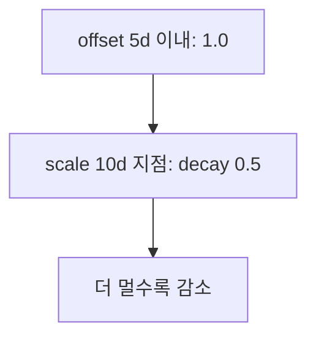

# 시간 감쇠 점수

> 검색에서 문서의 날짜가 기준 시점에서 멀수록 점수를 부드럽게 낮추는 방법이다. Elasticsearch의 `gauss`·`exp`·`linear` 감쇠 함수가 대표적이며 RAG의 최신성 가중에도 쓴다.

## 쉽게 말하면
신문 가판대에서 어제 신문은 거의 그대로, 한 달 전 신문은 값을 절반으로 쳐 주는 식이다. 오래될수록 점수를 서서히 깎는다.

## 자세히
(Elasticsearch function_score 문서를 직접 열어 확인.)
- **감쇠 함수 3종**: `gauss`(정규 곡선), `exp`(지수), `linear`(선형). 숫자·날짜·위치 필드에 쓰며 범위 질의의 부드러운 대안이다.
- **매개변수**: `origin`(기준점, 날짜는 기본 now), `scale`(origin+offset에서 점수가 `decay`가 되는 거리), `offset`(이 거리 안은 감쇠 없음, 기본 0), `decay`(scale 거리에서의 점수, **기본 0.5**).
- **수식**(d = max(0, |x−origin| − offset)): gauss S = exp(−d²/(2σ²)), σ² = −scale²/(2·ln(decay)); exp S = exp(λ·d), λ = ln(decay)/scale; linear S = max((s−d)/s, 0), s = scale/(1−decay)(scale의 두 배에서 0).
- **날짜 예**: origin 2013-09-17, scale 10d, offset 5d, decay 0.5 → 5일 이내는 점수 1.0, origin에서 15일 거리에서 0.5.
- **기타**: 다중 값 필드는 origin에 가장 가까운 값을 쓰고(`multi_value_mode`로 변경), **필드가 없는 문서는 점수 1**을 받는다(주의: 날짜가 없으면 감쇠가 안 된다).
- **RAG 적용(제안)**: 의미 유사도 점수에 시간 감쇠 점수를 곱하거나 더해 최근 문서를 우선하되, 시간에 무관한 문서는 감쇠하지 않는 설계가 필요하다([반감기 최신성 가중](#half-life-recency-prior)).

## 그림으로 보기



## 예시
```json
"gauss": {"@timestamp": {"origin": "now", "scale": "10d", "offset": "5d", "decay": 0.5}}
```
- 교육 활용: decay 값을 바꿔 가며 문서 순위가 어떻게 달라지는지 실험.

## 헷갈리는 것과 비교
| 개념 | 차이 |
|---|---|
| 시간 감쇠 | 점수를 부드럽게 낮춤 |
| 날짜 필터(사전 필터) | 기준 밖 문서를 제외 |
| [신선도 사전필터 vs 감쇠](#freshness-prefilter-vs-decay) | 두 방식 비교 |

## 더 읽을거리
- [Elasticsearch function_score 쿼리](https://www.elastic.co/guide/en/elasticsearch/reference/current/query-dsl-function-score-query.html) — 감쇠 함수.
