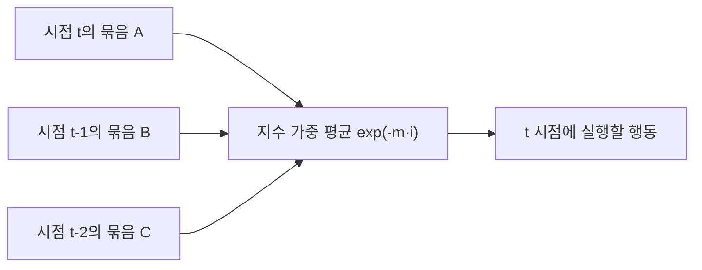
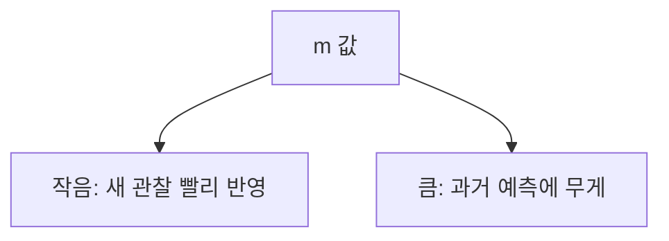

# 시간 앙상블

> 행동 묶음 예측에서 **매 스텝 정책을 호출해 겹치는 묶음들이 같은 시점에 낸 여러 예측을 가중 평균**하는 방법. 묶음이 바뀔 때 생기는 끊김을 없애 부드러운 동작을 만든다. (ACT 논문 본문 직접 읽음, arXiv 2304.13705)

## 쉽게 말하면
여러 선생님이 같은 시각에 "다음 동작은 이거야"라고 각자 말했을 때 최근에 말한 의견에 가중치를 조절해 평균을 내는 것이다. 한 선생님만 믿다가 선생님이 바뀔 때 튀는 일이 없다.

## 자세히
- 문제: 단순한 행동 묶음은 k스텝마다 새 관찰을 갑자기 반영해 **동작이 끊겨 보일 수 있다.**
- 해법: 실행하는 동안 **매 시점 정책을 질의**해 묶음들이 겹치게 한다. 한 시점에는 예측이 여러 개 생기고 이를 **지수 가중** `w_i = exp(−m·i)`로 평균한다(w₀가 가장 오래된 행동의 가중치). **m이 작을수록 새 관찰을 빨리 반영**한다.
- 일반 스무딩과의 차이: 인접 시점의 행동을 섞어 편향이 생기는 일반 스무딩과 달리, **같은 시점에 대해 예측된 행동**을 합친다. **학습 비용은 늘지 않고** 추론 때 계산만 늘어난다(논문 설명).
- 효과(논문 ablation): 시간 앙상블 유무를 비교했을 때 ACT는 어느 쪽에서도 가장 높은 성공률이었다. 논문은 BC-ConvMLP가 시간 앙상블로 가장 큰 이득(4%)을 봤고 다음이 3.3%라고 보고했으며, VINN(비모수 방법)은 성능이 떨어졌다고 한다(본문 발췌 기준, 정확한 대상 표는 확인하지 않음). 하이퍼파라미터를 각각 따로 튜닝했다는 단서가 있다.
- 한계: 추론 시 매 스텝 호출이므로 계산이 늘고, 모든 방법에 이득이 있는 것은 아니다.

## 그림으로 보기

## 예시
- 매 스텝 추론하며 같은 시점에 대한 여러 묶음 예측을 가중 평균해 로봇 팔 궤적을 부드럽게 한다.
- 교육: 겹치는 이동평균과의 차이를 그림으로 설명(같은 시점의 여러 예측 vs 인접 시점 평균).

## 헷갈리는 것과 비교
| 개념 | 차이 |
|---|---|
| 시간 앙상블 | 같은 시점의 여러 예측을 가중 평균 |
| 이동 평균 스무딩 | 인접 시점 값을 평균(편향 가능) |
| [행동 묶음 예측](#action-chunking) | 이 기법이 보완하는 기반 방식 |

## 더 읽을거리
- [ACT 논문](https://arxiv.org/abs/2304.13705) — 시간 앙상블 정의와 ablation(본문 읽음).
