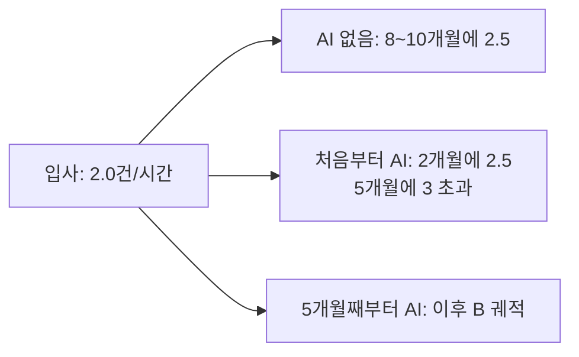
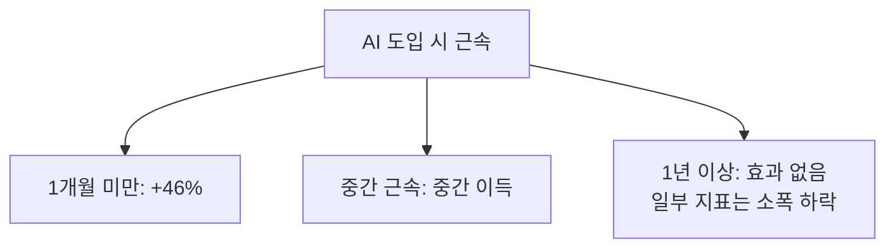

# 근속 기간별 생산성 곡선

> 입사 후 개월 수에 따라 시간당 해결 건수가 어떻게 오르는지를 AI 사용 여부별로 그린 곡선. "Generative AI at Work" 연구의 Figure 8이 대표 그림으로, AI를 처음부터 쓴 상담사는 2개월에 2.5건, 안 쓴 상담사는 8~10개월에 2.5건에 도달했다.

## 쉽게 말하면
새로 들어온 직원의 성장 그래프를 두 개 겹쳐 그린 것이다. 한 선은 선배 귀띔(AI) 없이, 한 선은 귀띔을 받으며 일한 직원이다. 두 선의 출발점은 같지만 귀띔을 받은 쪽이 훨씬 가파르게 오른다. 더 흥미로운 세 번째 선이 있다. 5개월 동안 혼자 하다가 귀띔을 받기 시작한 직원은 그때부터 갑자기 가파르게 오른다. 도구가 성장 속도를 바꾼다는 증거다.

## 자세히
출처: Brynjolfsson, Li, Raymond "Generative AI at Work" NBER 31161 본문 §4.2.2–4.2.3(PDF를 직접 읽음). 한 소프트웨어 회사의 채팅 상담 환경 한 곳의 결과다.
- **세 그룹(Figure 8)**: ① never treated(끝까지 AI 없음) ② always treated(입사 때부터 AI 접근) ③ treated 5 mo.(처음 4개월은 AI 없이, 5개월째부터 접근).
- **출발점**: 모두 시간당 약 2.0건 해결로 시작.
- **never treated**: 8~10개월에 걸쳐 약 2.5건에 도달.
- **always treated**: **2개월** 만에 2.5건, 5개월차에는 3건 초과.
- **treated 5 mo.**: 처음 5개월은 never treated와 같이 천천히 오르다가, 접근 시작 후 always treated와 같은 궤적으로 빠르게 상승.
- **결론 문장(논문)**: 여러 지표에서 AI를 쓰는 2개월차 상담사가 AI 없는 6개월 넘은 상담사와 같거나 더 낫다. 평균 처치 효과는 별개 분석이고 여기서 인용하지 않는다.
- **입사 시점별 효과(Figure 5B)**: AI 도입 시점의 근속을 5그룹으로 나누면 경험이 적을수록 이득이 크다. **1개월 미만** 상담사는 시간당 해결이 로그 0.38(약 46%) 개선(같은 근속의 AI 없는 상담사 대비). **1년 넘은** 상담사는 효과 없음. 가장 숙련된 상담사는 해결률·고객만족에서 작지만 통계적으로 유의한 **음의 효과**도 있었다.
- **"학습 곡선"이라 안 부르는 이유**: 저자들은 학습 곡선이라는 말을 피하고 경험 곡선이라고 쓴다. 상담사가 배우는 것인지 단지 추천을 따르는 것인지 구별할 수 없기 때문이다(각주 15).
- 추천 채택률은 평균 35%. 근속 1년 이상은 30%, 3개월 미만은 37%로 시작해 시간이 지나며 모두 증가.
- **해석 한계**: 한 회사, 채팅 지원, 비교적 안정된 제품 환경. 다른 직무·언어·제품으로 일반화하려면 별도 증거가 필요하다.

## 그림으로 보기

## 예시
- 교육 설계: 신입 온보딩 기간을 "AI 포함 2개월"로 잡을 수 있는지 시범 부서에서 측정(제안). 이때 단순히 건수만이 아니라 해결률·만족도도 함께 본다.
- 숙련자에게는 같은 도구를 의무화하기보다 선택 사용으로 두고 품질 지표를 감시한다(논문의 음의 효과 근거).

## 헷갈리는 것과 비교
| 개념 | 차이 |
|---|---|
| 경험 곡선 | 근속에 따른 성과 향상 그래프 |
| 학습 곡선 | 배우는 것임을 가정. 이 논문은 구별 불가라 안 씀 |
| [경험 곡선 단축](#experience-curve-ai) | 이 그래프가 보여 주는 핵심 현상 |
| [숙련도 격차 축소](#skill-gap-compression) | 기술 수준별 효과 차이 |

## 더 읽을거리
- [NBER Working Paper 31161](https://www.nber.org/system/files/working_papers/w31161/w31161.pdf) — §4.2 Figure 5·8(직접 읽음)
- [Generative AI at Work (arXiv 2304.11771)](https://arxiv.org/abs/2304.11771) — 초록
