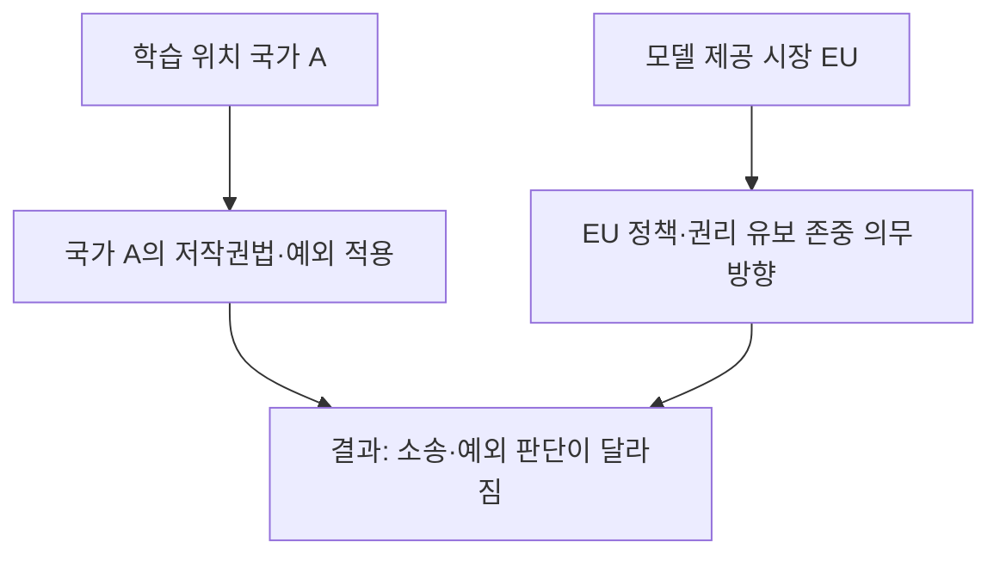
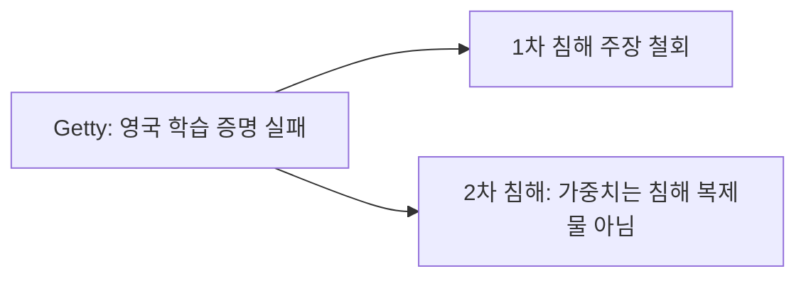

# 학습 장소와 관할

> AI 모델을 **어느 나라에서 학습했는지**에 따라 적용되는 저작권법과 예외가 달라지고, 그에 따라 소송의 성립 여부도 달라질 수 있다는 점이다. 반대로 최근 EU 규정은 학습 장소와 상관없이 EU 기준을 지키라는 방향의 조항도 담고 있다.

## 쉽게 말하면
국가마다 교통법규가 다르듯 저작권법도 나라마다 다르다. 어느 나라 도로에서 운전했느냐에 따라 위반 여부가 갈린다. 그런데 "어느 도로에서 운전했든 우리 시장에 차를 팔려면 우리 안전 기준을 지켜라"라는 식의 규정도 생기고 있다.

## 자세히
(The Register의 영국 고등법원 판결 보도, EU AI Act 리사이틀 106, EU DSM 지침 2019/790 제3·4조, CC FAQ를 직접 열어 확인. 일본 저작권법 30조의4는 원문에 접근하지 못해 다루지 않는다. 법률 자문이 아니다.)
- **영국 Getty v. Stability AI(2025-11-04, 고등법원)**: Getty는 **학습이 영국에서 이뤄졌음을 증명하지 못해** 소송 도중 일반(1차) 저작권 침해 주장을 철회했다. 법원은 "학습이 영국에서 이뤄졌음을 증명하지 못했다"고 적었다. Getty는 외국에서 학습했더라도 침해물을 영국에 들여온 것이 2차 침해라고 주장했으나 Joanna Smith 판사는 모델이 학습 작품의 복제본을 저장하지 않으므로 **"모델 가중치는 그 자체로 침해 복제물이 아니다"**며 기각했다. 이 판단은 영국법의 해당 조항에 대한 것이고 **학습의 적법성은 판단하지 않았다**(상위 노드 [모델 가중치는 개작인가](#model-weights-derivative-question)).
- **EU의 접근(AI Act 리사이틀 106)**: 범용 AI 모델 제공자는 EU 저작권 준수 정책을 두고 권리 유보를 존중해야 하며, 이는 **저작권 관련 행위가 어느 관할에서 이루어졌든 적용**된다고 적는다. 목적은 제공자가 EU보다 낮은 저작권 기준으로 시장 이점을 얻는 것을 막는 것이라고 밝힌다. 즉 학습 장소를 EU 밖으로 옮겨도 **EU 시장에 모델을 내놓는 경우** 부담이 생길 수 있다는 방향이다. 리사이틀이 구체 집행 방식을 정하지는 않는다.
- **EU의 TDM 예외(지침 2019/790 제3·4조)**: 회원국이 법으로 만드는 예외이며 적용 범위는 해당 법의 영역이다. 제3조는 연구기관·문화유산기관의 과학 연구용 TDM, 제4조는 일반 TDM(권리 유보 시 제외)이다([텍스트·데이터 마이닝 예외](#text-data-mining-exception)).
- **미국 사정(CC FAQ)**: CC는 미국에서 텍스트·데이터 마이닝이 일반적으로 공정 이용으로 여겨지므로 라이선스의 표시 요건이 적용되지 않을 수 있다고 설명한다(CC의 관점이며 판결이 아님).
- **정리(제안)**
  | 쟁점 | 학습 장소의 영향 |
  |---|---|
  | 1차 침해(복제) | 복제가 이루어진 곳의 법이 문제 — Getty는 영국 학습을 증명하지 못해 철회 |
  | 수입·배포 등 2차 책임 | 국가별 조문 해석에 따라 다름(영국은 가중치가 침해물이 아니라고 판단) |
  | EU 시장 제공 | 학습 장소와 무관한 의무 방향(리사이틀 106) |
  | 예외 가능성 | TDM 예외·공정 이용은 나라마다 존재 여부와 조건이 다름 |
  원칙적으로 저작권은 국가별로 적용된다는 점이 이 사건 결과에서 드러나지만 이는 한 판결에서 읽은 것이며, 법역 간 일반 원칙의 서술이 아니다.
- **실무(제안)**: ① 학습 위치(국가, 클라우드 지역)와 데이터 처리 경로를 **기록** ② 모델을 배포할 시장별로 요구 사항을 따로 점검 ③ 학습 장소를 옮기는 것만으로 의무를 피할 수 있다고 가정하지 않기 ④ 법무와 규제 변화(이행 지침, 판례)를 주기적으로 확인.

## 그림으로 보기

## 예시
- 한국 기업이 미국 클라우드에서 학습한 모델을 EU 고객에게 제공: 학습 위치 기록, 데이터 유보 신호 점검, EU 제공자 의무를 법무와 확인.
- 교육 소재: "AI는 국경을 넘는데 저작권법은 국경이 있다" — 학습 위치·배포 시장을 표로 정리하는 실습.

## 헷갈리는 것과 비교
| 개념 | 차이 |
|---|---|
| 학습 장소와 관할 | 어느 나라 법이 적용되는가 |
| [모델 가중치는 개작인가](#model-weights-derivative-question) | 가중치의 법적 지위 |
| [텍스트·데이터 마이닝 예외](#text-data-mining-exception) | 예외 규정 |
| [제3자 스크래핑 공백](#third-party-scraping-gap) | 수집자·학습자 분리 문제 |

## 더 읽을거리
- [The Register: Getty v. Stability AI 판결 보도](https://www.theregister.com/2025/11/04/uk_court_getty_stability_ai/) — 영국에서 학습을 증명 못 해 철회, 가중치는 침해 복제물 아님(직접 확인).
- [EU AI Act Recital 106](https://artificialintelligenceact.eu/recital/106/) — 관할과 무관한 저작권 정책 의무 방향(직접 확인).
- [Creative Commons FAQ](https://creativecommons.org/faq/) — 미국의 TDM과 공정 이용 설명(직접 확인).
