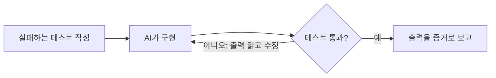
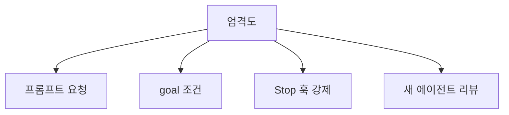

# 테스트 먼저 시키기

> AI에게 코드를 시키기 전에(또는 함께) "통과/실패로 답이 나오는 검사"를 먼저 주는 습관. 그 검사가 AI의 완료 기준이 되어, "다 됐어요"라는 말 대신 통과한 출력이 증거가 된다.

## 쉽게 말하면
요리사에게 "맛있게 해 주세요"라고 하면 요리사 기준으로 끝납니다. "간이 이 계량 범위, 온도 65도 이상"이라는 채점표를 먼저 주면 요리사가 스스로 맛보고 고칩니다. 테스트가 그 채점표다. 없으면 사용자가 매번 맛보는 테스트 담당이 된다.

## 자세히
- **Claude Code 모범 사례(2026-11 문서)**: Claude는 일이 끝나 보이면 멈춘다. 실행할 검사가 없으면 "끝나 보임"만 근거가 된다. 통과/실패로 돌아오는 검사를 주면 변경 → 검사 → 출력 읽기 → 수정을 스스로 반복한다.
- **검사의 종류**: 테스트 파일, 빌드 종료 코드, 린터, 정답 파일과 diff하는 스크립트, 목업과 비교하는 스크린샷.
- **엄격도 단계**: ① 프롬프트로 "통과할 때까지" 요청 ② `/goal`처럼 별도 모델이 매 턴 조건 충족을 확인 ③ Stop 훅으로 하네스가 강제(통과 전엔 턴 종료 불가, [훅과 가드레일](#hooks-guardrails)) ④ 코드를 안 쓴 다른 서브에이전트가 리뷰.
- **증거 요구**: "테스트 통과"만이 아니라 실행한 명령과 출력을 보이게 한다.
- **재현 테스트 흐름(버그)**: ① 버그를 재현하는 실패 테스트 작성 ② 실패 확인 ③ 수정 ④ 통과 확인 ⑤ 다른 테스트도 통과. 이게 [TDD](#tdd)의 AI판이다.
- **주의**: AI가 테스트를 고쳐 통과시키지 못하게 "테스트 파일은 수정 금지"를 명시한다.

## 그림으로 보기

## 예시
"로그인 시 잘못된 비밀번호로 3번 실패하면 계정이 잠겨야 해. 먼저 이를 재현하는 실패 테스트를 `tests/auth`에 쓰고 실패를 보여줘. 그다음 구현해서 `pytest tests/auth`가 통과할 때까지 반복하고 마지막 출력을 붙여줘. 테스트 파일은 구현 단계에서 수정하지 마."

## 헷갈리는 것과 비교
| 개념 | 차이 |
| --- | --- |
| [TDD](#tdd) | 사람의 개발 방법론. 여기선 AI의 완료 기준으로 활용 |
| [결정적 피드백](#deterministic-feedback) | 테스트가 주는 신호의 성질 |
| [AI 코드 리뷰 습관](#code-review-ai) | 사람이 위험 지점을 보는 절차 — 보완 관계 |
| 프롬프트로 요청 vs Stop 훅 | 전자는 AI가 판단, 후자는 하네스가 강제 |

## 더 읽을거리
- [Claude Code: Best practices — Give Claude a check to run](https://code.claude.com/docs/en/best-practices) — 검사·goal·Stop 훅·리뷰
- [Anthropic: Building effective agents](https://www.anthropic.com/engineering/building-effective-agents) — 코딩 에이전트와 테스트 피드백
