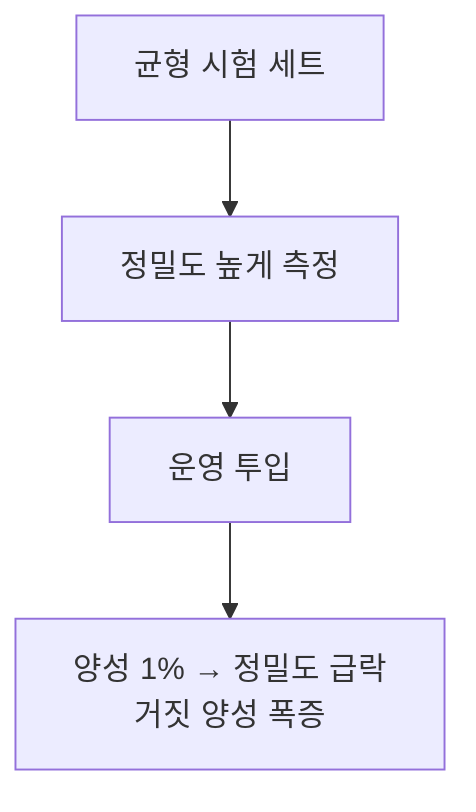

# 시험 세트 비율 불일치

> 시험 세트의 양성 비율이 **실제 운영 환경의 양성 비율보다 높으면 정밀도가 낙관적으로 부풀려진다.** 재현율과 FPR은 비율과 무관하지만 정밀도는 양성 비율(유병률)에 직접 의존한다.

## 쉽게 말하면
검사 도구가 "환자 90%를 찾고 건강한 사람 5%를 환자로 오판"한다고 하자. 환자와 건강한 사람이 반반인 시험에서는 믿을 만하지만, 환자가 1%뿐인 실제 병원에서는 양성이라고 한 사람 대부분이 건강한 사람이다.

## 자세히
- **핵심 관계**: 정밀도 = TPR·p / (TPR·p + FPR·(1−p)) (p = 양성 비율). TPR(재현율)과 FPR은 비율이 바뀌어도 그대로지만 정밀도는 p가 낮을수록 급락한다.
- **직접 시뮬레이션(분류기 고정: TPR 0.90, FPR 0.05, 표본 200만 개)**
  | 양성 비율 | 정밀도(시뮬) | 정밀도(공식) | 재현율 |
  |---|---|---|---|
  | 50% | 0.947 | 0.947 | 0.900 |
  | 20% | 0.819 | 0.818 | 0.900 |
  | 5% | 0.487 | 0.486 | 0.900 |
  | 1% | **0.154** | 0.154 | 0.898 |
  | 0.1% | 0.018 | 0.018 | 0.891 |
  같은 분류기가 50:50 시험 세트에서는 정밀도 0.947이지만 운영 유병률 1%에서는 **0.154**다. 재현율은 변하지 않는다.
- **근거 논문(Saito & Rehmsmeier, PLOS ONE 2015, 본문 확인)**: ROC 곡선은 클래스 비율이 바뀌어도 변하지 않아 오해를 부르고, 같은 동작점이 균형 데이터에서는 거짓 양성 160개, 불균형 데이터에서는 1,600개가 될 수 있다. PRC(정밀도-재현율 곡선)는 양성·음성 비율에 따라 변하며 무작위 분류기의 기준선도 P/(P+N)로 움직인다. 저자들은 불균형 분류에서 PRC가 가장 정보량 있는 시각 도구라고 결론짓고 "Only PRC changes with the ratio of positives and negatives"라고 쓴다.
- **발생 원인**: 양성을 더 모으려고 음성을 줄여 시험 세트를 만듦, 라벨링 비용 때문에 의심 샘플을 과표집, 공개 벤치마크의 비율이 운영과 다름.
- **대응**
  1. 시험 세트의 비율을 **운영 비율과 같게** 하거나, 다르면 비율 차이를 명시.
  2. 다른 비율의 시험 세트로 얻은 정밀도는 위 공식으로 운영 비율에 **환산**해 보고(TPR·FPR을 알면 가능).
  3. 정밀도·재현율을 함께 보고하고 양성 비율을 표기.
  4. 운영 중 정밀도는 [감시 표본 추출](#classifier-monitoring-sampling)로 실제 측정.
  5. 과표집을 썼다면 [평가용 과표집](#oversampling-for-evaluation)의 가중 보정 필요.
- 환산은 TPR·FPR이 비율과 무관하다는 가정이 성립할 때만 맞다(양성의 난이도 분포가 같다는 가정).

## 그림으로 보기

## 예시
- 사기 탐지 모델: 시험 세트 사기 10%에서 정밀도 0.7 → 운영 사기 0.5%에서는 약 0.08. 경보 처리 인력이 터진다.
- 교육: "99% 정확도"와 "양성이라고 했을 때 맞을 확률"은 다르다는 베이즈 정리 사례.

## 헷갈리는 것과 비교
| 개념 | 비율 영향 |
|---|---|
| 재현율(TPR) | 무관 |
| FPR | 무관 |
| 정밀도 | **크게 영향** |
| ROC AUC | 무관(그래서 오해) |
| PR AUC | 영향(비율 반영) |

## 더 읽을거리
- [Saito & Rehmsmeier 2015, PLOS ONE](https://journals.plos.org/plosone/article?id=10.1371/journal.pone.0118432) — 불균형에서 PRC가 ROC보다 정보량이 많은 이유.
- [scikit-learn: precision_recall_curve](https://scikit-learn.org/stable/modules/generated/sklearn.metrics.precision_recall_curve.html) — PR 곡선 계산(미열람, 직접 사용 가능).
