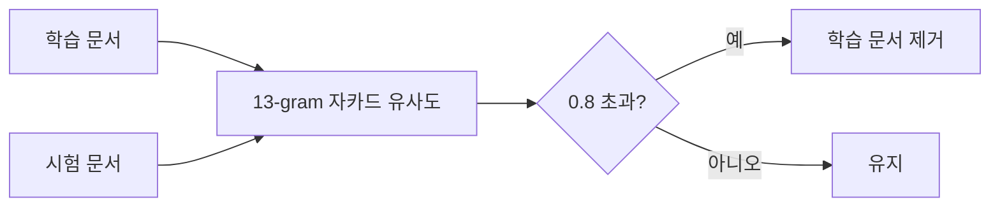
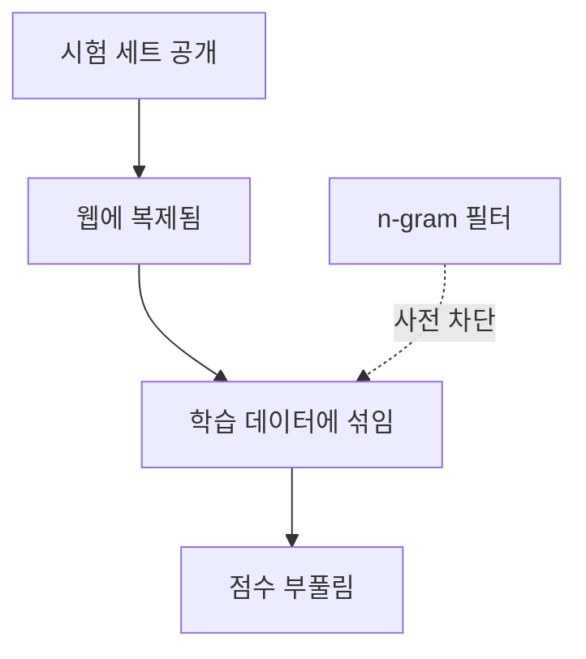

# 13-그램 시험 세트 필터링

> 시험 문서와 13-그램 자카드 유사도가 0.8을 넘는 학습 문서를 학습 데이터에서 빼서, 모델이 시험 답을 미리 보지 못하게 하는 오염(contamination) 방지 절차다.

## 쉽게 말하면
수능 문제를 미리 푼 학생은 점수가 부풀려진다. 학습 자료에서 "시험 문제와 거의 똑같은 페이지"를 미리 치워 두는 일이다.

## 자세히
(Gopher 논문 arXiv 2112.11446 부록 A.1 "Test-set Filtering"을 직접 읽고 확인.)
- 방법: 학습 문서와 시험 문서 사이의 **13-gram 자카드 유사도**를 계산해 **0.8 초과**면 그 학습 문서를 제거. 중복 제거에서 쓴 MinHash 계열 접근과 같다.
- 대상 시험 데이터: Wikitext103, C4, Curation Corpus, LAMBADA. 추가로 Wikitext103 검증·테스트에 쓰인 Wikipedia 페이지는 Wikipedia 학습 데이터에서 따로 제거(수정본이 놓쳤을 가능성 때문).
- MassiveText의 **모든 하위 집합**에 적용.
- **한계**: Gopher 학습 이후에 만들어진 시험 세트(예: The Pile)는 이미 학습 데이터에 섞여 있을 수 있다고 저자가 밝힌다. 즉 이 필터는 "그때 알던 시험"만 막는다.
- 임계값 0.8·n=13은 논문이 쓴 값이다. 패러프레이즈·번역된 유출은 n-gram으로 못 잡는다(제안).

## 그림으로 보기

## 예시
- 사내 평가 문제를 만든 뒤, 학습·검색 코퍼스에 문제 문장이 있는지 n-gram 검색.
- 교육 활용: "벤치마크 점수가 높아도 시험 유출 여부를 물어야 한다"는 평가 리터러시.

## 헷갈리는 것과 비교
| 개념 | 차이 |
|---|---|
| 시험 세트 필터링 | 학습 vs 시험 사이 중복 제거 |
| [근접 중복 제거](#near-duplicate-removal) | 학습 문서끼리 중복 제거 |
| [Gopher 품질 휴리스틱](#gopher-quality-heuristics) | 품질 기준 필터(유출과 무관) |

## 더 읽을거리
- [Gopher (arXiv 2112.11446)](https://arxiv.org/abs/2112.11446) — 부록 A.1 Test-set Filtering.
