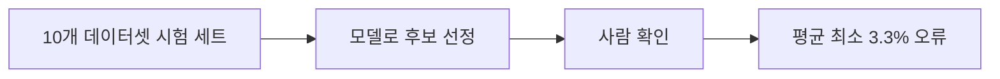
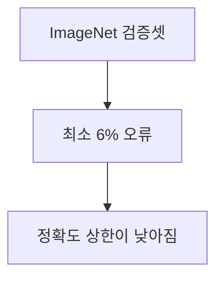

# 시험 세트 라벨 오류율

> 시험 세트 라벨 오류율은 벤치마크의 평가용 데이터에서 정답 라벨이 틀린 샘플의 비율이다. 널리 쓰는 공개 벤치마크도 평균 3% 이상의 오류가 있다는 연구가 있다.

## 쉽게 말하면
모두가 쓰는 시험지의 정답지에 오타가 섞여 있다면, 학생(모델)이 잘 푼 문제를 오답 처리하게 된다. 점수 차이가 작은 학생끼리는 등수가 뒤바뀔 수도 있다.

## 자세히
- **핵심 수치(arXiv 2103.14749 초록)**: 10개 데이터셋 시험 세트에서 평균 최소 3.3% 라벨 오류를 추정했고, ImageNet 검증셋은 최소 6%가 오류다. 초록에는 QuickDraw 수치가 없다.
- **추정 방법(해석)**: 모델 예측으로 후보를 뽑고(confident learning) 사람이 확인해 실제 오류를 확정한다. 모델이 찾지 못한 오류는 빠지므로 "최소"라는 표현이 붙는다.
- **의미(해석)**: 벤치마크 정확도 99%는 그 정확도 위로 올라갈 여지가 라벨 오류 때문에 없을 수 있다. 오류율이 모델 간 점수 차이보다 크면 점수 비교의 의미가 줄어든다.
- **우리 데이터에 적용(해석)**: 자체 평가셋은 처음부터 이중 검수로 만들고([평가셋 고정](#evaluation-set-freeze)), 주기적으로 후보를 뽑아 확인한다. 순위 영향은 [벤치마크 순위 불안정](#benchmark-ranking-instability)에서 본다.

## 그림으로 보기

## 예시
- 사내 분류 평가셋 1,000개 중 검수 결과 35개가 틀렸다면 라벨 오류율 3.5%다. 모델 A·B 차이가 1%라면 비교가 불안하다.
- 교육 활용: 학습자가 공개 벤치마크 샘플 20개를 직접 보고 라벨이 맞는지 판정해 본다.

## 헷갈리는 것과 비교
| 개념 | 차이 |
| --- | --- |
| 시험 세트 라벨 오류 | 평가 데이터의 정답 오류 |
| 학습 세트 라벨 오류 | 학습 데이터의 오류, 모델이 어느 정도 견딤 |
| [벤치마크 순위 불안정](#benchmark-ranking-instability) | 오류가 순위를 바꾸는 효과 |
| [정리 전후 비교 평가](#cleaning-before-after-eval) | 정리 효과를 깨끗한 평가셋으로 확인 |

## 더 읽을거리
- [Pervasive Label Errors in Test Sets (arXiv 2103.14749)](https://arxiv.org/abs/2103.14749) — 10개 데이터셋 평균 3.3%
