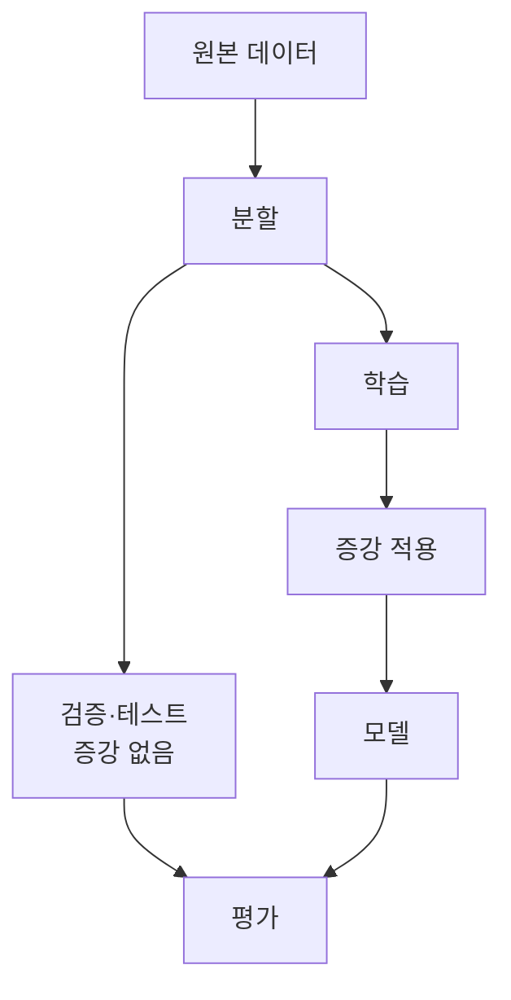
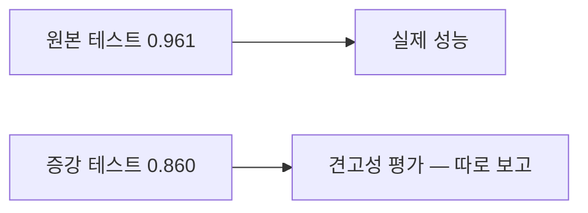

# 시험셋 무증강 원칙

> 증강은 **학습 데이터에만** 쓰고, 검증·테스트에는 원본 그대로 쓴다. 평가 데이터를 증강하면 "실제 데이터에서의 성능"이 아니라 "만든 변형 데이터에서의 성능"을 재게 되고, 같은 원본의 복제본이 점수를 부풀리거나 왜곡한다.

## 쉽게 말하면
모의고사 연습은 문제를 이리저리 변형해도 좋다. 하지만 실제 시험 채점을 "변형 문제"로 하면 실제 시험 점수가 아니다. 채점은 늘 진짜 시험지로 한다.

## 자세히
- **목적**: 테스트는 "배포 후 만날 실제 데이터 분포"의 대리인이다. 증강은 학습 때 모델을 튼튼하게 하는 도구이지 평가 대상을 바꾸는 도구가 아니다.
- **직접 실험(scikit-learn 1.9.1, digits, 로지스틱 회귀)**: 원본 테스트(540개) 정확도 **0.961**. 같은 테스트에 노이즈(σ=4) 증강본 4개를 더해 5배(2,700개)로 만들면 **0.860**. 점수가 달라진 것은 모델이 나빠져서가 아니라 평가 대상이 바뀌었기 때문이다. 반대로 학습에 노이즈 증강을 쓴 모델은 원본 테스트 **0.970**, 노이즈 테스트 0.891이었고, 증강 없이 학습한 모델은 노이즈 테스트에서 0.837이었다. 증강 효과(견고성)를 보고 싶으면 **원본 테스트와 노이즈 테스트를 따로 보고**한다.
- **증강 평가가 새는 경우**: 한 원본의 증강본이 검증과 학습에 갈라지거나, 한 원본의 증강본 여러 개가 테스트에 있어 같은 정답이 여러 번 세어지면 샘플 수가 부풀어 신뢰구간이 부당하게 좁아진다.
- **허용되는 예외**: 증강 자체가 평가 목적일 때. 예) 견고성 테스트(노이즈·회전·오타 주입)는 **별도 평가셋**으로 만들어 원본 테스트와 분리해 보고. 테스트 시 증강(TTA)은 *예측* 단계의 기법이며 정답 라벨은 원본 기준으로 한다.
- **체크리스트**: ① 분할 후 학습 세트에서만 증강 ② 증강본의 그룹 ID는 원본과 같게([증강 그룹 누수](#augmentation-group-leak)) ③ 평가 보고에 "원본 기준"이라고 명시.

## 그림으로 보기

## 예시
- 이미지 분류: 학습 때 회전·밝기 증강, 테스트는 원본 사진. 별도로 "흐린 사진 200장" 견고성셋을 만들어 보조 지표.
- 교육: "연습 문제와 시험 문제를 분리한다"는 비유로 설명.

## 헷갈리는 것과 비교
| 개념 | 차이 |
|---|---|
| 학습 증강 | 모델을 튼튼하게, 학습 세트에만 |
| 테스트 증강 | 평가 대상을 바꿈 — 기본 금지 |
| 견고성 평가셋 | 변형을 평가 목적으로 따로 구성 |
| [늦은 분할 오류](#late-split-error) | 증강을 분할 전에 함 |

## 더 읽을거리
- [scikit-learn Common pitfalls — Data leakage](https://scikit-learn.org/stable/common_pitfalls.html) — 테스트 데이터에 fit하지 않는 원칙.
