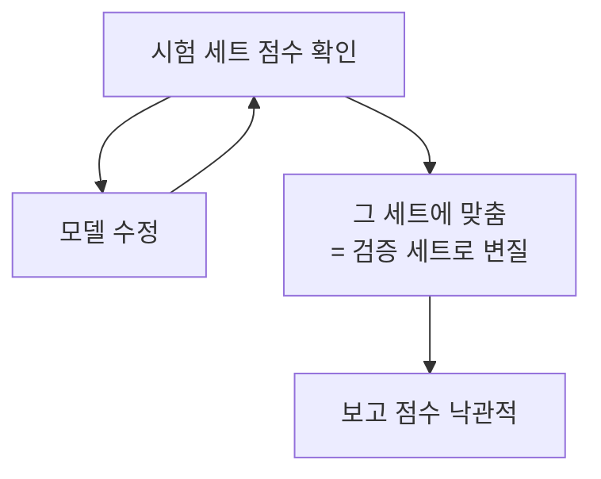
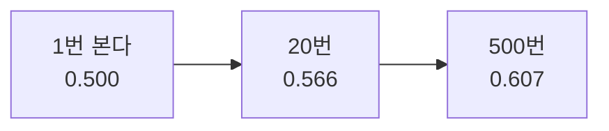

# 테스트 세트 재사용 위험

> 테스트 세트를 보고 모델을 고치는 일을 반복하면 그 세트는 사실상 검증 세트가 되어, 거기서 얻은 점수가 새 데이터의 성능보다 높게 나온다. 많이 볼수록 낙관이 커진다.

## 쉽게 말하면
봉인된 정답지를 몰래 한 번 보면 그 시험은 더 이상 실력 측정이 아니다. 정답지를 열 번, 백 번 보면서 답을 고쳐 가는 건 공부가 아니라 정답 맞히기다. 테스트 세트도 "본 횟수"가 늘수록 점수에 내 선택이 스며든다.

## 자세히
- **근거(scikit-learn 교차검증 문서, 열람)**: 하이퍼파라미터를 시험 세트에서 계속 조정하면 시험 세트의 지식이 모델에 새어 들어가 평가 지표가 일반화 성능을 보여 주지 못한다.
- **직접 해 본 시뮬레이션(실력 없는 무작위 이진 예측을 m개 시험해 시험 세트 200개에서 가장 높은 점수를 고르고, 새 세트 200개에서 다시 평가, 400번 반복)**:

| 본 모델 수 m | 본 세트의 최고 점수 | 새 데이터 점수 |
| --- | --- | --- |
| 1 | 0.500 | 0.499 |
| 5 | 0.541 | 0.502 |
| 20 | 0.566 | 0.495 |
| 100 | 0.587 | 0.500 |
| 500 | 0.607 | 0.499 |

  새 데이터 점수는 모두 0.5 안팎(실력 없음)인데, 본 세트의 최고 점수는 m이 클수록 0.500→0.607로 올랐다. 낙관은 본 횟수의 로그처럼 천천히 커졌다(계산 결과를 보면 5→500에서 0.066 증가). 실제 모델은 독립이 아니라 편향이 이보다 작을 수 있다.
- **현실 판단(해석)**: 시험 세트가 크고 시도가 적으면 영향이 작다(직접 확인한 건 최악의 경우). 큰 대회 데이터에서는 큰 과적합이 드물다는 보고도 있다([리더보드 과적합](#leaderboard-overfitting)).
- **방지책**: ① 시험 세트는 마지막에 한 번만 ② 튜닝은 검증 세트·교차검증에서 ③ 시험 세트를 이미 여러 번 봤다면 새 데이터를 모아 다시 평가 ④ 본 횟수를 기록한다.

## 그림으로 보기

## 예시
- 사내 평가 문항 200개로 프롬프트를 20번 고쳐 정답률이 올랐다면, 처음 쓰지 않은 새 문항 200개를 만들어 다시 잰다.
- 교육 활용: 무작위 예측 500개 중 최고를 고르는 코드를 돌려 "실력 없이도 60%"를 직접 본다.

## 헷갈리는 것과 비교
| 개념 | 차이 |
| --- | --- |
| 테스트 세트 재사용 | 시험 세트를 보고 수정 |
| 데이터 누수 | 전처리·특성에 시험 정보가 새는 것 |
| [최종 테스트 세트 확인](#final-test-set-confirmation) | 올바른 절차 |
| [리더보드 과적합](#leaderboard-overfitting) | 공개 순위 버전 |

## 더 읽을거리
- [scikit-learn: Cross-validation](https://scikit-learn.org/stable/modules/cross_validation.html) — 시험 세트 보류 이유
