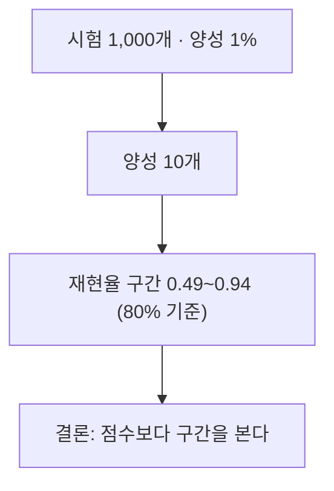

# 희귀 클래스 기준 시험 크기

> 불균형 데이터에서 시험 세트의 충분한 크기는 전체 샘플 수가 아니라 **희귀 클래스(양성) 샘플 수**로 정한다. 재현율은 양성 수, 정밀도는 예측 양성 수가 분모라서, 이 수가 작으면 점수의 신뢰구간이 매우 넓다.

## 쉽게 말하면
전교생 1만 명 중 특정 질병 환자가 1%라면 환자는 100명이다. 시험 세트로 1,000명을 뽑으면 환자는 평균 10명뿐이다. 1,000명으로 평가했다고 해서 "1,000명 규모의 평가"가 아니라 "환자 10명 규모의 평가"다.

## 자세히
(Shang·Langlois·Tsioutsiouliklis, "Precision/Recall on Imbalanced Test Data"(AISTATS 2023) PDF 본문을 직접 열어 확인. 수치는 직접 계산.)
- **논문의 문제 설정**: 메일 분류기 여러 개를 운영하는데 일부 범주는 전체 메일의 5% 미만, 심지어 1% 미만이다. 정기적으로 샘플을 뽑아 사람이 라벨링해 정밀도·재현율을 감시하는데 라벨링이 비싸므로 **최소한의 샘플로 정밀도·재현율을 모두 오차 ±5%(신뢰구간 폭 10%)** 이내로 추정하려 한다.
- **방법**: 분류기가 양성으로 예측한 쪽을 **과표집(oversample)** 해서 혼동행렬 값을 두 개의 독립 이항분포로 만들고, 보정된 정밀도·재현율의 신뢰구간과 베이지안 신용구간 공식을 제시. 결과: **정밀도는 과표집률이 높을수록 구간이 좁아지고, 재현율은 구간 폭을 최소로 하는 최적 과표집 비율이 존재**한다. 정확한 공식은 논문 본문 참조.
- **직접 계산(윌슨 95% 구간, 재현율이 80%일 때 양성 수별)**
  | 양성 수 | 재현율 80%의 95% 구간 |
  |---|---|
  | 10 | 0.49 ~ 0.94 |
  | 30 | 0.63 ~ 0.91 |
  | 50 | 0.67 ~ 0.89 |
  | 100 | 0.71 ~ 0.87 |
  | 200 | 0.74 ~ 0.85 |
  | 500 | 0.76 ~ 0.83 |
  → 폭 10%(±5%) 목표는 양성이 약 250~300개는 되어야 가까워진다(위 표에서 외삽한 대략치이며 이 계산은 단순 이항 가정).
- **시험 세트의 불균형 비율**: 시험 세트가 실제 운영보다 덜 불균형하면 정밀도가 낙관적으로 나온다(거짓 양성이 운영에서 더 많음). 논문은 실제 사전 비율에 맞춘 보정과, 비율을 맞추기 어려우면 ROC 분석을 권한다(검색 결과 요약).
- 경험칙: 양성이 적은 클래스를 위해 계층화 분할([층화 train_test_split](#stratified-train-test-split))을 쓰되, 양성이 수십 개 수준이면 시험 대신 [교차 검증](#small-data-validation-strategy)과 구간 보고를 쓴다(제안).

## 그림으로 보기

## 예시
- 사기 탐지(사기 0.5%): 시험 20만 건에 사기 1,000건이 되도록 크기를 정한다. 1,000건이면 재현율 구간이 매우 좁아진다.
- 메일 분류 운영 감시: 예측 양성을 과표집해 라벨링하면 사람이 라벨링할 양을 줄일 수 있다(논문 방식).

## 헷갈리는 것과 비교
| 개념 | 차이 |
|---|---|
| 희귀 클래스 기준 크기 | 양성 수로 시험 크기 결정 |
| 전체 샘플 수 기준 | 불균형에서는 오해를 부름 |
| [층화 분할](#stratified-train-test-split) | 비율 유지. 크기 충분성은 별개 |
| 과표집 | 라벨링 비용을 줄이는 표본 추출 방식(학습 데이터 오버샘플링과 다름) |

## 더 읽을거리
- [Precision/Recall on Imbalanced Test Data (AISTATS 2023, PDF)](https://proceedings.mlr.press/v206/shang23a/shang23a.pdf) — 문제 설정·과표집·구간 폭 결과(본문 확인).
