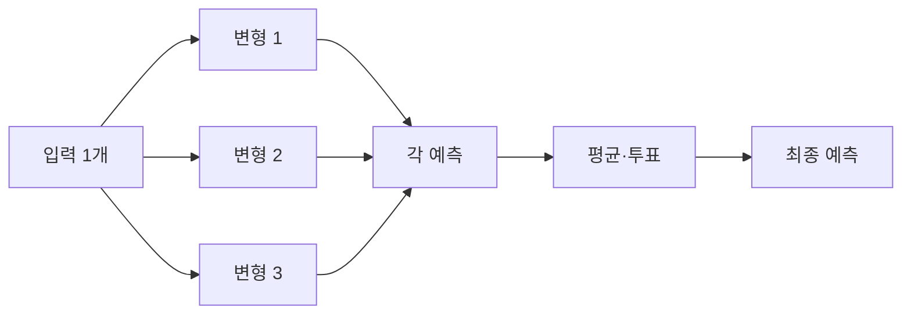
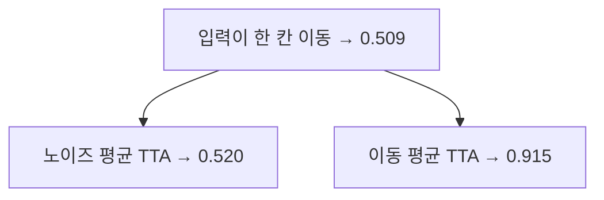

# 테스트 시 증강(TTA)

> TTA는 예측할 때 입력 하나를 뒤집기·자르기·약한 노이즈 등으로 여러 개 변형해 각각 예측하고 그 결과를 평균(또는 투표)해 최종 답을 내는 기법이다. 학습은 그대로 두고 예측만 바꾼다.

## 쉽게 말하면
사진 한 장을 보고 헷갈릴 때, 같은 사진을 살짝 다른 각도·밝기로 여러 번 보고 의견을 모아 결정하는 것과 같다. 한 번 본 인상에 흔들리지 않고 여러 번 본 평균 인상으로 판단한다.

## 자세히
- **방식과 위험(Shanmugam 외, ICCV 2021 "Better Aggregation in Test-Time Augmentation" 검색 요약·초록, 열람 한계 있음)**: 여러 변형본의 예측을 모아 더 부드러운 예측을 얻는다. 논문의 표준 정책은 변형 30개(뒤집기 2 × 자르기 5 × 크기 3)이고 기본 결합은 단순 평균이다. 저자들은 TTA가 전체 정확도를 올려도 맞던 예측을 틀리게 바꾸는 경우가 많다고 지적하고, 평균 대신 집계 방법을 학습하는 방식을 제안한다. 구체적 수치는 확인하지 못했다.
- **직접 해 본 실험(숫자 손글씨, 랜덤 포레스트 200그루, 시험 719개)**: 깨끗한 시험 정확도 0.969. 노이즈(표준편차 3)를 입힌 시험 입력은 0.924였고, 거기에 노이즈를 더 입힌 복사본 8개와 원본의 예측 확률을 평균하는 TTA는 0.926(+0.002)이었다. 노이즈 5에서는 0.828에서 0.840(+0.012). 이미지를 한 칸 옮긴 시험은 0.509로 무너졌는데 노이즈 평균 TTA는 0.520에 그쳤지만, 좌우로 −1·0·+1칸 이동한 복사본을 평균하는 TTA는 0.915로 크게 회복했다.
- **해석**: TTA는 입력에 일어나는 변형과 같은 종류의 변형을 모아야 효과가 크다. 노이즈 평균은 이동 오류를 못 고쳤고, 이동 평균은 이동 오류를 고쳤다. 그러나 이 모델이 이동에 약한 것은 학습 데이터가 정렬돼 있어서이며, 학습 때 이동 증강을 했다면 TTA 이득이 작았을 수 있다(이 실험에서는 확인하지 않음).
- **비용과 조건(해석)**: 예측 비용이 변형 수만큼 늘고, 변형이 라벨을 바꾸면 안 된다(예: 숫자 6을 뒤집으면 9가 될 수 있음). 평가할 때는 TTA 여부를 밝혀야 비교가 공정하다([견고성 평가셋](#robustness-eval-set)).

## 그림으로 보기

## 예시
- 이미지 분류: 좌우 반전과 5개 자르기 평균(흔한 설정). 의료 영상처럼 방향이 의미를 가지면 반전을 쓰지 않는다.
- 교육 활용: 변형 종류(노이즈·이동)를 바꿔 TTA의 효과를 비교하는 실습.

## 헷갈리는 것과 비교
| 개념 | 차이 |
| --- | --- |
| 학습 시 증강 | 학습 데이터를 변형해 학습 |
| TTA | 예측 입력을 변형해 결합 |
| 앙상블 | 서로 다른 모델 여러 개 결합 |
| [견고성 평가셋](#robustness-eval-set) | 변형에 대한 성능을 별도로 측정 |

## 더 읽을거리
- [Better Aggregation in Test-Time Augmentation (arXiv 2011.11156)](https://arxiv.org/abs/2011.11156) — TTA의 집계 방법과 맞던 예측이 뒤집히는 문제
