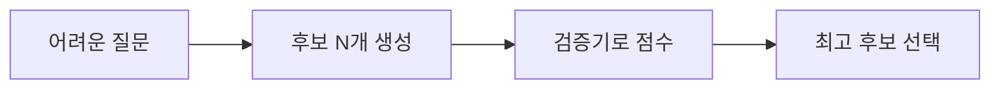
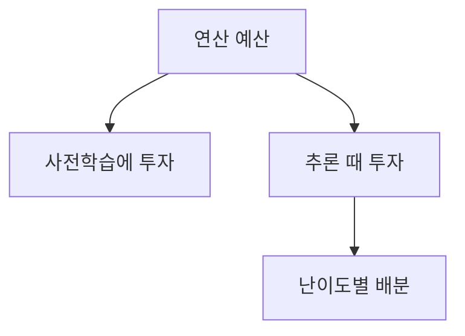

# 테스트 시점 연산(Test-time compute)

> 모델을 더 크게 **훈련**하는 대신, **답을 낼 때 연산을 더 쓰는**(여러 후보 생성·검증·수정·오래 생각) 접근. 어려운 문제일수록 같은 모델이 더 잘 풀게 만든다.

## 쉽게 말하면
시험에서 문제를 한 번에 쓰지 않고 초안을 여러 개 만들어 보고 검산해서 최고를 고르는 것이다. 머리(모델 크기)를 키우지 않아도 시간(연산)을 더 쓰면 점수가 오른다.

## 자세히
- 핵심 논문: Snell 외, *Scaling LLM Test-Time Compute Optimally*(arXiv 2408.03314, 2024-08). 초록 기준:
  - 효과는 **문제 난이도**에 크게 좌우된다.
  - 프롬프트마다 연산을 **적응적으로 배분**하면 균등 배분보다 훨씬 효율적. 이 "compute-optimal" 전략은 best-of-N 대비 **4배 이상** 효율이 좋았다.
  - FLOPs를 맞춘 비교에서, 작은 모델이 어느 정도 성공률이 있는 문제에서는 **14배 큰 모델을 능가**했다(조건부 결과).
- 연구한 두 메커니즘: ① 과정 기반 검증기 보상모델로 후보를 **검색(verifier search)** ② 프롬프트에 맞춰 응답 분포를 **적응적으로 갱신**(수정).
- 시사점: 추론 연산과 사전학습 연산의 균형을 다시 보게 한다.
- 실무 연결: [적응형 생각](#adaptive-thinking)과 [effort 파라미터](#effort-parameter)가 이 흐름의 제품화된 형태로 볼 수 있다(해석). 대신 비용·지연이 늘고, 정답을 검증할 수 있는 문제에 특히 효과적이다([RLVR](#rl-verifiable-rewards)).

## 그림으로 보기

## 예시
- 수학 문제에 답 8개를 뽑아 검증기로 채점해 최고를 고르거나, 한 번에 오래 생각하게 한다.
- 교육: "빨리 답하기 vs 오래 검토하기"의 비용-품질 곡선을 그리는 실습.

## 헷갈리는 것과 비교
| 개념 | 차이 |
|---|---|
| 테스트 시점 연산 | 추론 때 연산을 늘림 |
| 스케일링 법칙(훈련) | 훈련 연산·데이터를 늘림 |
| best-of-N | 단순 N개 뽑아 고르기, 위 방법의 기준선 |

## 더 읽을거리
- [Scaling LLM Test-Time Compute Optimally](https://arxiv.org/abs/2408.03314) — 4배 효율, 14배 모델(초록 읽음).
