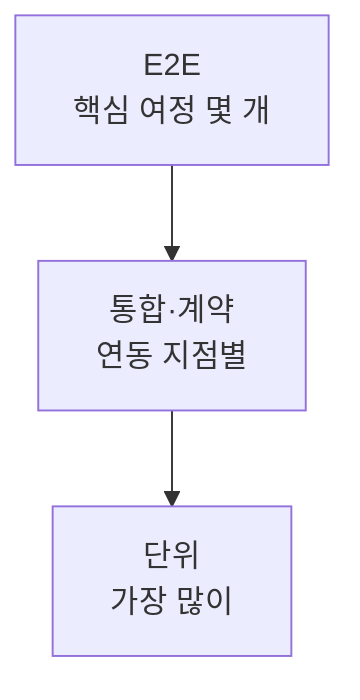
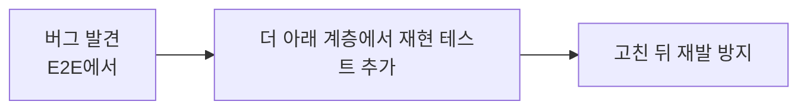

# 단위·통합·E2E 테스트

> 자동화 테스트를 **얼마나 큰 범위를 한 번에 검사하느냐**로 나눈 분류. 작은 범위(단위)는 빠르고 싸서 많이, 큰 범위(E2E)는 느리고 불안정해서 적게 두는 "테스트 피라미드"가 기본 원칙이다. AI가 코드를 쓰는 시대에는 이 분류가 "AI에게 어떤 검증 수단을 줄까"의 기준이 된다.

## 쉽게 말하면
자동차 공장에서 나사 하나의 강도를 재는 검사(단위), 엔진과 변속기가 맞물려 도는지 보는 검사(통합), 완성차를 실제로 몰아 보는 시험 주행(E2E)이 있다. 시험 주행은 가장 확실하지만 오래 걸리고 비싸니 핵심 코스만 돈다.

## 자세히
(Martin Fowler, "The Practical Test Pyramid" 정리)
- **단위(unit) 테스트**: 함수·클래스 하나를 격리해 검사. 가장 많고 빠르고 싸다. 구현 세부가 아니라 **공개 인터페이스의 관찰 가능한 동작**을 시험하고, 단순 getter·setter는 건너뛴다.
- **통합(integration) 테스트**: DB·파일시스템·다른 서비스와 맞물려 동작하는지 검사. 한 번에 한 연동 지점만 시험하고 나머지는 테스트 대역(double)으로 대체한다. 데이터를 직렬화·역직렬화하는 곳에서 특히 가치가 크다.
- **계약(contract) 테스트**: 서비스와 소비자가 인터페이스에 합의했는지 검사(소비자 주도 계약, 도구 예: Pact).
- **UI 테스트**: 화면 동작 검사. 스크린샷 비교로 레이아웃을 확인하기도 한다.
- **E2E(end-to-end) 테스트**: 배포된 전체 시스템을 보통 UI로 몰아 본다. 가장 확신을 주지만 **느리고 불안정하며 유지비가 크므로** 핵심 사용자 여정 몇 개로 제한한다.
- **비율 지침**: 단위 많이 → 통합·계약 적당히 → E2E 아주 적게. 아래 계층이 이미 검증한 것은 위에서 반복하지 않고, 위에서 잡은 버그는 **더 아래 계층의 테스트로 재현**해 추가한다.
- **함정**: 역삼각형인 "아이스크림 콘"(느린 고수준 테스트만 많고 단위가 적음)은 유지·실행이 어렵다.

| 계층 | 속도 | 개수 | 확신 범위 | 깨짐(불안정) |
|---|---|---|---|---|
| 단위 | 매우 빠름 | 많이 | 좁음 | 적음 |
| 통합 | 보통 | 적당 | 중간 | 중간 |
| E2E | 느림 | 아주 적게 | 넓음 | 많음 |

## 그림으로 보기



## 예시
```python
# 단위 테스트(순수 함수, 빠름)
def test_discount():
    assert apply_discount(100, 0.1) == 90

# 통합 테스트(실제 DB 연결, 한 연동 지점)
def test_save_user(db):
    save_user(db, "kim"); assert db.get_user("kim")
```
- 비개발자 설명: "AI가 만든 앱을 검사할 때, 나사(단위)·조립(통합)·시험 주행(E2E) 중 어디를 얼마나 자동화했는지 묻는다."

## 헷갈리는 것과 비교
| 개념 | 차이 |
|---|---|
| 단위 테스트 | 한 부품, 격리, 빠름 |
| 통합 테스트 | 부품 간 연결(DB·API) |
| E2E 테스트 | 사용자 시나리오 전체 |
| [TDD](#tdd) | 테스트를 먼저 쓰며 개발하는 방법론(분류가 아니라 작업 순서) |

## 더 읽을거리
- [Martin Fowler: The Practical Test Pyramid](https://martinfowler.com/articles/practical-test-pyramid.html) — 계층별 역할·비율·함정.
