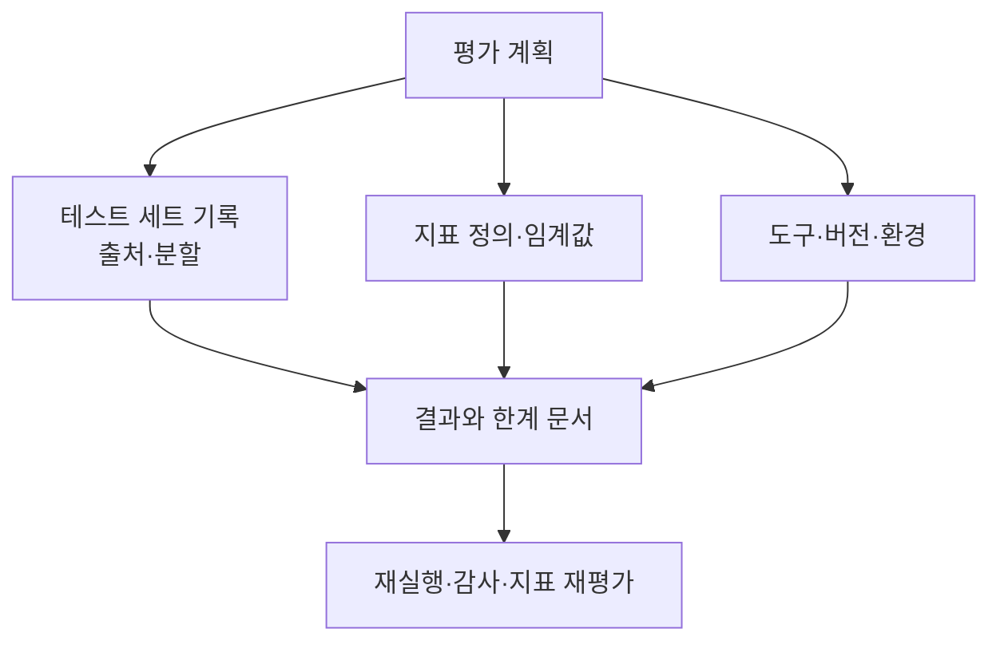

# TEVV 문서화

> AI를 시험·평가할 때 쓴 테스트 세트, 지표, 도구, 방법론, 결과를 기록해 두는 일. NIST AI RMF MEASURE 2.1이 요구하며, 같은 평가를 다시 해 볼 수 있게 하는 것이 목적이다.

## 쉽게 말하면
요리 대회 심사표와 같다. 점수만 남기면 왜 그 점수인지, 다음에 같은 방식으로 다시 매길 수 있는지 알 수 없다. 어떤 재료(테스트 세트)로, 어떤 기준(지표)과 도구로, 어떤 절차로 평가했는지까지 적어야 재현된다.

## 자세히
출처: NIST AIRC Playbook의 Measure 페이지(열어서 읽음).
- **MEASURE 2.1**: 테스트 세트·지표·TEVV 도구를 문서화한다. Playbook은 "문서화가 반복 가능성과 일관성을 가능하게 한다"고 설명한다.
- **제안 방식**: 업계에서 쓰는 **데이터시트(datasheets for datasets)**와 **모델 카드**를 활용하고, 이 문서화 도구가 여전히 맞는지 다시 평가해 필요하면 갱신한다.
- **점검 질문 예**: "AI 시스템의 개발, 테스트 방법론, 지표, 성능 결과를 문서화했는가?"
- **무엇을 적나(실무 정리, 이 페이지 목록은 아님)**: 데이터 출처·분할, 지표 정의와 임계값, 도구·버전, 실행 환경, 결과와 한계, 누가 언제 수행했는지.
- **관련**: MEASURE 2.13은 TEVV 지표와 프로세스 자체의 효과를 평가하라고 요구하므로 문서가 있어야 이 재평가가 가능하다([TEVV](#tevv)).
- Playbook은 자발적 지침이다.

## 그림으로 보기

## 예시
- 상담 챗봇 평가 기록: 테스트 세트 500문항(출처·수집일), 지표 = 정확도·유해 응답률, 도구 버전, 결과 표, 알려진 한계.
- 6개월 뒤 모델을 바꿔도 같은 문서대로 재측정해 비교.

## 헷갈리는 것과 비교
| 개념 | 차이 |
|---|---|
| 모델 카드 | 모델 자체 설명서, TEVV 문서는 평가 기록 |
| 데이터시트 | 데이터셋 설명서 |
| [TEVV](#tevv) | 활동 전체, 문서화는 그 일부 |
| [MEASURE 함수](#measure-function) | 상위 단계 |

## 더 읽을거리
- [NIST AIRC Playbook — Measure](https://airc.nist.gov/AI_RMF_Knowledge_Base/Playbook/Measure) — MEASURE 2.1 문서화 제안과 질문(열어서 확인)
