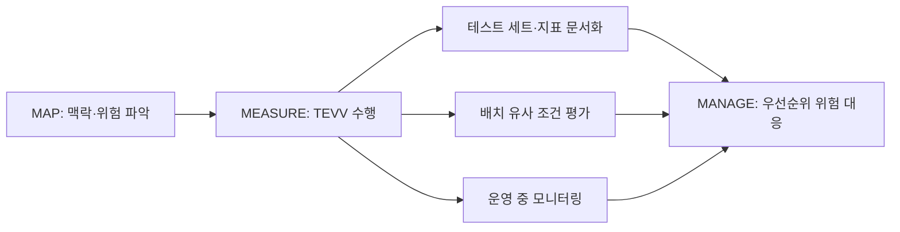

# TEVV 시험·평가·검증·확인

> Test, Evaluation, Verification, Validation의 약자. NIST AI RMF가 AI를 전 과정에서 객관적·반복 가능하게 점검하라고 요구하는 활동 묶음이다.

## 쉽게 말하면
자동차를 출시 전 충돌 시험하고, 출시 후에도 정기 검사를 받는 것과 같다. 한 번 통과했다고 끝이 아니라 실제 도로(운영 환경)에서 계속 확인한다.

## 자세히
출처: NIST AI RMF 핵심 함수 페이지(MEASURE 절, 2026-11-15 확인).
- **프레임워크의 요구**: "객관적이고 반복 가능하거나 확장 가능한 TEVV 프로세스"를 문서화하고 따르라. 지표는 과학적·법적·윤리적 규범에 맞춰야 한다.
- **MEASURE 2(신뢰성 평가)**: 테스트 세트·지표·TEVV 도구를 문서화(2.1). 배치 조건과 유사한 환경에서 성능을 측정하고 운영 중 모니터링. 타당성·신뢰성·안전·보안·회복탄력성·투명성·책임성·설명 가능성·프라이버시·공정성·환경 영향을 평가. **TEVV 지표와 프로세스 자체도 평가한다(2.13).**
- **시점**: 배포 전 시험 + 운영 중 정기 점검. 사람 대상 연구는 보호와 대표성을 평가.
- **평가자**: 최전선 개발자가 아닌 내부 전문가, 독립 평가자, 도메인 전문가, 영향받는 공동체를 참여시킨다(MEASURE 1).
- 용어 구분(일반적 설명, 이 페이지 정의는 아님): 검증(verification)은 사양대로 만들었나, 확인(validation)은 의도한 용도에 맞나.
- 신뢰 특성 목록은 [신뢰할 수 있는 AI 특성](#trustworthiness-characteristics), 운영 중 추적은 [위험 추적](#risk-tracking-over-time).

## 그림으로 보기

## 예시
- 채용 추천 모델: 출시 전 직군별 성능·편향 시험, 배포 후 분기별 같은 지표 재측정, 평가 지표가 여전히 타당한지 연 1회 점검.
- 평가 문서에 "측정하지 못한 위험" 목록을 남기는 것도 요구 사항이다(MEASURE 1).

## 헷갈리는 것과 비교
| 개념 | 차이 |
|---|---|
| TEVV | 시험·평가·검증·확인 전체 |
| [AI 평가](#ai-evaluation) | 벤치마크·평가 방법 전반 |
| 감사 | 독립 기관의 사후 점검 |

## 더 읽을거리
- [NIST AI RMF Core](https://airc.nist.gov/airmf-resources/airmf/5-sec-core/) — MAP·MEASURE·MANAGE·GOVERN 설명
