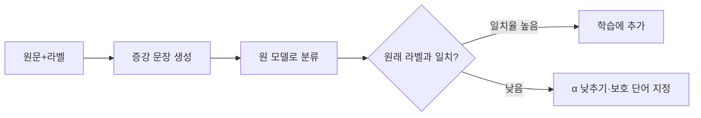
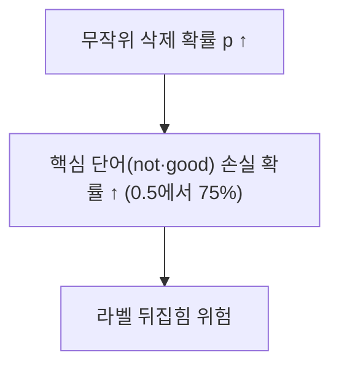

# 텍스트 증강 라벨 점검

> 텍스트를 단어 치환·삭제·역번역 등으로 늘린 뒤, **증강 문장이 원래 라벨(감성·주제 등)을 그대로 유지하는지 표본과 지표로 확인**하는 절차다. 문장이 많이 바뀌면 라벨이 더 이상 맞지 않을 수 있다.

## 쉽게 말하면
"배터리가 별로 좋지 않다"에서 "않다"를 우연히 지우면 "배터리가 좋다"가 되어 정답이 부정에서 긍정으로 뒤집힌다. 증강은 문장을 바꾸는 일이라, 바꾼 뒤에도 같은 정답이 맞는지 확인해야 한다.

## 자세히
(Wei & Zou 2019 EDA, arXiv 1901.11196 PDF 본문을 직접 읽음 + 직접 시뮬레이션)
- **EDA 연산 4가지**: 유의어 치환(SR), 무작위 삽입(RI), 무작위 교환(RS), 무작위 삭제(RD). 바뀌는 단어 수는 문장 길이에 비례(n=α·l)하며 α는 "문장에서 바뀌는 단어 비율"이다. 긴 문장은 잡음을 더 흡수한다.
- **논문의 점검 방법**: 증강 없이 학습한 RNN의 마지막 층 출력을 뽑아, 테스트 문장과 문장당 9개 증강 문장을 t-SNE로 2차원에 그렸다. 증강 문장이 원문 둘레에 모이면 라벨이 보존된 것으로 본다. 결과: 증강 문장이 원문을 가깝게 둘러싸서 "대체로" 라벨이 유지됐다고 해석했다(시각적·정성적 근거).
- **α가 클수록 위험**(논문 실험): SR은 작은 α에서 좋고 높은 α는 성능을 해쳤다(너무 많이 바꾸면 문장의 정체가 변함). RS는 α≤0.2에서 이득, α≥0.3에서 하락. RD는 낮은 α에서 가장 크고 높은 α(절반 가까이 삭제)에서는 크게 해쳤다. 권장 범위는 대체로 작은 α(0.05~0.2 구간이 안정적이라는 결과).
- **직접 시뮬레이션**: "the battery life is not good and the screen is great" 문장에서 부정 판단을 담은 단어 'not'과 'good'을 무작위 삭제(RD)가 지울 확률: 삭제 확률 p=0.05에서 9.8%, 0.1에서 19.1%, 0.2에서 35.3%, 0.3에서 50.9%, 0.5에서 74.9%(각 2만 회). 짧은 문장에서는 핵심 단어를 잃을 확률이 빠르게 커진다.
- 점검 절차(제안): ① 증강 문장 50개를 사람이 읽고 라벨이 맞는지 표시 ② 원래 모델(증강 없는)로 증강 문장을 분류해 **원래 라벨과 일치율** 측정 ③ 핵심 단어(부정어·수치·고유명사)를 보호 목록으로 두고 삭제·치환에서 제외 ④ 임계 α를 정하고 라벨 불일치 비율 보고. 역번역은 의미 보존이 비교적 좋다고 알려졌지만 표본 점검은 여전히 필요하다([중간 언어 선택](#intermediate-language-choice)).

## 그림으로 보기

## 예시
- 리뷰 감성 증강: 부정어 목록(not·never·않다·못)은 삭제·치환 대상에서 제외하고 일치율을 확인.
- 교육: "증강한 데이터도 라벨이 맞는지 검증해야 한다"는 데이터 품질 원칙.

## 헷갈리는 것과 비교
| 개념 | 차이 |
|---|---|
| 라벨 보존 점검 | 증강 후에도 정답이 맞는지 확인 |
| 모델 검증 정확도 | 학습 결과, 라벨 오류 원인 분리가 어려움 |
| [UDA](#uda-consistency-training) | 증강본과 원본의 예측 일치를 학습에 이용 |
| [라벨 보존 변환](#label-preserving-transform) | 이 점검이 확인하는 성질 |

## 더 읽을거리
- [EDA: Easy Data Augmentation (arXiv 1901.11196)](https://arxiv.org/abs/1901.11196) — 4연산, α 실험, t-SNE 라벨 보존 시각화(PDF 본문 읽음).
