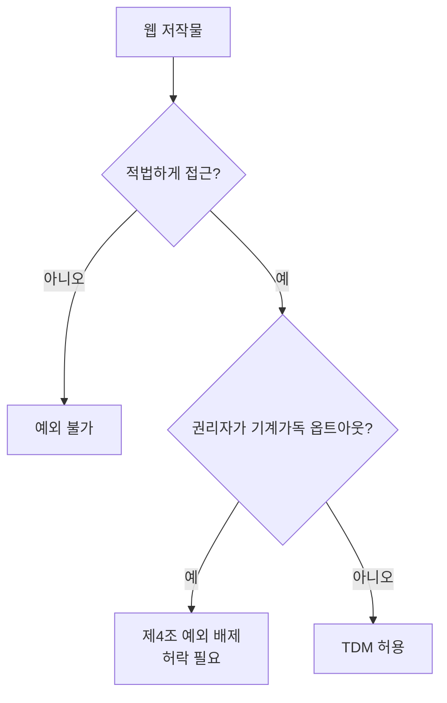
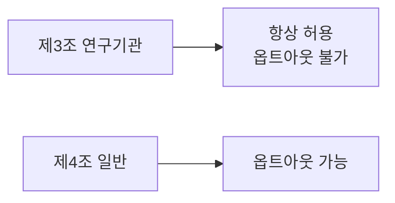

# 텍스트·데이터 마이닝 예외

> 텍스트·데이터 마이닝(TDM) 예외는 저작권자의 허락 없이 저작물을 자동 분석 목적으로 복제·추출할 수 있게 하는 법적 예외다. AI 학습 데이터 수집이 허용되는 근거로 자주 거론되며, EU는 "옵트아웃(권리 유보)이 없을 때만" 허용하는 구조다.

## 쉽게 말하면
도서관에서 책을 빌려 통계를 내는 건 저자 허락이 필요 없다. 그런데 저자가 "내 책은 통계 분석도 사절"이라고 기계가 읽을 수 있게 적어 두었다면, 일부 경우에는 분석할 수 없다. 이 "사절 표시"가 옵트아웃이다.

## 자세히
- **정의(EU DSM 지침 2019/790, EUR-Lex 열람)**: TDM은 recital 8에서 "디지털 형태 정보의 자동화된 컴퓨터 분석"으로 설명된다.
- **두 갈래(검색 요약 + 지침 recital 확인)**: 제3조는 연구기관·문화유산기관의 과학 연구용 TDM을 의무적으로 허용한다(적법 접근 필요). 제4조는 **누구에게나** 적용되는 일반 예외지만 권리자가 "적절한 방식으로" 유보하면 적용되지 않는다. recital 18은 온라인에 공개된 콘텐츠의 적절한 유보 방법으로 메타데이터와 웹사이트 이용약관을 포함한 **기계가 읽을 수 있는 수단**을 든다. (조문 원문은 페이지 일부만 읽혀 직접 인용하지 못했다.)
- **AI Act 연결(2차 출처 요약)**: 범용 AI(GPAI) 모델 제공자는 저작권 정책을 갖추고 제4조(3)의 권리 유보를 최신 기술로 식별·준수해야 한다(AI Act 53조(1)(c)). 유럽집행위는 2025-12-01 옵트아웃 프로토콜 의견 수렴을 시작했고 2026-01에 이어졌다고 보도된다. 어떤 신호(robots.txt·메타데이터 등)가 인정되는지 합의 목록이 만들어지는 중이다.
- **미해결 쟁점**: 제3자가 스크래핑해 건네주면 제공자가 구속되지 않을 수 있음, EU 밖에서 학습하는 경우의 적용 범위, 옵트아웃 방식의 불명확성.
- **다른 법역**: 국가마다 달라 미국은 공정이용 판단, 일본·싱가포르 등은 별도 예외를 둔다고 알려져 있으나 이번에 직접 확인하지 않았다.
- 법률 자문이 아니다.

## 그림으로 보기

## 예시
- 대학 연구소가 논문 코퍼스를 연구 목적으로 분석: 제3조 해당 가능.
- 기업이 뉴스 사이트를 학습용으로 수집: 사이트가 robots.txt·약관으로 유보했는지 확인해야 한다([AI 크롤러 차단](#ai-crawler-blocking), [robots.txt와 이용약관 불일치](#robots-txt-vs-tos)).
- 교육 소재: 자기 회사 사이트의 옵트아웃 표시를 점검.

## 헷갈리는 것과 비교
| 개념 | 차이 |
|---|---|
| TDM 예외 | 저작권 허락 불필요, 조건부 |
| 라이선스(CC 등) | 허락의 조건, 예외가 있으면 작동 안 함 |
| [CC ShareAlike](#cc-sharealike) | 예외 밖에서 공개 공유 시 의무 |
| 공정이용(미국) | 사안별 판단 |

## 더 읽을거리
- [Directive (EU) 2019/790 (EUR-Lex)](https://eur-lex.europa.eu/legal-content/EN/TXT/HTML/?uri=CELEX:32019L0790) — recital 8·11·14·18 확인.
- [Commission FAQ: AI and copyright compliance](https://digital-strategy.ec.europa.eu/en/faqs/stakeholder-consultation-ai-and-copyright-compliance) — 옵트아웃 의견 수렴(검색 결과로 확인).
