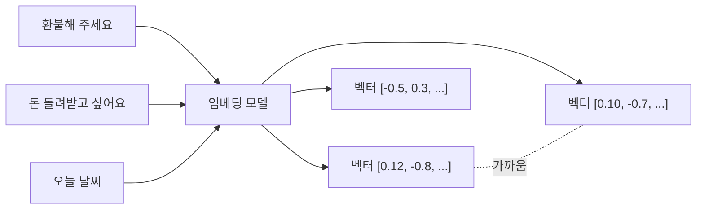
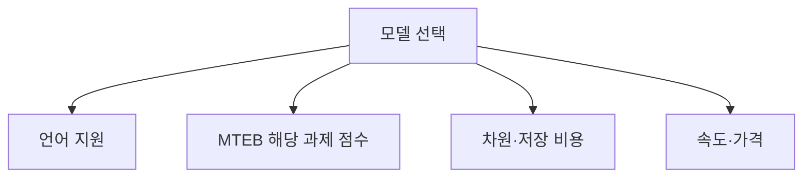

# 텍스트 임베딩 모델

> 문장·문서를 의미가 비슷하면 가까워지는 숫자 벡터로 바꿔 주는 모델. 검색·분류·군집화의 바탕이다.

## 쉽게 말하면
도시를 위도·경도 두 숫자로 나타내면 가까운 도시를 바로 알 수 있다. 임베딩은 문장에 "의미의 좌표"를 붙이는 일이다. 다만 좌표가 2개가 아니라 수백~수천 개이고, "환불해 주세요"와 "돈 돌려받고 싶어요"는 글자가 달라도 가까운 곳에 놓인다.

## 자세히
- **출력**: 고정 길이 벡터(차원). 큰 모델일수록 차원이 커서 저장 공간이 늘어난다(예: SGPT-5.8B는 4096차원, Hugging Face MTEB 글, 확인 2026-11-02).
- **MTEB**(Massive Text Embedding Benchmark): 56개 데이터셋·8개 과제(분류, STS 문장 유사도, 검색 등)로 임베딩 모델을 비교하는 공개 리더보드. 과제별 탭이 있으니 내 용도(검색이면 Retrieval)의 점수를 본다.
- **선택 기준**: 속도 우선 / 균형(all-MiniLM-L6-v2, all-mpnet-base-v2) / 성능 우선(큰 모델) 3그룹. 그 밖에 언어(한국어 지원), 입력 길이, 비용, 차원을 고려한다.
- **원칙**: 문서와 질문은 **같은 모델**로 임베딩해야 한다. 모델을 바꾸면 전체를 다시 임베딩한다.
- **거리 척도**: 코사인 유사도·내적이 흔하며 모델이 권장하는 것을 쓴다.
- 임베딩은 [청킹](#chunking)된 조각 단위로 만들어 [벡터 DB](#vector-db)에 저장한다. 이미지·텍스트 공용 임베딩은 [임베딩과 CLIP](#embedding-clip) 참고.
- 한계: 의미는 잘 잡지만 정확한 코드·숫자 일치에는 약해 [BM25](#hybrid-search-bm25)와 함께 쓰는 일이 많다.

## 그림으로 보기

## 예시
- 고객 문의 중복 찾기: 문의 글을 임베딩해 코사인 유사도 0.85 이상이면 같은 건으로 묶는다(임계값은 데이터로 조정).
- 모델 교체 시: 인덱스 전체 재임베딩이 필요하므로 모델 이름·버전을 메타데이터로 기록해 둔다.

## 헷갈리는 것과 비교
| 개념 | 차이 |
| --- | --- |
| 임베딩 모델 | 텍스트 → 벡터(검색용). 생성은 안 함 |
| LLM | 텍스트 생성. 내부에도 토큰 임베딩이 있으나 용도가 다름 |
| 벡터 DB | 벡터를 저장·검색 |
| 토큰화 | 글자를 토큰으로 나눔. 임베딩의 전 단계 |

## 더 읽을거리
- [MTEB: Massive Text Embedding Benchmark (Hugging Face)](https://huggingface.co/blog/mteb) — 임베딩 평가 방식과 모델 그룹.
