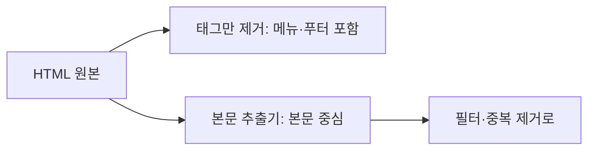
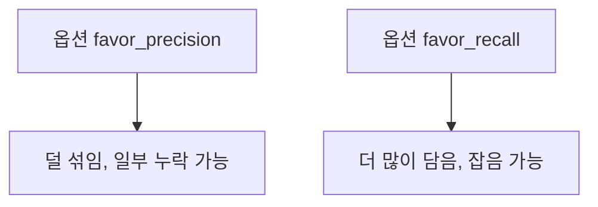

# WARC에서 본문 추출

> WARC·WAT에는 웹페이지의 **HTML 원본**이 들어 있어서, 학습에 쓰려면 메뉴·광고·푸터를 빼고 **본문만 뽑는 추출기**(trafilatura 등)를 거쳐야 한다. 어떤 추출기를 쓰고 어떤 옵션을 주느냐에 따라 데이터 품질이 달라진다.

## 쉽게 말하면
신문을 통째로 스캔하면 광고·목차·구독 안내까지 같이 들어온다. 기사 본문만 오려 내는 가위의 성능이 좋으면 깨끗한 글이 남고, 나쁘면 쓰레기가 같이 남는다.

## 자세히
(trafilatura 설치본과 Wikipedia "Common Crawl" 문서 HTML 한 건(약 150KB)으로 직접 실행. 한 페이지 한 가지 설정의 관찰이다)
- **단순 태그 제거**(정규식으로 `<...>` 삭제): 약 10,900자. 앞부분이 `Jump to content Main menu ... Navigation Main page Contents Current events ...`처럼 **메뉴 텍스트로 시작**한다. "Jump to content", "Main menu", "Toggle", "Donate", "Privacy policy", "Cookie statement"가 모두 남는다.
- **trafilatura 기본 추출**: 약 8,400자. 위 메뉴·푸터 문구가 **모두 사라지고** 본문이 "Common Crawl" 제목과 개요 표, 본문 문단으로 시작한다. `include_tables=False`로 표를 빼면 약 8,100자. `favor_precision=True`는 약 8,300자(약간 더 보수적), `favor_recall=True`는 기본과 같은 길이였다.
- 해석: 본문 추출만으로 메뉴·푸터 같은 **반복 보일러플레이트**가 크게 줄어든다. 이는 이후 중복 제거에서 거대 군집이 되는 문구([중복 군집 크기](#duplicate-cluster-size))를 애초에 줄이는 효과가 있다. 다만 이 한 페이지의 관찰이라 추출기별 우열을 일반화할 수 없다. 큰 규모 비교는 별도 평가가 필요하다.
- FineWeb 예제는 본문 추출에 `Trafilatura(favour_precision=True)`를 썼다([FineWeb 예제](#datatrove-fineweb-example)). 정밀도 우선은 본문이 아닌 텍스트를 덜 섞지만 본문 일부를 놓칠 수 있다.
- WET(Common Crawl 제공 텍스트)를 쓰는 길도 있지만, WET은 추출기 선택을 직접 못 하므로 품질을 높이려면 WARC에서 직접 추출한다는 것이 일반적인 설명이다(이 실험으로는 확인하지 않음).

## 그림으로 보기



## 예시
```python
import trafilatura
text = trafilatura.extract(html, favor_precision=True)   # 본문만
```
- 같은 페이지로 추출기 두 개의 결과를 나란히 비교해 메뉴 잔재를 확인.
- 교육: "데이터 품질은 수집 뒤 첫 가공(추출)에서 이미 갈린다."

## 헷갈리는 것과 비교
| 개념 | 차이 |
|---|---|
| 태그 제거 | 단순히 HTML 표시만 지움 |
| 본문 추출 | 메뉴·광고·푸터까지 판별해 제거 |
| WET | Common Crawl이 만든 추출 텍스트 |
| [WARC·WAT·WET](#warc-wat-wet) | 파일 종류 구분 |

## 더 읽을거리
- [trafilatura 문서](https://trafilatura.readthedocs.io/) — 추출 옵션(favor_precision, include_tables 등; 설치해 사용).
