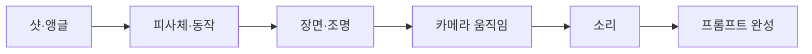
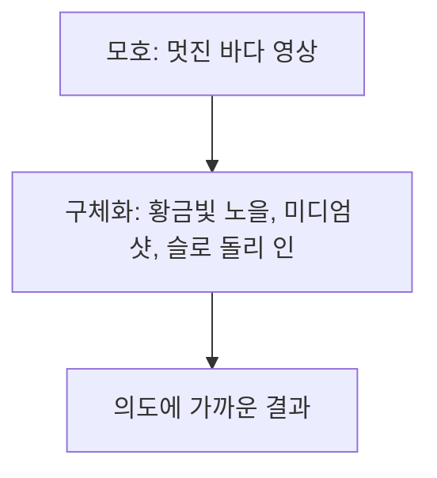

# 영상 프롬프트 쓰기

> 텍스트-영상 모델에는 **피사체·동작·장면·카메라(앵글·움직임)·렌즈·스타일·시간 요소·소리**를 구체적으로 적는다. 짧은 클립에는 **작은 변화**만 지시하는 것이 잘 먹힌다.

## 쉽게 말하면
촬영 감독에게 콘티를 건네듯 쓴다. "멋진 영상"이 아니라 "황금빛 노을, 중간 샷, 카메라는 천천히 다가감"처럼 감독이 바로 찍을 수 있게 말한다.

## 자세히
(Google Cloud Vertex AI Veo 프롬프트 가이드 확인)
- **요소**(전부 쓸 필요는 없음): 피사체("a seasoned detective"처럼 구체적으로), 동작(눈을 천천히 깜빡이는 미세 동작까지), 장면·맥락(장소·시간대·날씨), **카메라 앵글**(아이레벨·로우·하이·버즈아이·클로즈업·미디엄), **카메라 움직임**(정지·팬·틸트·돌리·줌·크레인·드론·핸드헬드·휩팬), 렌즈·광학 효과(광각·망원·얕은 심도·플레어·랙포커스), 시각 스타일(조명·분위기·색감), 시간 요소(슬로모션·타임랩스), 소리(효과음·환경음·대사는 **별도 문장**으로), 컷 용어(매치컷·점프컷·몽타주).
- 팁: 모호하면 평범한 결과가 나온다. 클립이 짧으면 "촛불이 조금 타 내려감" 같은 **미세한 변화**가 극적 변신보다 낫다. 일부 고급 앵글·렌즈는 공식 지원이 아니라고 가이드가 경고한다.
- **네거티브 프롬프트**: "no", "don't" 같은 지시형 문장은 권장되지 않는다. 원치 않는 요소를 나열한다(예: "urban background, man-made structures").
- 서드파티 팁(비공식): 주요 카메라 움직임은 하나만 쓰고, 전경·후경·좌우 위치를 명시하면 안정적이라는 조언이 있다.
- 예시 구조(가이드 요소 조합): 샷 → 피사체·동작 → 환경·조명 → 카메라 움직임 → 소리.

## 그림으로 보기

## 예시
> 황금빛 노을의 나무 부두 위, 낡은 선장의 미디엄 샷. 그가 멀리 폭풍을 천천히 바라본다. 따뜻한 역광이 실루엣을 만든다. 카메라는 느리게 돌리 인. 파도가 말뚝에 부딪히는 소리, 멀리서 낮은 뱃고동.

- 교육 활용: 같은 장면을 앵글만 바꿔 3번 생성해 비교하는 실습.

## 헷갈리는 것과 비교
| 개념 | 차이 |
|---|---|
| 영상 프롬프트 | 시간·움직임·소리까지 지정 |
| 이미지 프롬프트 | 정지 화면 묘사 |
| 네거티브 프롬프트 | 빼고 싶은 요소 나열 |
| [시공간 패치](#spacetime-patches) | 모델이 영상을 표현하는 내부 단위 |

## 더 읽을거리
- [Veo on Vertex AI: 영상 생성 프롬프트 가이드](https://docs.cloud.google.com/vertex-ai/generative-ai/docs/video/video-gen-prompt-guide)
