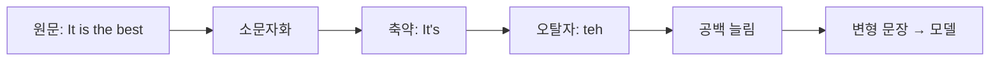
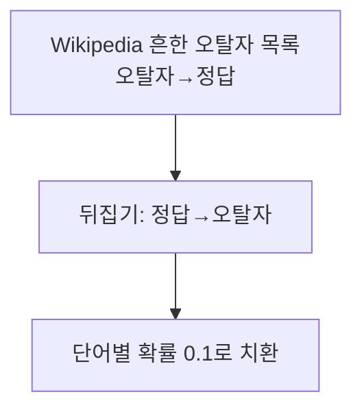

# 텍스트 오타 변형

> 언어 모델 평가에서 **입력 문장에 흔한 오타·대소문자 변경·공백 변형을 가해** 답이 흔들리는지 보는 가장 기본적인 견고성 테스트다. 의미는 그대로인데 표면만 바꾸는 "가벼운 변형"이다.

## 쉽게 말하면
사람은 "teh"를 보면 자동으로 "the"로 읽는다. 사용자가 급하게 친 문장에도 AI가 똑같이 답해야 한다. 오타 변형은 문장에 일부러 사소한 실수를 넣어 놓고, 모델이 사람처럼 넘어가는지 확인하는 시험이다.

## 자세히
(HELM 논문 「Holistic Evaluation of Language Models」(TMLR 2023-08, arXiv 2211.09110) 부록 D.1을 PDF로 직접 읽어 확인.)
- **HELM의 기본 변형 4가지(논문)**
  - **Lowercase**: 입력 전체를 소문자로.
  - **Contraction/Expansion**: "I am ↔ I'm" 같은 축약·확장. NL-Augmenter의 변형에서 가져왔다.
  - **Misspellings**: Wikipedia의 "흔한 오탈자 목록"(오탈자→정답)을 **뒤집어** 정답→오탈자 사전을 만든다. 입력의 각 단어를 보고 사전에 있으면 **독립적인 확률로** 흔한 오탈자 중 하나로 바꾼다. 복수형도 사전에 추가한다.
  - **Extra spaces**: 공백 하나를 임의 길이의 공백 연속으로 바꾼다.
- **합성 레시피(논문)**: 핵심 실험에서는 위를 이어서 적용한다. 소문자화 → 축약 → 각 단어를 확률 0.1로 오탈자화(예: "the"→"teh") → 공백을 1~3개로 무작위 치환. 사전에 없는 단어도 있어 실제 확률은 0.1보다 낮다. 이렇게 합쳐서 **한 번의 평가로 여러 변형을 커버**한다.
- **왜 "자연스럽고 가벼운" 변형인가(논문)**: 사용자가 텍스트 창에서 흔히 하는 실수가 목표이며, 적대적 공격이 아니다. 결과는 **분류·QA·정보 검색**에만 적용한다(장문 생성은 정답이 모호).
- **해석 주의**: 이것은 영어 오타 중심이며, 한국어는 자모 순서·맞춤법·띄어쓰기가 다른 유형의 오류를 만든다(제안). 따라서 한국어 평가에는 한국어 오타 사전·변형 규칙이 필요하다.
- **점수 계산**: 이 변형들 아래의 최저 성능을 취하면 [섭동 최악 사례 정확도](#worst-case-over-perturbations).

## 그림으로 보기

## 예시
- 고객 챗봇 평가: "배송이 늦어요"에 오타·띄어쓰기 변형을 가해 의도 분류 정확도 하락폭을 잰다.
- 프롬프트: `Q: waht is the capitl of france?` 처럼 오타 질문에도 같은 답을 하는지 확인.
- 교육 활동: 오타를 0%·10%·30% 단어에 넣고 모델 답이 바뀌는 지점을 직접 확인.

## 헷갈리는 것과 비교
| 개념 | 차이 |
|---|---|
| 오타 변형 | 의미 불변의 표면 변형 |
| 적대적 공격 | 모델을 겨냥해 최적화한 입력 변형 |
| [변형 강도 단계](#perturbation-severity-levels) | 오타 비율 등 강도를 단계화 |
| [견고성 곡선](#robustness-curve) | 오타 비율에 따른 성능 곡선 |

## 더 읽을거리
- [Holistic Evaluation of Language Models (arXiv 2211.09110)](https://arxiv.org/abs/2211.09110) — 부록 D.1의 오탈자·소문자화·축약·공백 변형 레시피(PDF 직접 확인).
