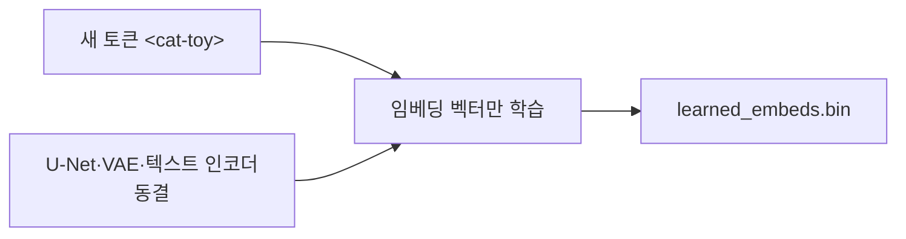
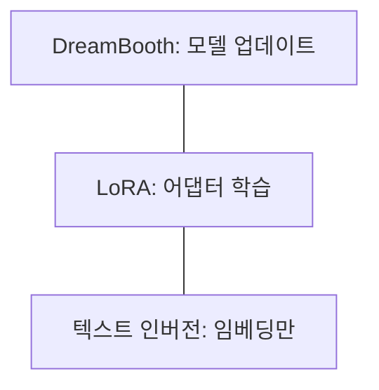

# 텍스트 인버전

> 텍스트 인버전은 모델은 그대로 두고 특별한 단어(placeholder token)의 임베딩 벡터만 새로 학습해, 몇 장의 이미지에서 대상이나 스타일을 가르치는 기법이다.

## 쉽게 말하면
사전에 없는 새 단어 "<cat-toy>"를 하나 만들어 그 뜻(벡터)만 적어 두는 것과 같다. 사전의 나머지는 건드리지 않으니 결과 파일이 아주 작다.

## 자세히
HF diffusers 가이드(v0.42.1) 기준:
- 몇 장의 예시 이미지에 맞도록 텍스트 임베딩을 학습·갱신하고, 새 임베딩은 프롬프트에 꼭 써야 하는 특수 단어에 묶인다.
- 주요 인자: `--placeholder_token`(예 `<cat-toy>`), `--initializer_token`(대상을 대략 설명하는 한 단어, 예 `toy`), `--learnable_property`(`object` 또는 `style`), `--num_vectors`(늘리면 표현력↑·비용↑).
- 결과물: `learned_embeds.bin`, `token_identifier.txt`, `type_of_concept.txt`.
- 예시 설정: 3000 스텝, learning_rate 5e-4. 가이드는 V100 1장에서 약 1시간이라고 적는다.
- 추론: `pipeline.load_textual_inversion("sd-concepts-library/cat-toy")` 후 프롬프트에 `<cat-toy>`를 쓴다.
- DreamBooth는 모델 전체(U-Net)를 업데이트하는 반면 이 방법은 임베딩만 학습한다.

## 그림으로 보기



## 예시
```bash
accelerate launch textual_inversion.py \
  --pretrained_model_name_or_path=$MODEL_NAME --train_data_dir=./cat \
  --learnable_property=object --placeholder_token="<cat-toy>" \
  --initializer_token=toy --max_train_steps=3000 --learning_rate=5.0e-04
```

## 헷갈리는 것과 비교
| 개념 | 학습 대상 |
|---|---|
| 텍스트 인버전 | 새 단어 임베딩(작음) |
| [DreamBooth](#dreambooth) | 모델 가중치 전체 |
| LoRA | 저랭크 어댑터 |
| [Prior preservation](#prior-preservation-loss) | DreamBooth 과적합 방지 |

## 더 읽을거리
- [HF Textual Inversion 가이드](https://huggingface.co/docs/diffusers/training/text_inversion) — 스크립트와 인자.
- [논문 arXiv 2208.01618](https://hf.co/papers/2208.01618) — 원 논문.
