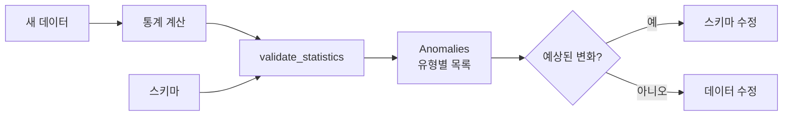
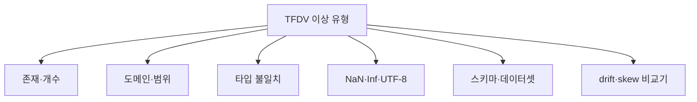

# TFDV 이상 유형

> TFDV가 데이터를 스키마와 대조해 찾아내는 **이상(anomaly)의 종류 목록**이다. 공식 `anomalies.proto`에 `AnomalyInfo.Type`으로 약 85가지가 정의되어 있다(2026-11 확인).

## 쉽게 말하면
공항 보안검색대에 "금지 물품 목록"이 있는 것과 같다. 스키마가 "정상 승객의 기준"이고, 이상 유형은 "칼, 액체, 라이터…" 처럼 어떤 규칙을 어겼는지 이름을 붙여 알려 주는 라벨이다. 라벨이 구체적이라 무엇부터 고칠지 바로 안다.

## 자세히
`tfdv.validate_statistics(statistics, schema)`는 통계와 스키마의 차이를 `Anomalies` 프로토콜 버퍼로 돌려준다. 유형은 크게 이렇게 묶인다.
- **존재·개수**: `FEATURE_TYPE_NOT_PRESENT`(어떤 예제에도 없음), `FEATURE_TYPE_LOW_FRACTION_PRESENT`(너무 적은 비율에만 있음), `FEATURE_TYPE_LOW/HIGH_NUMBER_VALUES`(예제당 값 개수 위반), `FEATURE_TYPE_UNEXPECTED_REPEATED`.
- **도메인 밖 값**: `ENUM_TYPE_UNEXPECTED_STRING_VALUES`(문서 예: `payment_type`에 `Prcard`가 1% 미만 등장), `INT_TYPE_BIG_INT`·`FLOAT_TYPE_SMALL_FLOAT`처럼 범위 이탈.
- **타입 불일치**: `INT_TYPE_INT_EXPECTED`, `FLOAT_TYPE_STRING_NOT_FLOAT`(문자열을 실수로 못 읽음), `STRING_TYPE_NOW_INT`.
- **값 품질**: `FLOAT_TYPE_HAS_NAN`, `FLOAT_TYPE_HAS_INF`, `ENUM_TYPE_INVALID_UTF8`.
- **스키마·데이터셋 수준**: `SCHEMA_NEW_COLUMN`(스키마에 없는 새 열), `SCHEMA_MISSING_COLUMN`, `NO_DATA_IN_SPAN`, `DATASET_LOW/HIGH_NUM_EXAMPLES`.
- **비교기(drift/skew)**: `COMPARATOR_L_INFTY_HIGH`, `COMPARATOR_JENSEN_SHANNON_DIVERGENCE_HIGH`, `COMPARATOR_NORMALIZED_ABSOLUTE_DIFFERENCE_HIGH`, 그리고 비교 대상 데이터가 없을 때의 `COMPARATOR_*_DATA_MISSING`.
- **특수 구조**: sparse·weighted 피처 불일치, 시퀀스 값 빈도, 이미지 바이트 크기 초과, 임베딩 차원 오류 등.
- **대응 원칙(공식 문서)**: 이상이 *예상된 변화*면 스키마를 고친다(`tfdv.get_domain(schema,'payment_type').value.append('Prcard')`). *진짜 오류*면 학습 전에 원본 데이터를 고친다.
- 집계 통계 검증 외에 `validate_examples_in_tfrecord`로 **예제 단위** 검증도 가능하며, 이상별로 문제 예제의 통계를 돌려준다.

## 그림으로 보기

## 예시
- 택시 요금 데이터의 `payment_type`에 새 결제 수단 `Prcard`가 등장 → 도메인 밖 값 이상. 정상 신규 값이면 도메인에 추가.
- 센서 로그에 NaN이 섞여 들어옴 → `FLOAT_TYPE_HAS_NAN`으로 학습 전 차단.

## 헷갈리는 것과 비교
| 개념 | 차이 |
|---|---|
| 이상 유형(스키마 위반) | 스키마 규칙 위반을 이름으로 분류 |
| [skew·drift 비교기](#skew-drift-comparator) | 두 데이터셋 분포를 비교해 변화 감지 |
| [스키마 환경](#schema-environments) | 학습/서빙에서 요구 피처가 달라 생기는 오탐을 제거 |
| [데이터 드리프트](#data-drift) | 현상 자체. 이상 유형은 TFDV의 검출 라벨 |

## 더 읽을거리
- [TFDV 시작하기](https://www.tensorflow.org/tfx/data_validation/get_started) — 이상 검출·환경·skew/drift 공식 가이드.
- [anomalies.proto](https://github.com/tensorflow/metadata/blob/master/tensorflow_metadata/proto/v0/anomalies.proto) — 전체 유형 정의.
