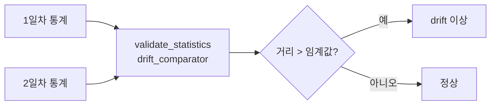
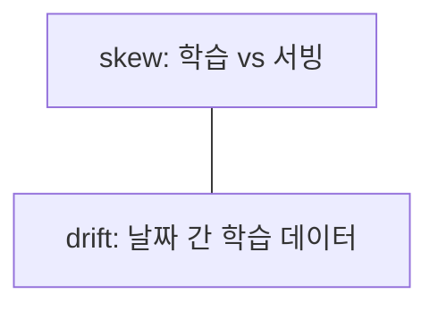

# TFDV drift 비교기

> TFDV의 **drift 비교기(drift_comparator)**는 **서로 다른 날짜(또는 이전 실행)의 학습 데이터 분포**를 비교해, 시간이 지나며 데이터가 임계값 이상 변했는지 감지한다. 학습 데이터가 조금씩 바뀌어 모델이 낡아 가는 것을 알려 준다.

## 쉽게 말하면
매일 찍는 체중계 기록을 어제와 비교해 "하루 사이 2kg 이상 변하면 경고"를 설정하는 것이다. 비교 상대가 어제 데이터(이전 날짜)라는 점이 skew 비교기(학습 vs 서빙)와 다르다.

## 자세히
(TensorFlow 공식 문서 「Get started with TensorFlow Data Validation」을 WebFetch로 직접 읽어 확인. TFDV를 설치·실행하지는 않았다.)
- **사용법(문서)**: 스키마 특징에 drift 비교기와 임계값을 두고, `validate_statistics`에 **현재 통계와 `previous_statistics`**를 넘긴다.
  ```python
  tfdv.get_feature(schema, 'payment_type').drift_comparator.infinity_norm.threshold = 0.01
  drift_anomalies = tfdv.validate_statistics(
      statistics=train_day2_stats, schema=schema, previous_statistics=train_day1_stats)
  ```
- **척도(문서)**: skew와 같다. **L-infinity norm은 범주형만** 감지하고, **`jensen_shannon_divergence` 임계값**을 쓰면 수치형·범주형 모두 감지한다. 문서에는 같은 안내가 drift 절에도 반복되는데, 두 번째 문장이 `skew_comparator`라고 적혀 있어 drift에서도 JS 발산을 쓸 수 있는지는 코드 예시로 확인하지 못했다(문서 표현의 모호함).
- **skew와의 차이(문서)**: skew는 **학습 대 서빙**(`serving_statistics`), drift는 **학습 데이터의 날짜 간 변화**(`previous_statistics`). 문서의 설명: "skew between training and serving data", "drift between different days of training data".
- **결과(문서)**: `Anomalies` 프로토콜 버퍼.
- **운영(해석)**: 매일 새 학습 데이터 통계를 만들 때 어제 통계와 비교하는 단계를 파이프라인에 넣어, drift 경보가 나면 학습을 멈추고 원인을 확인한다. 임계값은 표본 크기·변동성에 따라 정한다. → [드리프트 임계값 정하기](#drift-threshold-tuning)
- **한계**: 비교 상대가 직전 하루이므로 **서서히 누적되는 변화**(매일 작은 변화)는 임계값을 못 넘겨 놓칠 수 있다(해석, 문서에 없음). 기준 시점을 고정한 비교를 병행하는 방법을 고려할 수 있다.

## 그림으로 보기



## 예시
- 결제 수단 비율이 매일 학습 데이터에 들어오는데 어느 날 `Cash` 비율이 급증 → 전날 대비 L-infinity 거리 경보.
- 교육 활동: 3일치 범주 비율 표로 일별 비교와 1일차 기준 비교의 차이 느껴 보기.

## 헷갈리는 것과 비교
| 개념 | 차이 |
|---|---|
| drift 비교기 | 날짜 간 학습 데이터 변화 |
| [TFDV skew 비교기](#tfdv-skew-comparator) | 학습 vs 서빙 |
| 개념 드리프트 | 입력-정답 관계가 변함. 입력 분포 변화와 다름 |
| [L-infinity·JS 발산](#l-infinity-js-divergence) | 거리 척도 |

## 더 읽을거리
- [Get started with TensorFlow Data Validation (TensorFlow 문서)](https://www.tensorflow.org/tfx/data_validation/get_started) — drift 비교기와 `previous_statistics`(직접 확인).
