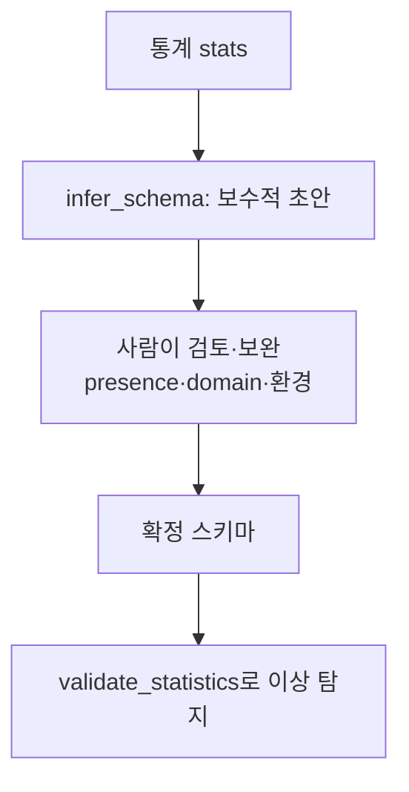
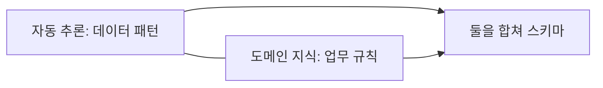

# 추론 스키마 검토

> TFDV의 `infer_schema`는 통계에서 **초안 스키마를 자동으로 만들지만**, 공식 문서가 "**반드시 검토하고 도메인 지식으로 보완하라**"고 강하게 권한다. 자동 추론은 보수적 규칙으로 만든 출발점일 뿐이다.

## 쉽게 말하면
엑셀 표를 AI가 자동으로 양식(필수 칸·값 범위)으로 만들어 주는 것과 같다. 대체로 맞지만 "이 칸은 법적으로 꼭 필요해요", "이 값은 허용돼요" 같은 업무 지식은 사람이 직접 고쳐 넣어야 한다.

## 자세히
(TensorFlow 공식 문서 「Get started with TensorFlow Data Validation」을 WebFetch로 직접 읽어 확인. TFDV를 직접 실행하지는 않았다.)
- **무엇을 추론하나(문서)**: 스키마는 ① 어떤 특징이 있어야 하는지 ② 타입 ③ 예시당 값의 개수 ④ 전체 예시에서의 존재 비율 ⑤ 기대하는 값의 도메인 등 "올바른 데이터"의 기대 속성을 기술한다. 같은 스키마를 TensorFlow Transform 설정에도 쓸 수 있다. 스키마는 비교적 정적이어야 하고, 통계는 데이터셋마다 달라진다.
- **자동 추론의 성격(문서)**: `tfdv.infer_schema(stats)`는 통계에서 **보수적인 휴리스틱**으로 안정적인 속성만 추론해 특정 데이터셋에 **과적합되지 않게** 한다. 문서는 "**추론된 스키마를 검토하고 필요하면 다듬으라**(도메인 지식 반영)"고 강하게 권한다.
- **기본 동작(문서)**: 필수 특징의 `value_count.min`과 `max`가 같으면 **형태(shape)를 추론**한다. 끄려면 `infer_feature_shape=False`.
- **수정 방법(문서)**: 스키마는 Schema 프로토콜 버퍼라 표준 API로 고칠 수 있고 TFDV가 도우미 함수를 제공한다. 예: `payment_type`이 최소 50%의 예시에서 채워져야 하게 하려면
  `tfdv.get_feature(schema, 'payment_type').presence.min_fraction = 0.5`.
  도메인 값을 추가하려면 `tfdv.get_domain(schema, 'payment_type').value.append('Prcard')`(문서의 이상 항목 예시에서 "기대된 값이면 스키마를 이렇게 갱신").
- **검토 체크리스트(제안, 문서 내용을 바탕으로 한 해석)**: 필수/선택 특징이 업무와 맞는지, 값 도메인이 빠짐없는지, 수치 범위가 합당한지, 학습에만 있는 라벨은 환경 설정이 필요한지. → [TFDV 스키마 환경](#tfdv-schema-environments)
- **한계**: 추론은 입력 데이터에 있는 패턴만 보므로, 데이터에 한 번도 안 나온 정상 값이나 업무 규칙은 사람이 추가해야 한다(해석).

## 그림으로 보기

## 예시
- 추론된 스키마에서 `age` 필수 여부와 범위를 업무 규칙(0~120)에 맞게 수정하고, 허용 결제 수단 목록에 신규 값을 추가.
- 교육 활동: 작은 표에서 자동으로 만든 양식을 팀이 검토해 빠진 규칙을 찾아보기.

## 헷갈리는 것과 비교
| 개념 | 차이 |
|---|---|
| 추론 스키마 | 통계에서 만든 초안 |
| 확정 스키마 | 사람이 검토·보완한 기준 |
| [TFDV 스키마 환경](#tfdv-schema-environments) | 학습/서빙별 스키마 변형 |
| [GX Expectation 스위트](#expectation-suite-design) | 비슷한 목적의 다른 도구 규칙 묶음 |

## 더 읽을거리
- [Get started with TensorFlow Data Validation (TensorFlow 문서)](https://www.tensorflow.org/tfx/data_validation/get_started) — `infer_schema`, 스키마 수정, 이상 탐지(직접 확인).
