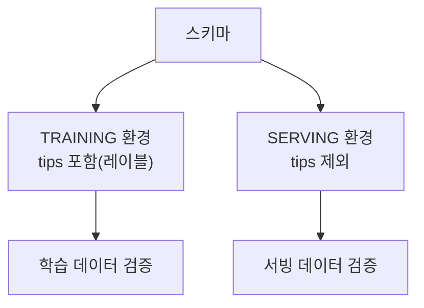
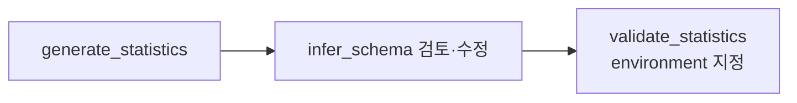

# TFDV 스키마 환경

> TensorFlow Data Validation(TFDV)의 **스키마 환경(Environments)**은 같은 스키마 안에서 "학습 때는 필요하지만 서빙 때는 없는 특징"처럼 **상황별로 요구가 다른 특징**을 표현하는 기능이다. 환경을 안 쓰면 정상인 차이가 이상(anomaly)으로 보고된다.

## 쉽게 말하면
시험지에는 문제와 정답란이 있지만, 실제 응시생에게 나눠 줄 때는 정답란이 없다. 이때 "정답란이 없다"를 오류로 보면 안 된다. "학습용 서식에는 정답란 필수, 응시용 서식에는 정답란 없음"이라고 서식을 구분해 두는 것이 환경이다.

## 자세히
(TFDV 공식 시작 문서 tensorflow.org/tfx/data_validation/get_started를 직접 읽고 정리. 이번에 TFDV를 설치·실행하지는 않았다.)
- **TFDV의 기본 흐름**: 통계 계산(`tfdv.generate_statistics_from_tfrecord`·CSV·DataFrame) → 스키마 추론(`tfdv.infer_schema(stats)`, 보수적 휴리스틱이라 **추론 결과를 검토·보완하라**고 권고) → 통계와 스키마를 대조(`tfdv.validate_statistics`)해 이상 탐지. 스키마는 비교적 정적이고 통계는 데이터셋마다 다르다고 문서가 설명한다.
- **문제 상황(문서 예)**: `tips` 특징이 학습에서는 레이블이지만 서빙 데이터에는 없다. 환경 지정이 없으면 서빙 검증에서 이상으로 나타난다.
- **해결 방법(문서 코드)**
  ```python
  schema.default_environment.append('TRAINING')
  schema.default_environment.append('SERVING')
  tfdv.get_feature(schema, 'tips').not_in_environment.append('SERVING')
  serving_anomalies_with_env = tfdv.validate_statistics(
      serving_stats, schema, environment='SERVING')
  ```
  모든 특징은 기본적으로 두 환경에 속하고, `tips`만 SERVING에서 제외한다. 환경은 `default_environment`, `in_environment`, `not_in_environment`로 특징에 연결한다.
- **함께 쓰는 기능(같은 문서)**: 학습-서빙 **skew**(`skew_comparator`, 범주형은 L-infinity 거리, 문서 예 임계값 0.01이고 예제 결과 0.0435984), 일별 학습 데이터 **drift**(`drift_comparator`), 숫자·범주 모두 보려면 `jensen_shannon_divergence`. 슬라이스별 통계(`slicing_util.get_feature_value_slicer`)도 지원한다([슬라이스 표본 크기 주의](#slice-sample-size-caution)).
- **주의(해석)**: 환경을 빠뜨리면 정상 상황을 오류로 보고 알림 피로가 생기고, 반대로 제외를 잘못하면 실제 누락을 놓친다. 환경별로 어떤 특징이 필요한지 모델 입력 명세와 함께 문서화한다.

## 그림으로 보기



## 예시
- 학습 데이터에는 `churn`(이탈 여부) 레이블이 있고 서빙 요청에는 없는 이탈 예측 모델: `churn`을 SERVING 환경에서 제외해 서빙 검증을 정상화.
- 교육 소재: 같은 스키마로 학습·서빙을 검증했을 때 오류가 나는 이유를 "정답란" 비유로 설명.

## 헷갈리는 것과 비교
| 개념 | 차이 |
|---|---|
| 스키마 | 정상 데이터의 기대 속성 |
| 스키마 환경 | 상황별로 다른 특징 요구 |
| skew | 학습과 서빙 분포 차이 |
| drift | 날짜 간 분포 변화 |
| 관련 | [TFDV](#tfdv), [분포 변화의 종류](#distribution-shift-types) |

## 더 읽을거리
- [Get started with TensorFlow Data Validation](https://www.tensorflow.org/tfx/data_validation/get_started) — 스키마 환경·skew·drift(직접 확인).
