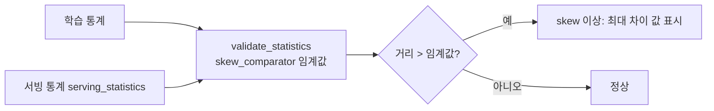
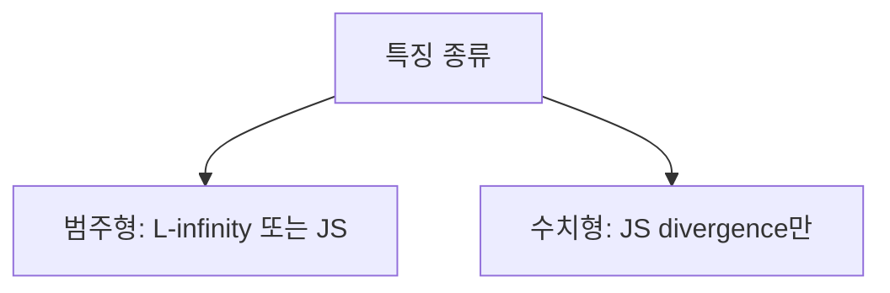

# TFDV skew 비교기

> TensorFlow Data Validation(TFDV)의 **skew 비교기(skew_comparator)**는 **학습 데이터와 서빙(실제 운영) 데이터의 분포 차이**를 스키마에 적어 둔 임계값으로 감지한다. 두 데이터가 달라 모델 성능이 떨어지는 "학습-서빙 skew"를 조기에 잡는 장치다.

## 쉽게 말하면
시험 공부를 모의고사(학습)로 했는데 실제 시험(서빙) 문제 유형이 다르면 점수가 떨어진다. skew 비교기는 "모의고사와 본시험의 유형 비율이 이만큼 이상 다르면 알려 줘"라고 경보 기준을 적어 두는 것이다.

## 자세히
(TensorFlow 공식 문서 「Get started with TensorFlow Data Validation」을 WebFetch로 직접 읽어 확인. 이번에 TFDV를 설치·실행하지는 않았다. 아래 수치 0.0435984는 문서의 예시 출력이다.)
- **사용법(문서)**: 스키마의 특징에 skew 비교기와 임계값을 설정하고, `validate_statistics`에 학습 통계와 `serving_statistics`를 같이 넘긴다.
  ```python
  tfdv.get_feature(schema, 'payment_type').skew_comparator.infinity_norm.threshold = 0.01
  skew_anomalies = tfdv.validate_statistics(
      statistics=train_stats, schema=schema, serving_statistics=serving_stats)
  ```
- **거리 척도(문서)**: **L-infinity norm**은 **범주형 특징에만** skew를 감지한다. 임계값을 `infinity_norm` 대신 **`jensen_shannon_divergence`**로 지정하면 **수치형·범주형 모두** 감지한다.
- **예시 출력(문서)**: 서빙 데이터에 `payment_type`이 `Cash`인 예시가 훨씬 많으면 이상 항목이 나온다: "High L-infinity distance between serving and training … distance is 0.0435984 … above the threshold 0.01. The feature value with maximum difference is: Cash". 즉 **최대 차이가 난 값**까지 알려 준다.
- **결과 타입(문서)**: `Anomalies` 프로토콜 버퍼.
- **해석(문서)**: 진짜 skew라면 **모델 성능에 직접 영향**을 줄 수 있어 추가 조사가 필요하다고 말한다.
- **환경과의 관계(문서)**: 학습에만 있는 라벨(예: `tips`)이 서빙에 없으면 이상으로 잡히므로 `TRAINING`/`SERVING` **환경**을 구분해 예외로 둔다. → [TFDV 스키마 환경](#tfdv-schema-environments)
- **한계(해석)**: 임계값 0.01은 문서의 예시이지 권장값이 아니다. 표본 크기와 비즈니스 영향에 맞춰 정해야 한다. → [드리프트 임계값 정하기](#drift-threshold-tuning)

## 그림으로 보기



## 예시
- 결제 수단 특징에서 학습 데이터엔 `Cash` 비율이 낮았는데 서빙에서 갑자기 높아지면 skew 경보.
- 교육 활동: 학습/서빙 두 표의 범주 비율을 손으로 계산해 L-infinity(비율 차이의 최댓값)를 구해 보기.

## 헷갈리는 것과 비교
| 개념 | 차이 |
|---|---|
| skew | 학습 vs 서빙 데이터 차이 |
| [TFDV drift 비교기](#tfdv-drift-comparator) | 날짜 간 학습 데이터 변화 |
| 스키마 이상 | 스키마(타입·도메인)와 맞지 않음 |
| [L-infinity·JS 발산](#l-infinity-js-divergence) | 두 비교기가 쓰는 거리 척도 |

## 더 읽을거리
- [Get started with TensorFlow Data Validation (TensorFlow 문서)](https://www.tensorflow.org/tfx/data_validation/get_started) — skew/drift 비교기, 임계값, 환경(직접 확인).
