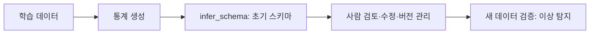
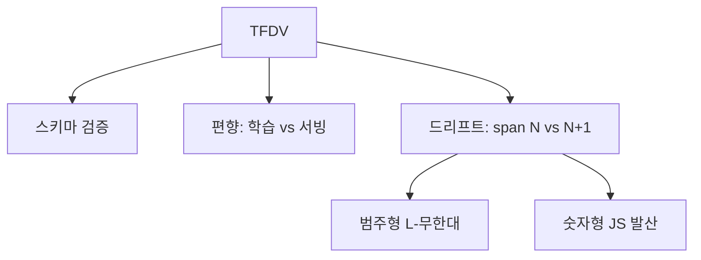

# TensorFlow Data Validation

> TFX 파이프라인의 데이터 분석·검증 컴포넌트(TFDV)다. 데이터 통계를 스키마와 비교해 이상을 찾고, 학습 데이터와 서빙 데이터의 분포 차이(편향)와 시간에 따른 변화(드리프트)를 탐지한다.

## 쉽게 말하면
입고 검수대에 "원래 이런 모양이어야 한다"는 규격서(스키마)를 걸어 두고, 새 데이터가 규격서와 다르면 알려 주는 장치다. 어제 데이터와 오늘 데이터의 분포가 얼마나 달라졌는지, 학습 때 본 데이터와 서비스 중 데이터가 얼마나 다른지도 숫자로 알려 준다.

## 자세히
(TensorFlow 공식 TFDV 가이드를 직접 열어 확인. 이번에 TFDV를 설치·실행해 보지는 못했다.)
- **세 가지 기능**: ① 스키마 기반 검증(통계를 스키마와 비교) ② 학습-서빙 편향 탐지 ③ 데이터 드리프트 탐지.
- **스키마 검증**: 자료형·범주 값 같은 기대 속성을 스키마에 담고, 입력 데이터의 통계가 이를 만족하는지 본다. TFX 파이프라인 안에서 ExampleGen이 만든 각 분할, Transform 전 데이터, Transform 후 데이터에 대해 여러 번 호출된다.
- **스키마 자동 생성**: `tfdv.infer_schema(statistics=train_stats)`로 학습 데이터 통계에서 초기 스키마를 만들고 `tfdv.display_schema(schema=schema)`로 본다. 문서는 자동 생성 스키마가 "최선 노력" 수준으로 기본 속성만 추론하므로 **사람이 검토·수정하고 버전 관리에 넣어** 파이프라인에 명시적으로 밀어 넣으라고 안내한다.
- **스키마 환경(environments)**: 학습에는 필요하지만 서빙에는 없는 `LABEL` 같은 특징을 표현하려고 `TRAINING`·`SERVING` 환경을 정의해 라벨을 학습 환경에만 연결한다.
- **학습-서빙 편향**: 학습 데이터와 서빙 데이터의 특징 값 분포가 크게 다른 경우. 원인 예: 초기 데이터가 부족해 완전히 다른 코퍼스로 학습 데이터를 만들었거나, 서빙 데이터를 편향되게 샘플링해 학습. 과소 대표 슬라이스를 보완하려고 편향 샘플링을 쓰고 가중치를 되돌리지 않으면 분포가 인위적으로 틀어진다.
- **드리프트 탐지**: 연속된 구간(span N과 N+1, 예: 날짜별 학습 데이터) 사이를 비교하며 **범주형은 L-무한대 거리, 숫자형은 근사 젠슨-섀넌 발산**으로 표현한다. 임계 거리를 넘으면 경고하며 적절한 값은 도메인 지식과 반복 실험으로 정한다고 한다.
- **찾는 흔한 문제(문서 목록)**: 결측 특징, 라벨이 특징으로 섞여 모델이 정답을 미리 보는 경우, 기대 범위 밖 값, 이상 데이터, 전이학습 모델 전처리와 학습 데이터 불일치. 시각화(Facets)로 한 값이 지배하는 특징, 행 번호·날짜 문자열처럼 고유값이 균일하게 퍼진 특징 등 데이터 버그를 발견한다.
- **한계**: TFX 파이프라인을 쓰지 않으면 도입 장벽이 있다(일반적 지적). 비TF 환경에서는 [Great Expectations](#great-expectations) 같은 대안이 쓰인다.

## 그림으로 보기



## 예시
문서의 스키마 자동 생성 예:
```python
schema = tfdv.infer_schema(statistics=train_stats)
tfdv.display_schema(schema=schema)
```
교육 소재: 어제와 오늘 거래 로그의 분포를 비교해 임계 거리를 넘으면 모델 재학습을 검토하는 흐름을 그림으로 설명.

## 헷갈리는 것과 비교
| 개념 | 차이 |
|---|---|
| 스키마 검증 | 자료형·값 범위 등 정적 규칙 |
| 학습-서빙 편향 | 학습과 서빙 시점 분포의 차이 |
| 드리프트 | 시간에 따른 분포 변화 |
| [Great Expectations](#great-expectations) | 범용 규칙 기반 검증, TFX 비의존 |

## 더 읽을거리
- [TensorFlow: TFDV 가이드](https://www.tensorflow.org/tfx/guide/tfdv) — 스키마·편향·드리프트·시각화(직접 열어 확인).
