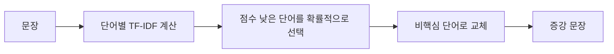
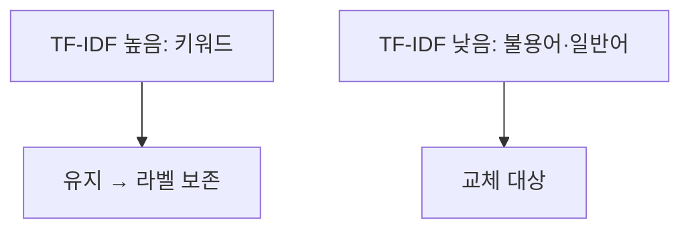

# TF-IDF 단어 치환

> 문장에서 **정보량이 낮은 단어(TF-IDF 점수가 낮은 단어)를 골라 다른 비핵심 단어로 바꾸는** 텍스트 증강이다. 핵심 키워드는 남겨 라벨이 바뀌지 않게 한다. UDA 논문이 주제 분류(DBPedia)용으로 제안했다.

## 쉽게 말하면
뉴스 기사의 제목을 "축구 결승전에서 한국이 승리했다"라고 하자. "에서", "했다" 같은 말은 바꿔도 주제(스포츠)가 유지되지만 "축구", "결승전"을 바꾸면 주제가 흔들린다. 그래서 흔한 말만 골라 다른 흔한 말로 바꾼다.

## 자세히
- 문제의식(UDA, Xie et al. 2019, arXiv 1904.12848): 역번역(back-translation)은 문장 전체 의미는 지키지만 어떤 단어가 남는지는 통제할 수 없다. 주제 분류에서는 일부 키워드가 결정적이므로 키워드는 유지해야 한다.
- 점수: 단어 w의 TFIDF(w) = TF(w)·IDF(w). 문장 최대 점수를 C라 할 때 **교체 확률 = min(p·(C − TFIDF(w))/Z, 1)**, Z는 (C − TFIDF)의 문장 평균. 점수가 낮을수록 교체될 확률이 높다. p는 증강 강도로, DBPedia 실험에서 0.7.
- 대체 단어 뽑기: 어휘 전체에서 샘플하되, 키워드가 뽑히지 않도록 S(w)=freq(w)·IDF(w)를 계산해 **S가 낮은 단어일수록 뽑힐 확률이 높게** 한다(확률 ∝ max S − S(w)).
- 토큰화: BERT의 단어 토크나이저로 단어를 먼저 나눈다(서브워드 입력은 그 뒤).
- 한계: 이 기법은 논문에서 주제 분류에 맞춘 것이다. 감성 분류처럼 "좋다/나쁘다"가 핵심인 과제에서는 TF-IDF가 낮은 단어에도 의미가 담길 수 있어 효과가 다를 수 있다(추정).

## 그림으로 보기

## 예시
- DBPedia 주제 분류에서 "…is a village in 폴란드" 문장의 전치사·일반 동사는 바꾸고 지명·직업어는 유지.
- 교육: "증강은 라벨을 바꾸지 않는 선에서만 변형한다"는 원칙을 보여 주는 사례([클래스 보존 증강](#augmentation-class-preserving) 참고).

## 헷갈리는 것과 비교
| 개념 | 차이 |
|---|---|
| TF-IDF 단어 치환 | 낮은 점수 단어를 비핵심 단어로 교체 |
| 역번역 | 다른 언어로 번역 후 되돌려 문장 전체를 재구성 |
| [신뢰도 마스킹](#confidence-masking) | 증강이 아니라 손실 계산에서 예제를 거르는 방법 |

## 더 읽을거리
- [Unsupervised Data Augmentation (arXiv 1904.12848)](https://arxiv.org/abs/1904.12848) — 2.3절·부록 A.2를 PDF 텍스트로 읽음.
