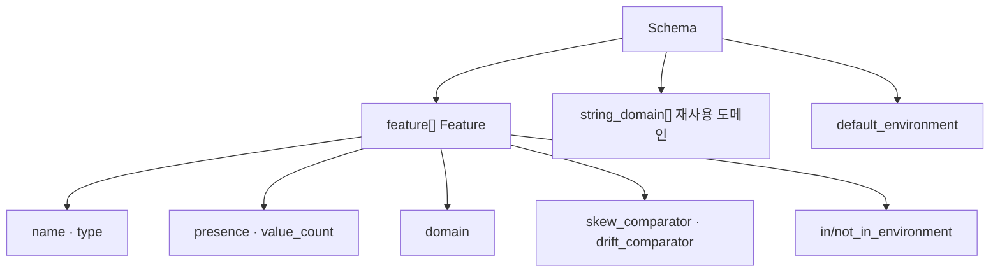
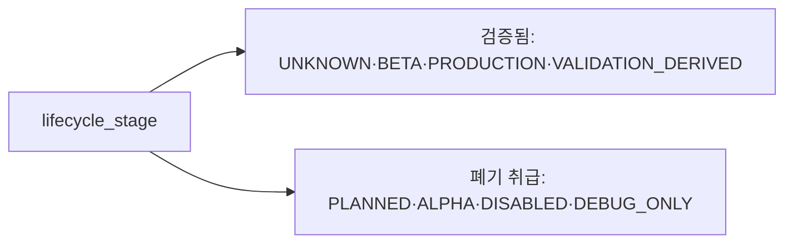

# Schema 프로토콜 버퍼

> TFDV(TensorFlow Data Validation)가 데이터의 "정상 상태"를 적어 두는 **`schema.proto`** 의 `Schema`와 `Feature` 메시지 구조다. 특징마다 타입·존재 비율·값 개수·도메인·비교기·환경을 선언해 검증 규칙을 만든다.

## 쉽게 말하면
스키마는 데이터의 "입학 요건표"다. 어떤 열이 있어야 하고(이름), 어떤 종류의 값이며(타입), 얼마나 자주 있어야 하고(존재 비율), 어떤 값만 허용되는지(도메인)를 한 장에 적어 둔다. 검증은 이 표와 실제 데이터를 맞춰 보는 일이다.

## 자세히
(TensorFlow Metadata의 `schema.proto` 원문과 코멘트를 직접 읽었다. 필드 번호는 해당 시점 파일 기준이며 바뀔 수 있다.)
- **`Schema` 메시지**
  - `feature`(필드 1): `Feature` 목록.
  - `string_domain`(4): 특징들이 이름으로 참조할 수 있는 **재사용 가능한 최상위 문자열 도메인**.
  - `default_environment`(5): 특징이 기본적으로 존재하는 환경(예: 학습·서빙).
  - `sparse_feature`·`weighted_feature`는 복합 특징을 기술한다. `int_domain`·`float_domain`은 목록에 있으나 코멘트에 최상위 수치 도메인은 TFDV에서 지원되지 않는다고 적혀 있다.
- **`Feature` 메시지의 주요 필드**
  - `name`(1): 특징 이름, 필수.
  - `type`(6): `BYTES`·`INT`·`FLOAT`·`STRUCT`·`TYPE_UNKNOWN` — 값의 **물리 표현**.
  - **존재 규칙** `presence`(14, oneof): `min_fraction`(특징을 포함해야 하는 예제의 최소 비율), `min_count`(최소 예제 수). 그룹 맥락에서는 `group_presence`(17)를 쓴다.
  - **모양(oneof)**: `shape`(23, 고정 다차원 모양), `value_count`(5, 예제당 값 개수의 min·max), `value_counts`(32, 중첩 단계별 값 개수).
  - **도메인(oneof `domain_info`)**: `domain`(7, 스키마 최상위 문자열 도메인 참조) 또는 `int_domain`·`float_domain`·`string_domain`·`bool_domain`·`struct_domain` 인라인 정의, 그리고 자연어·이미지·오디오·비디오·URL·시간 같은 **의미 도메인**.
  - **비교기**: `skew_comparator`(18, 서빙 데이터와의 분포 비교), `drift_comparator`(21, 연속 스팬(예: 날짜) 사이 비교). 둘 다 `FeatureComparator`를 쓰며 **무한 노름(L∞), Jensen–Shannon 발산, 정규화 절대 차이** 임계값을 걸 수 있다.
  - **환경**: `in_environment`(20), `not_in_environment`(19)는 서로소여야 하며, 특징은 `in_environment` 또는 `default_environment`에 환경이 있고 `not_in_environment`에 없을 때 그 환경에 속한다.
  - **수명주기**: `deprecated`(2)는 `lifecycle_stage`(22)로 대체됐다. `lifecycle_stage`는 하위 특징에도 적용되며 **UNKNOWN_STAGE·BETA·PRODUCTION·VALIDATION_DERIVED**만 검증되고 PLANNED·ALPHA·DISABLED·DEBUG_ONLY는 폐기로 취급된다.
- **앞선 글과의 연결**: 이 구조는 [라벨 열 처리](#label-column-handling)의 `not_in_environment`, [L∞ 거리](#l-infinity-norm-categorical)·[JS 발산](#jensen-shannon-divergence)의 임계값 설정이 놓이는 자리이고, [새 열 이상](#schema-new-column-anomaly)은 이 스키마에 열이 없을 때 발생한다.
- **한계**: 위는 구조 설명이며 각 필드의 실제 사용 예·기본값은 TFDV 가이드와 코드에서 확인해야 한다.

## 그림으로 보기



## 예시
```python
tfdv.get_feature(schema, 'payment_type').presence.min_fraction = 0.5
tfdv.get_feature(schema, 'payment_type').skew_comparator.infinity_norm.threshold = 0.01
```
(앞서 읽은 TFDV 가이드의 설정 예)
- 교육 소재: 스키마 한 장에 특징 3개의 규칙을 직접 적어 보기.

## 헷갈리는 것과 비교
| 항목 | 의미 |
|---|---|
| presence | 예제 중 특징이 존재해야 하는 최소 비율·개수 |
| value_count | 한 예제 안의 값 개수 범위 |
| domain | 허용되는 값의 집합·범위 |
| skew vs drift comparator | 서빙과 비교 vs 연속 스팬과 비교 |

## 더 읽을거리
- [schema.proto (TensorFlow Metadata)](https://raw.githubusercontent.com/tensorflow/metadata/master/tensorflow_metadata/proto/v0/schema.proto) — Schema·Feature 필드와 코멘트(직접 읽음).
