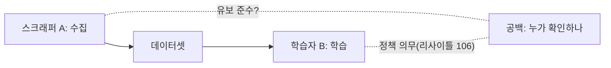
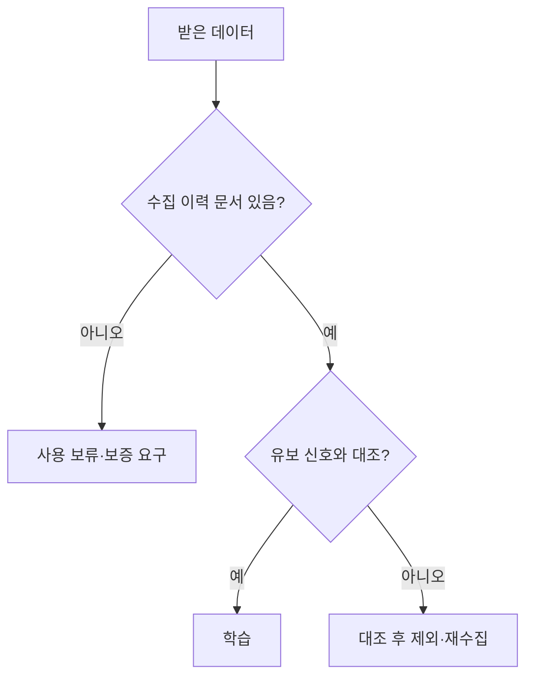

# 제3자 스크래핑 공백

> 데이터를 **수집한 쪽(스크래퍼)과 학습하는 쪽(모델 개발자)이 다를 때**, 수집 단계의 권리 유보(옵트아웃) 준수와 합법적 접근 여부를 누가 책임지는지 불분명해지는 빈틈이다. 학습하는 쪽이 "나는 받아서 쓰기만 했다"고 말하기 어려워지는 방향으로 규제가 움직이고 있지만 세부 범위는 확정되지 않았다.

## 쉽게 말하면
식당이 납품업체에서 재료를 받아 요리한다고 하자. 납품업체가 불법으로 재료를 구해 왔다면, 식당이 "몰랐다"고 하면 끝일까? 요리하는 쪽도 재료 출처를 확인할 의무가 있는지의 문제다.

## 자세히
(EU DSM 지침 2019/790의 제3·4조 본문과 리사이틀, EU AI Act 리사이틀 106을 직접 열어 확인. 법률 자문이 아니며 EU 법만 다룬다.)
- **TDM 예외의 조건(지침 제4조)**: 제4(1)조는 **"적법하게 접근할 수 있는(lawfully accessible)" 저작물**의 복제·추출을 TDM 목적으로 허용한다. 제4(3)조는 권리자가 **적절한 방식으로 이용을 명시적으로 유보하지 않았을 때만** 이 예외가 적용된다고 하며, 온라인 공개 콘텐츠에는 **기계가 읽을 수 있는 수단**을 예로 든다. 제4(2)조는 복제본을 TDM에 필요한 기간만 보관할 수 있게 한다. 리사이틀 18은 온라인 공개 콘텐츠의 적절한 유보 방식을 기계 판독 수단으로 한정해 적고, 리사이틀 14는 적법한 접근을 공개 접근 정책이나 구독 계약, 온라인에서 자유롭게 열람 가능한 콘텐츠로 설명한다.
- **연결(AI Act 리사이틀 106)**: 범용 AI 모델 제공자는 **EU 저작권법을 준수하는 정책**을 두어야 하고, 그 정책은 지침 제4(3)조에 따른 **권리 유보를 식별하고 존중**해야 한다. 이 의무는 학습의 저작권 관련 행위가 **어느 관할에서 이루어졌는지와 무관하게** 적용된다고 리사이틀이 적으며, EU 기준보다 낮은 기준을 써서 시장 이점을 얻지 못하게 하려는 목적을 밝힌다. 리사이틀은 해석 지침이며 조문 자체가 아니므로 세부 의무는 53조 본문과 이행 지침을 봐야 한다(이번에 53조 본문은 열지 않았다).
- **공백의 구조(제안, 위 문서에서 직접 도출되지 않은 해석)**
  | 단계 | 행위자 | 쟁점 |
  |---|---|---|
  | 수집 | 스크래퍼 A | A가 옵트아웃을 무시하고 수집했는가 |
  | 전달 | A → 학습자 B | B가 받은 데이터의 수집 이력을 알 수 있는가 |
  | 학습 | B | B의 복제·추출이 예외로 적법한가(적법 접근·유보 여부) |
  | 정책 | B(범용 AI 제공자) | 리사이틀 106의 "권리 유보 존중 정책"이 외부에서 받은 데이터에도 미치는가 |
  B의 학습 행위에도 제4조의 조건(적법 접근, 유보 없음)이 독립적으로 문제 될 수 있다는 점은 조문 구조로 보이지만, A의 위법 수집이 B의 면책을 어떻게 막는지는 확인하지 못했다. 이 부분은 해석이 정리되지 않은 영역으로 남는다.
- **수령자 점검표(제안)**: ① 데이터셋의 **수집 기간·크롤러·사용자 에이전트** 기록 요구 ② 수집 당시 robots.txt·약관·기계 판독 유보 신호를 **어떻게 처리했는지** 문서 요구 ③ 유보 신호가 이후에 생긴 도메인의 처리(재수집·제외) ④ 계약에 보증·면책과 감사 조항 ⑤ 자체 정책으로 학습 전 도메인 목록을 최신 유보 신호와 대조 ⑥ 출처 기록을 [학습 데이터 목록](#training-data-manifest)에 남김.
- **한계**: 이 글은 EU 조문 구조를 읽은 것이다. 미국 공정 이용 등 다른 법역의 판단과 다르다. 책임 분배는 계약과 사실관계에 달려 있다.

## 그림으로 보기

## 예시
- 대학이 만든 웹 말뭉치를 기업이 받아 상용 모델 학습에 쓰려는 경우: 말뭉치 수집 시점과 당시 유보 처리 방식을 확인하고, 최신 유보 신호로 도메인을 걸러 낸 뒤 학습.
- 교육 소재: "데이터를 사 오면 책임도 사 오나?"를 공급망 비유로 설명(AI 거버넌스 교육).

## 헷갈리는 것과 비교
| 개념 | 차이 |
|---|---|
| 제3자 스크래핑 공백 | 수집자≠학습자일 때 책임의 빈틈 |
| [텍스트·데이터 마이닝 예외](#text-data-mining-exception) | 예외의 조건과 옵트아웃 |
| [학습 장소와 관할](#territorial-training-location) | 어디서 학습했느냐의 문제 |
| [도메인별 허용 의사 기록](#domain-consent-registry) | 도메인별 허용 의사 장부 |

## 더 읽을거리
- [Directive (EU) 2019/790 (EUR-Lex)](https://eur-lex.europa.eu/legal-content/EN/TXT/HTML/?uri=CELEX:32019L0790) — 제3·4조 TDM 예외와 리사이틀(직접 확인).
- [EU AI Act Recital 106](https://artificialintelligenceact.eu/recital/106/) — 저작권 정책과 권리 유보 존중, 관할 무관(직접 확인).
