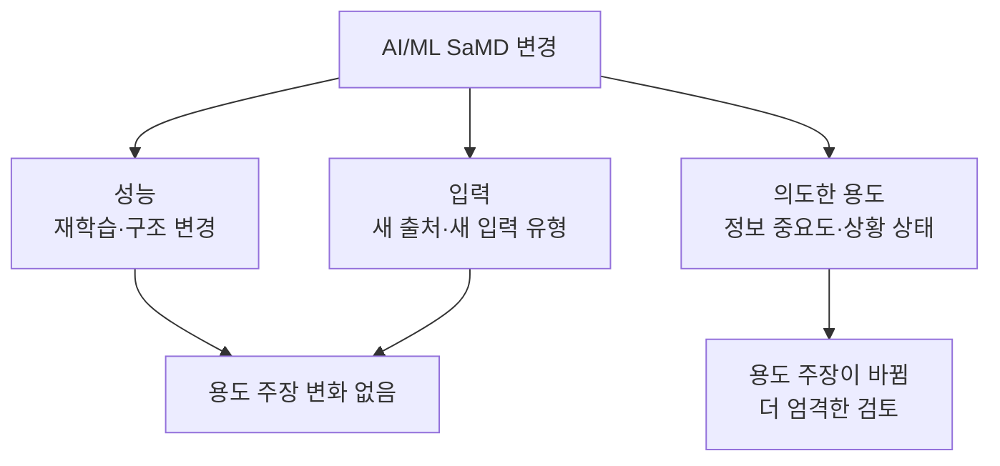

# 변경의 세 유형

> FDA 2019 토론 문서가 AI/ML SaMD의 변경을 나눈 세 갈래: **성능**, **입력**, **의도한 용도**. 유형에 따라 사용자에게 미치는 영향이 다르고, 사전 명세(SPS)·변경 프로토콜(ACP)로 어디까지 관리할 수 있는지가 달라진다.

## 쉽게 말하면
앱 업데이트를 "더 빨라짐(성능)", "새 센서 지원(입력)", "원래 안 하던 일을 하게 됨(용도)"으로 나누는 것과 같다. 앞의 둘은 같은 일을 더 잘하는 쪽이고, 마지막은 일 자체가 바뀌는 쪽이라 규제가 더 엄격하다.

## 자세히
출처: FDA 2019 토론 문서 III절(PDF 전문을 내려받아 읽음). 제안 문서이며, 현행 PCCP 지침은 [변경 설명 작성](#pccp-description-of-modifications)의 변경 유형 구분을 쓴다.
- **세 범주**: ① 성능(임상·분석 성능), ② 알고리즘이 쓰는 입력과 SaMD 출력에 대한 그 임상 연관, ③ 의도한 용도(IMDRF 틀의 정보 중요도와 상황 상태로 기술). 유형은 상호 배타적이지 않아 한 변경이 입력과 성능을 같이 바꾸거나, 성능 변화가 용도에 영향을 줄 수 있다.
- **(i) 성능만 변경, 용도·새 입력 없음**: 같은 입력 신호의 새 데이터셋(의도한 사용 집단 안)으로 재학습, AI/ML 구조 변경 등. 제조사는 사용자에게 성능을 알리되 명시한 사용 주장은 바꾸지 않는다. 예: 디지털 유방촬영에서 의심 병변 검출 민감도 향상.
- **(ii) 입력 변경, 용도 변화 없음**: 같은 유형 입력의 다른 출처 호환(예: 다른 제조사 CT 스캐너), 다른 입력 유형 추가(예: 심방세동 진단 SaMD에 심박 외에 산소포화도 데이터 추가).
- **(iii) 의도한 용도 변경**: 정보의 중요도가 바뀜(예: 진단 보조 점수 "임상 관리 주도"에서 "확정 진단"으로), 또는 제조사가 명시하는 상황 상태 변화(예: 18세 이상 성인용에서 소아 포함, 한 암에서 다른 암의 병변 검출로 확대).
- **연결**: 문서는 이런 변경 대부분이 알고리즘 구조 수정과 새 데이터 재학습을 수반하며 기존 소프트웨어 변경 지침상 시판 전 검토 대상이 될 수 있다고 본다. 세 유형은 SPS의 "예상 변경" 분류에 쓰였다([SPS와 ACP](#sps-algorithm-change-protocol)).
- **현행 지침과의 차이**: 현행 AI PCCP 지침은 PCCP에 적합한 변경을 ① 정량 성능 사양, ② 입력과 호환성, ③ 사용·성능 관련 일부(특정 하위 집단)로 서술하며 의도한 용도 범위 안에 머물러야 한다고 한다. 두 문서의 분류가 같지 않다.

## 그림으로 보기

## 예시
- 성능: 재학습으로 민감도가 오르지만 "유방 병변 검출 보조"라는 주장은 그대로.
- 입력: 새 제조사 CT와 호환되도록 입력 사양을 확장.
- 용도: 성인용 알고리즘을 소아 환자까지 허용.

## 헷갈리는 것과 비교
| 개념 | 차이 |
|---|---|
| 성능 변경 | 같은 일을 더 잘함 |
| 입력 변경 | 같은 일을 다른 입력으로도 함 |
| 용도 변경 | 하는 일이나 대상이 바뀜 |
| [변경 설명 작성](#pccp-description-of-modifications) | 현행 PCCP의 변경 유형 구분 |
| [정보의 중요도 축](#significance-of-information) | 용도 변경 판단에 쓰이는 IMDRF 축 |

## 더 읽을거리
- [Proposed Regulatory Framework for Modifications to AI/ML-Based SaMD (FDA, 2019)](https://www.fda.gov/media/122535/download) — III절 변경 유형(내려받아 확인)
