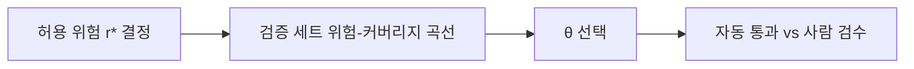
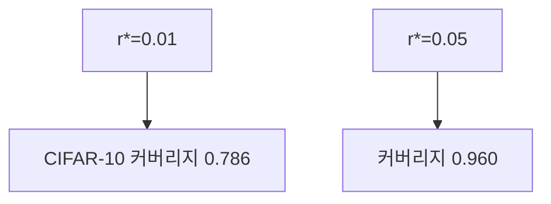

# 임계값 곡선으로 고르기

> 선택적 분류에서 "자동 통과 확신도 θ"는 위험-커버리지 곡선을 보고 정한다. 허용 오류율(r*)을 먼저 정하면 그에 맞는 커버리지가 정해진다.

## 쉽게 말하면
"틀려도 1%까지만 괜찮다"고 정하면 그 안에서 AI가 처리할 수 있는 비율이 나온다. 허용 오류를 낮출수록 사람에게 넘기는 비율이 늘어난다.

## 자세히
(Geifman & El-Yaniv arXiv 1705.08500의 표를 직접 읽고 확인. δ=0.001, softmax response 신뢰도.)
- **방법**: 목표 위험 r*와 신뢰 수준(δ)을 정하면 SGR 알고리즘이 검증 데이터로 임계값 θ를 골라 위험이 r*를 넘을 확률이 δ 미만임을 보장하면서 커버리지를 최대화한다.
- **CIFAR-10**: r*=0.01 → 커버리지 0.786(실제 테스트 위험 0.0092), r*=0.02 → 0.847, r*=0.05 → 0.960.
- **CIFAR-100**: r*=0.02 → 0.213, r*=0.05 → 0.445, r*=0.10 → 0.595, r*=0.25 → 0.883.
- **ImageNet top-1(VGG-16)**: r*=0.02 → 0.232, r*=0.10 → 0.595, r*=0.25 → 0.912. **top-5**: r*=0.02 → 0.535(위험 0.0179), r*=0.01 → 0.334.
- **읽는 법**: 같은 r*라도 데이터셋이 어려울수록 커버리지가 낮아진다. 곡선이 가파르게 오르는 구간에서는 θ를 조금 낮춰 커버리지를 크게 늘릴 수 있다.
- **업무 적용(제안)**: ① 오류 1건의 비용과 사람 검수 1건의 비용을 비교 ② 허용 위험 r* 결정 ③ 검증 세트에서 곡선 그리기 ④ 배포 후 분포가 바뀌면 θ 재점검. 모델이 과신하면 곡선이 낙관적이므로 보정 확인([과신](#overconfidence-routing-failure)).

## 그림으로 보기

## 예시
- 오류 비용이 크면 r*=0.01로 정해 78.6%만 자동 처리하고 나머지는 검수.
- 교육 활용: 슬라이더로 θ를 움직이며 자동 처리량과 오류가 어떻게 바뀌는지 체험.

## 헷갈리는 것과 비교
| 개념 | 차이 |
|---|---|
| 임계값 곡선 선택 | 운영 지점 결정 |
| [선택적 분류](#selective-classification) | 개념과 보장 |
| ROC 임계값 | 이진 분류 판정 임계값(목적이 다름) |

## 더 읽을거리
- [Selective Classification for Deep Neural Networks (arXiv 1705.08500)](https://arxiv.org/abs/1705.08500) — 표 1~4.
