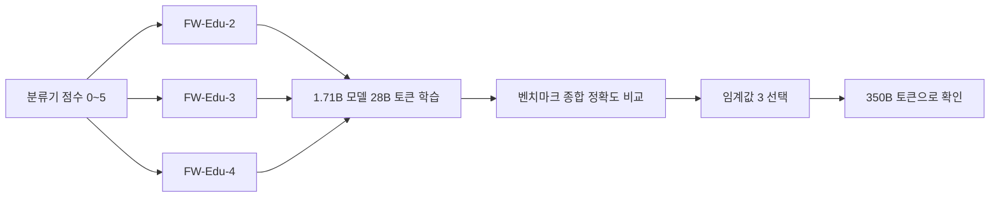
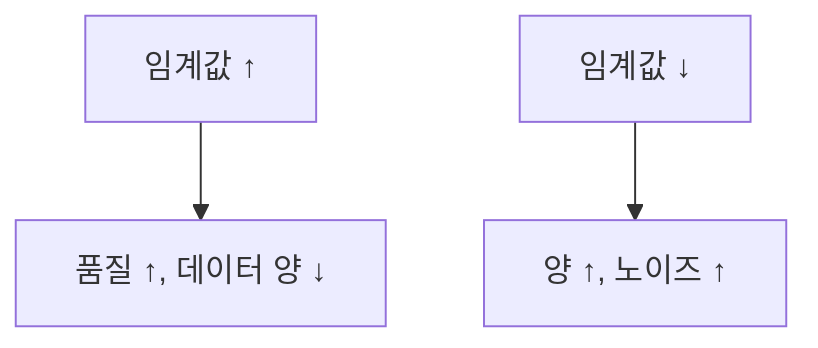

# 소형 모델 임계값 스윕

> 필터의 **임계값(몇 점 이상을 남길지)을 정할 때, 임계값마다 데이터를 만들어 작은 모델을 짧게 학습·비교해 가장 좋은 값을 고르는** 방법이다. 큰 모델을 학습하기 전에 싼 실험으로 결정한다.

## 쉽게 말하면
요리 소금 양을 정하려고 큰 솥 전체를 끓이지 않고, 작은 냄비 여러 개에 소금 양을 달리해 맛을 본 뒤 가장 맛있는 양을 큰 솥에 쓰는 것이다.

## 자세히
- 출처: FineWeb 논문(arXiv 2406.17557) FineWeb-Edu 절과 부록 F.2(읽음).
- 설정: 교육 점수 분류기의 정수 점수(0~5)를 `FW-Edu-i`(점수 **≥ i**인 문서만)로 나눠 데이터셋을 만들고, **1.71B 파라미터 모델을 280억(28B) 토큰으로 학습**해 여러 벤치마크의 **종합(aggregate) 정확도**를 비교했다(부록 Fig. 17). 결론: "임계값 3이 최고 평균 성능"이었고 FineWeb-Edu의 기준으로 채택됐다.
- 선택 이유(본문): 임계값 3이 **지식·추론 집약 벤치마크 성능과 HellaSwag 같은 다른 벤치마크 성능 사이에서 가장 좋은 절충**이었다. 임계값 3에서 분류기의 이진 F1은 82%였다.
- 검증(확장): 선택 뒤에는 **1.71B 모델을 350B 토큰**으로 더 크게 학습해 효과를 확인했다(Fig. 16: 다른 공개 웹 데이터셋과 9개 벤치마크 비교). 즉 **싼 스윕(28B 토큰)으로 후보를 좁히고 더 큰 실험(350B)으로 확인**하는 2단계 구조다.
- 비용 감각: 분류기를 FineWeb 15조 토큰에 적용하는 데 **H100 GPU 6,000시간**이 들었다고 논문이 쓴다. 이런 큰 비용 앞에서 28B 토큰 소형 학습은 "임계값을 틀리게 고르는 위험"을 줄이는 보험이다.
- 스윕 설계 요령(제안, 논문 방법을 일반화): ① 후보 임계값을 3~5개로 ② 모델 크기·토큰 수·시드를 **고정**해 임계값만 바꿈 ③ 성능 지표는 하나의 종합 점수와 개별 벤치마크 둘 다 기록 ④ 임계값이 올라가면 남는 데이터가 줄어 **토큰 수가 달라지는** 점을 같은 토큰 예산으로 맞출지(반복 학습) 정한다([데이터 양 대 품질](#data-quantity-vs-quality)) ⑤ 작은 모델 결과가 큰 모델에서도 유지되는지 한 번 확인.
- 한계: 소형 모델 결과가 대형 모델에서 그대로 재현된다는 보장은 없다. 논문의 최적 임계값 3은 해당 분류기·벤치마크 조합에서의 결과다. 이 문서에서는 그림의 구체 수치를 읽지 못해(그래프) 임계값별 점수 값은 적지 않았다.

## 그림으로 보기

## 예시
- 사내 문서 필터: 점수 ≥2/3/4 세 버전으로 작은 모델을 학습해 사내 업무 질의 정확도를 비교하고 임계값 선택.
- 교육: "임계값은 직감이 아니라 실험으로 정한다"는 데이터 큐레이션 원칙.

## 헷갈리는 것과 비교
| 개념 | 차이 |
|---|---|
| 임계값 스윕 | 값을 바꿔 가며 같은 조건으로 비교 |
| 하이퍼파라미터 탐색 | 학습 설정을 바꿔 비교(대상이 다름) |
| [희귀 클래스 재현율](#rare-class-recall) | 분류기 자체의 한계(임계값과 별개) |

## 더 읽을거리
- [FineWeb 논문 (arXiv 2406.17557)](https://arxiv.org/abs/2406.17557) — FineWeb-Edu 임계값 절·부록 F.2(읽음).
- [fineweb-edu-classifier 모델 카드](https://huggingface.co/HuggingFaceFW/fineweb-edu-classifier) — int_score ≥ 3 권장(읽음).
