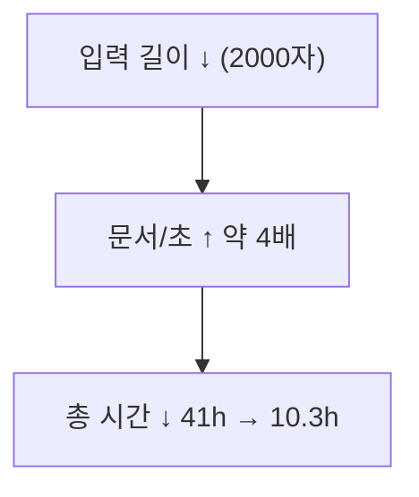

# 처리량 외삽

> 전체 데이터 처리 비용을 **작은 표본으로 처리 속도(문서/초)를 재어 전체 규모에 곱해 추정하는** 방법이다. 비용이 큰 작업을 시작하기 전에 시간·비용의 자릿수를 알려 준다.

## 쉽게 말하면
도로 1km를 달리는 시간을 재서 서울-부산 거리 시간을 어림잡는 것이다. 정확하지는 않아도 "하루면 되나, 일주일이 걸리나"는 알 수 있다.

## 자세히
- 직접 측정(2026-11-27, 이 환경의 단일 프로세스, CPU 사양 미확인; Common Crawl WET 샘플 앞 2MB의 문서 587개, 평균 6,925자): 언어 식별 도구 두 가지의 처리 속도.
  | 도구 | 입력 | 문서/초 | 백만 글자/초 |
  |---|---|---|---|
  | fastText `lid.176.ftz` | 전체 | **674** | 4.67 |
  | fastText | 앞 2,000자로 자름 | **2,692** | 4.06 |
  | py3langid | 전체 | 449 | 3.11 |
  | py3langid | 앞 2,000자로 자름 | 1,196 | 1.80 |
- 외삽 예(산수): 문서 **1억 건**이라면 fastText 전체 입력은 100,000,000 ÷ 674 ≈ 148,368초 ≈ **41시간**(단일 프로세스), 2,000자로 자르면 ÷ 2,692 ≈ 37,147초 ≈ **10.3시간**. py3langid는 각각 약 62시간·23시간. 병렬 처리 코어 수로 나누면 실제 시간이 줄지만 **외삽은 "단일 프로세스 기준 총 작업량"**을 보여 준다.
- 읽는 법: 입력을 **앞 2,000자로 자르면 문서/초는 약 4배(674→2,692)**가 되지만 초당 글자 수는 비슷하다(4.67 vs 4.06). 즉 비용은 **읽는 글자 수에 거의 비례**하며, 잘라서 읽으면 줄어든 만큼 빨라진다([입력 토큰 제한](#truncate-input-tokens)).
- 외삽의 주의점(제안):
  1. **표본 대표성**: 앞 2MB는 문서 길이·언어 분포가 전체와 다를 수 있다([파일 앞부분 샘플의 편향](#head-sample-bias)). 평균 길이가 달라지면 문서/초가 달라진다.
  2. **비선형 요소**: 입출력(I/O)·메모리·분산 처리의 오버헤드, 모델 로딩 시간(처음 한 번), 캐시 효과. 소량 측정에서는 안 보인다.
  3. **측정 방법**: 워밍업 후 여러 번 재고 중앙값을 쓰며, 하드웨어와 버전을 기록한다.
  4. 불확실성은 범위로 말한다(예: "30~60시간, 단일 코어 기준").
- 한계: 위 측정은 한 번의 실행이며 CPU 모델·스레드 수를 기록하지 않았다. GPU 추론(큰 모델)은 배치 크기·메모리에 따라 선형이 아니다.

## 그림으로 보기



## 예시
```python
t = time.time(); [m.predict(x) for x in docs]; rate = len(docs) / (time.time() - t)
hours = N_total / rate / 3600
```
- 교육: "계산을 시작하기 전에 자릿수를 추정한다" — 데이터 파이프라인 계획 실습.

## 헷갈리는 것과 비교
| 개념 | 차이 |
|---|---|
| 처리량(throughput) | 단위 시간당 처리량(문서/초) |
| 지연(latency) | 한 건의 응답 시간 |
| 외삽 | 표본 측정을 전체로 확대 추정 |
| [분류기 추론 비용](#classifier-inference-cost) | 이 추정의 상위 개념 |

## 더 읽을거리
- [FineWeb 논문 (arXiv 2406.17557)](https://arxiv.org/abs/2406.17557) — 분류기를 15조 토큰에 적용하는 데 6,000 H100 GPU시간이 들었다는 서술(읽음).
- 직접 실행: fastText·py3langid 처리 속도 측정과 산수.
