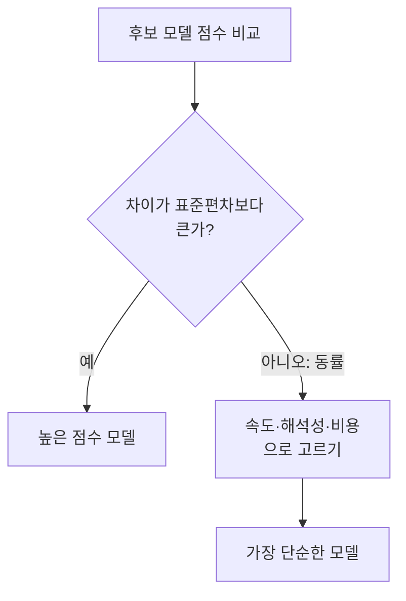
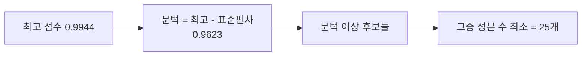

# 동률일 때 고르는 기준

> 두 모델의 교차검증 점수 차이가 점수의 흔들림(표준편차)보다 작으면 사실상 동률이다. 이때는 점수 대신 속도·해석 가능성·운영 비용·복잡도 같은 기준으로 고르며, 대표적 규칙이 "최고 점수에서 1 표준편차 안에 드는 가장 단순한 모델"이다.

## 쉽게 말하면
마라톤 완주 기록이 3시간 10분과 3시간 12분인 두 신발이 있다. 측정 오차가 5분이면 둘은 같은 신발이다. 그러면 가볍고 싸고 오래 가는 쪽을 고르면 된다. 점수의 소수점 차이로 고르는 것이 더 이상한 일이다.

## 자세히
- **1 표준오차 규칙(scikit-learn 예제, 열람)**: 가장 높은 평균 점수에서 그 폴드 표준편차를 뺀 값을 문턱으로 삼고, 문턱 이상인 후보 중 가장 단순한 것(예: 주성분 수가 가장 적은 것)을 고른다. 이 규칙은 The Elements of Statistical Learning에 나오며, `GridSearchCV(refit=함수)`로 구현한다. 예제는 숫자 데이터에서 최고 정확도 0.9944, 문턱 0.9623, 선택된 모델 25개 성분(정확도 0.9643)이었다. 문서의 설명 문장이 출력과 일치하지 않아 코드 출력을 기준으로 했다.
- **직접 해 본 실험(유방암 데이터 569개, 10겹)**:

| 모델 | 정확도(평균, 표준편차) | 학습 시간 |
| --- | --- | --- |
| 표준화+로지스틱 회귀 | 0.9789, 0.0216 | 0.004초 |
| 랜덤 포레스트 200그루 | 0.9579, 0.0362 | 0.222초 |
| 그래디언트 부스팅 | 0.9684, 0.0272 | 0.244초 |

  세 모델 정확도 차(최대 0.021)가 폴드 표준편차(0.02~0.04)와 비슷해 통계적으로 구분이 어렵다고 보는 것이 안전하다. 그렇다면 학습이 약 55배 빠르고 계수를 바로 해석할 수 있는 로지스틱 회귀를 고르는 것이 합리적이다. 이 데이터에서만의 결과다.
- **동률일 때의 기준 목록(해석)**: ① 학습·추론 속도와 비용 ② 해석 가능성(규제·설명 의무) ③ 모델 크기와 배포 난이도 ④ 데이터 변동에 대한 안정성 ⑤ 유지보수 인력이 아는 방식. 점수가 확실히 높을 때만 비싼 모델을 쓴다.
- **주의**: 폴드 표준편차는 신뢰구간이 아니다([점수 비독립성](#score-non-independence)). 이 규칙은 "구분 못 하면 단순한 것"이라는 휴리스틱이지 통계 검정이 아니다. 판정이 중요하면 [보정 검정](#model-comparison-cv)을 쓴다.

## 그림으로 보기

## 예시
- 코드: `refit=best_low_complexity`(문턱 이상 중 파라미터 값이 가장 작은 인덱스를 돌려주는 함수)를 `GridSearchCV`에 넘긴다.
- 실무: 고객 분류 모델 세 개의 정확도가 모두 0.95±0.03이면, 추론이 가장 빠르고 설명이 가능한 모델을 운영에 올린다. 교육 활용: "점수가 제일 높은 모델이 정답은 아니다"를 표 한 장으로 토론한다.

## 헷갈리는 것과 비교
| 개념 | 차이 |
| --- | --- |
| 최고 점수 선택 | 소수점 차이에 흔들림 |
| 1 표준오차 규칙 | 구분 안 되면 단순한 모델 |
| [짝지은 점수 비교](#paired-score-comparison) | 차이가 진짜인지 따지는 분석 |
| [교차검증으로 모델 비교](#model-comparison-cv) | 보정 검정 |

## 더 읽을거리
- [scikit-learn: Balance model complexity and cross-validated score](https://scikit-learn.org/stable/auto_examples/model_selection/plot_grid_search_refit_callable.html) — 1 표준오차 규칙 구현
