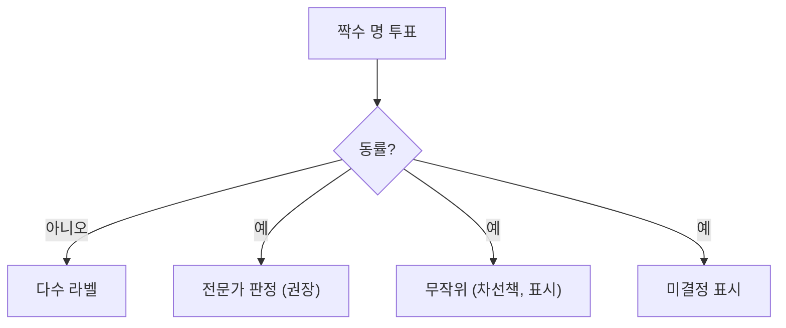
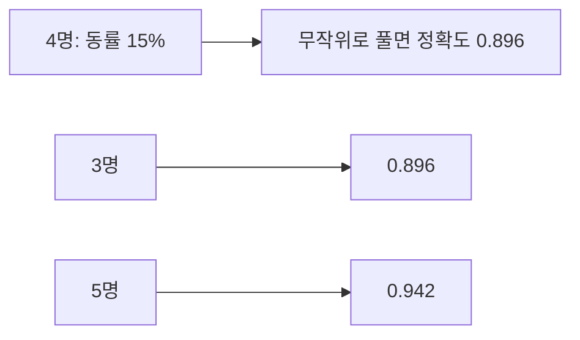

# 다수결 동률 처리

> 다수결 동률은 짝수 명이 판정해 정확히 같은 표가 나왔을 때 생긴다. 처리 방법에는 홀수 인원 설계, 추가 판정자·전문가 투입, 무작위 선택, "미결정" 표시 등이 있고 방법에 따라 정확도와 비용이 달라진다.

## 쉽게 말하면
위원 4명이 2대2로 갈렸을 때 위원장이 한 표를 더 던지거나, 제비뽑기로 정하거나, 아예 "결정 보류"로 두는 것과 같다. 처음부터 위원을 홀수로 구성하면 이런 상황이 없다.

## 자세히
- **방법들(검색 결과 요약, 일부 논문만 확인)**: ① 홀수 인원으로 설계해 동률 제거 ② 추가 주석자(3번째·5번째)를 투입해 확장된 집단의 다수결 ③ 지정된 판정자가 지침에 따라 해결 ④ "undecided" 같은 미결정 표시 ⑤ 무작위 선택 ⑥ 신뢰도·편향 가중. 어느 하나가 표준은 아니라고 한다. LLM 앙상블에서는 동률이 풀릴 때까지 에이전트를 추가로 부르는 "tie breaker" 라운드가 제안된다고 한다.
- **직접 열어 읽은 근거(Endriss & Fernández, BNAIC 2013)**: Snow 외의 텍스트 함의 인식 데이터(800쌍, 항목당 비전문가 10명 주석, 전문가 정답 있음)에서 단순 다수결(동률은 무작위)이 정답과 89.7% 일치했다. 편향을 보정하는 다수결 규칙은 91.5%, 탐욕 합의 규칙은 관대한 허용치 t=15에서 92.5%였다. 이 논문은 이 방법들이 더 연구할 가치가 있다는 수준의 결과로만 제시한다.
- **짝수 인원의 동률 확률(직접 계산, 작업자 정확도 0.8, 독립, 이진)**: 4명이면 2대2 동률 확률이 0.1536이다. 동률을 무작위로 정하면 정확도는 0.896(3명 다수결 0.896과 거의 같음)이고 5명 다수결은 0.942다. 즉 4명을 쓰는 것은 3명과 큰 차이가 없어 비용만 늘린다.
- **자기 신뢰도로 동률 깨기(검색 요약)**: GPT-4 감정 평가 연구는 모델이 자체 보고한 신뢰도가 동률을 깨는 데 유용하지 않았고 무작위가 더 나은 경우가 많았다고 한다(본문 미정독).
- **권고(해석)**: 가능하면 홀수 인원, 동률이 나면 전문가 판정으로 올리고 사유를 기록([판정 사유 기록](#adjudication-rationale-log)). 무작위는 비용이 부족할 때의 차선책이며 그 항목에 "동률로 무작위 결정" 표시를 남겨 평가셋에서는 제외하거나 가중치를 낮춘다.

## 그림으로 보기

## 예시
- 4명이 2대2: 전문가가 판정하고 사유를 "반어법 해석"으로 기록해 지침에 추가한다.
- 교육 활용: n=3, 4, 5에서 동률 확률과 다수결 정확도를 직접 계산해 표를 채운다.

## 헷갈리는 것과 비교
| 개념 | 차이 |
| --- | --- |
| 동률 처리 | 같은 표수일 때의 규칙 |
| [과반 판정 임계값](#majority-vote-threshold) | 몇 명이 같아야 확정할지 |
| [Condorcet 배심 정리](#condorcet-jury-theorem) | 인원이 늘 때 다수결 정확도 |
| [판정 사유 기록](#adjudication-rationale-log) | 동률 해결 사유 보존 |

## 더 읽을거리
- [Collective Annotation of Linguistic Resources (Endriss & Fernández, BNAIC 2013)](https://staff.fnwi.uva.nl/u.endriss/pubs/files/EndrissFernandezBNAIC2013.pdf) — 다수결 89.7%, 편향 보정 91.5%
