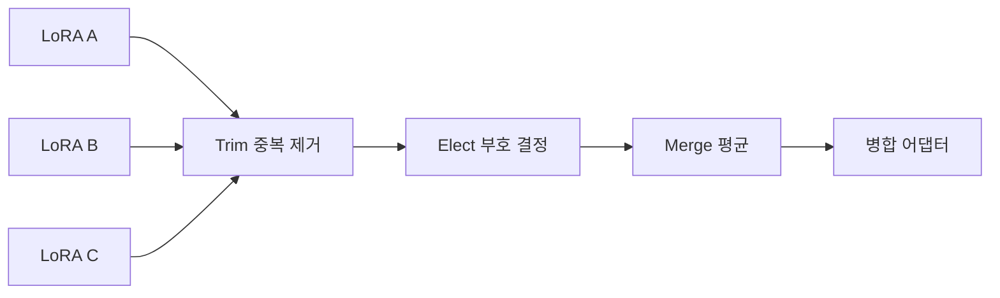
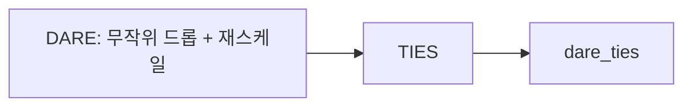

# TIES·DARE 병합

> TIES와 DARE는 여러 LoRA 어댑터를 합칠 때 서로 충돌하는 중복 파라미터를 줄여 성능 저하를 막는 병합 방법이다.

## 쉽게 말하면
여러 사람의 수정 의견을 한 문서에 합칠 때, 사소한 의견은 버리고(trim), 정반대 의견은 다수결로 방향을 정하고(elect), 같은 방향의 것만 평균(merge)하는 것과 같다. DARE는 의견을 무작위로 일부 지우고 나머지를 키워 중복을 줄이는 전처리다.

## 자세히
HF PEFT 모델 병합 가이드(PEFT v0.21.0) 기준:
- **TIES**(TrIm, Elect, and Merge): ① 중복 파라미터 제거 ② 부호가 충돌하면 합산 벡터의 부호로 결정 ③ 그 부호와 같은 값만 평균.
- **DARE**(Drop And REscale): 드롭률대로 파라미터를 무작위로 버리고 남은 것을 재스케일. TIES 같은 병합의 준비 단계로 쓴다.
- 사용: `model.add_weighted_adapter(adapters, weights, adapter_name, combination_type="ties"|"dare_ties", density=0.2)`. `density`는 각 모델에서 남길 가중치 비율.
- 가중치는 1.0 초과가 스케일 보존에 유리한 경우가 많고, 시작은 모두 1.0을 권장.
- 같은 베이스 모델로 학습한 LoRA끼리만 합치는 것이 안전하다. 전체 파인튜닝 모델을 합칠 땐 특수 토큰이 같은 임베딩 위치를 쓰는 문제를 조심.
- (IA)³는 `combination_type` 없이 선형 병합만 지원.
- 합치면 추가 학습 없이 여러 능력을 한 모델에 담는다.

## 그림으로 보기



## 예시
```python
model.add_weighted_adapter(["norobots","adcopy","sql"], [2.0,1.0,1.0], "merge",
                           combination_type="ties", density=0.2)
model.set_adapter("merge")
```

## 헷갈리는 것과 비교
| 방법 | 특징 |
|---|---|
| linear | 단순 가중 평균 |
| TIES | 부호 충돌 해결 |
| DARE | 무작위 드롭+재스케일 |
| [merge_and_unload](#merge-and-unload) | 어댑터를 베이스에 영구 합침(다른 개념) |

## 더 읽을거리
- [HF PEFT Model merging](https://huggingface.co/docs/peft/developer_guides/model_merging) — 코드와 설명.
- [TIES 논문](https://hf.co/papers/2306.01708), [DARE 논문](https://hf.co/papers/2311.03099)
