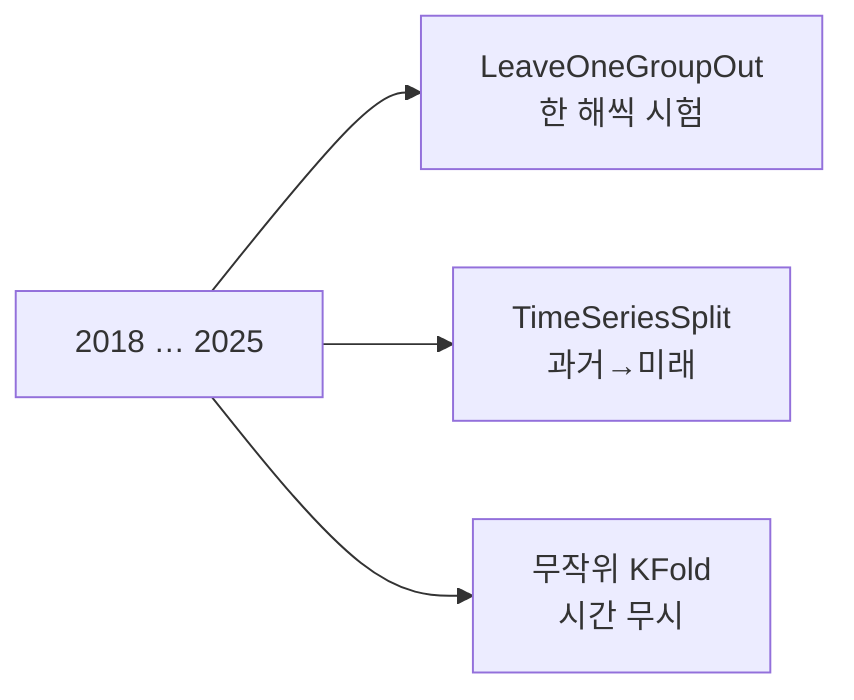
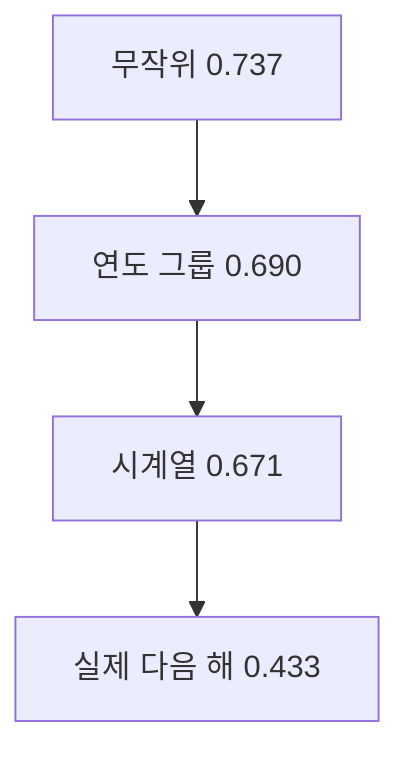

# 시간을 그룹으로 쓰기

> 데이터가 연도·월 같은 시간 구간으로 묶여 있으면 구간 하나를 통째로 시험 세트로 빼는 그룹 교차검증을 쓸 수 있다. 무작위 분할보다 "미래에 얼마나 맞힐지"를 더 현실적으로 보여 주지만, 시간이 흐르며 규칙이 바뀌면 그래도 낙관적이다.

## 쉽게 말하면
작년 문제와 올해 문제를 섞어 놓고 일부를 가리면, 같은 출제 경향이 학습 때도 들어 있어 쉽게 맞힌다. 진짜 시험은 내년 문제이므로, 한 해 전체를 가리고 풀어 보는 편이 실전에 가깝다. 다만 출제 경향이 내년에 확 바뀌면 그것마저 쉬운 연습이 된다.

## 자세히
- **분할기(scikit-learn 문서, 열람)**: 연도를 `groups`로 넘겨 `LeaveOneGroupOut`(연도 하나씩 시험)이나 `GroupKFold`를 쓸 수 있다. 시간 순서가 있는 데이터는 `TimeSeriesSplit`을 권하는데, 문서는 일반 분할이 학습·시험 사이에 비합리적인 상관을 만든다고 설명한다. `TimeSeriesSplit`은 항상 과거로 학습해 미래로 시험한다.
- **직접 해 본 실험(합성 데이터, 연도별 250개×8년(2018~2025), 규칙이 해마다 22.5도씩 회전하는 개념 이동, 로지스틱 회귀)**: 무작위 5겹 정확도 0.737, 연도 하나씩 빼는 `LeaveOneGroupOut` 0.690, `TimeSeriesSplit(5)` 0.671이었다. 전체로 학습해 실제 다음 해(2026, 새 데이터 2,000개)에 적용하자 0.433이었다. 모든 검증이 낙관적이었지만 시간 구조를 쓴 방식일수록 실제 값에 가까웠다. 이 실험은 개념 이동을 일부러 크게 설정한 인위적 사례다.
- **그룹 vs 시계열 분할**: 연도 그룹은 미래 연도로 학습할 수도 있다(과거를 시험). `TimeSeriesSplit`은 과거→미래 방향만 쓴다. 미래 정보를 학습에 쓰고 싶지 않으면 후자.
- **함정(해석)**: ① 연도별 표본 수가 다르면 [그룹 크기 불균형](#group-size-imbalance) 문제 ② 같은 사람·회사가 여러 해에 나오면 사람도 그룹으로 ③ 계절성은 연도 경계가 아니라 월 단위 구조와 겹칠 수 있다.
- **모니터링**: 배포 후에도 새 기간의 점수를 계속 측정해 드리프트를 감시한다.

## 그림으로 보기

## 예시
- 코드: `cross_val_score(model, X, y, cv=LeaveOneGroupOut(), groups=df["year"])`, 또는 `cv=TimeSeriesSplit(5)`.
- 실무: 연체 예측 모델은 2022년까지 학습해 2023년으로 시험하고, 점수가 해마다 떨어지면 재학습 주기를 정한다. 교육 활용: "섞어서 검증하면 안 되는 데이터"를 구분하는 퀴즈.

## 헷갈리는 것과 비교
| 개념 | 차이 |
| --- | --- |
| 연도 그룹 분할 | 연도 하나를 통째로 시험 |
| `TimeSeriesSplit` | 과거로 학습, 미래로 시험 |
| 무작위 KFold | 시간을 섞음, 가장 낙관적 |
| [LeavePGroupsOut](#leave-p-groups-out) | P개 그룹 조합 시험 |

## 더 읽을거리
- [scikit-learn: Cross-validation](https://scikit-learn.org/stable/modules/cross_validation.html) — 그룹 분할기와 시계열 분할 권장
