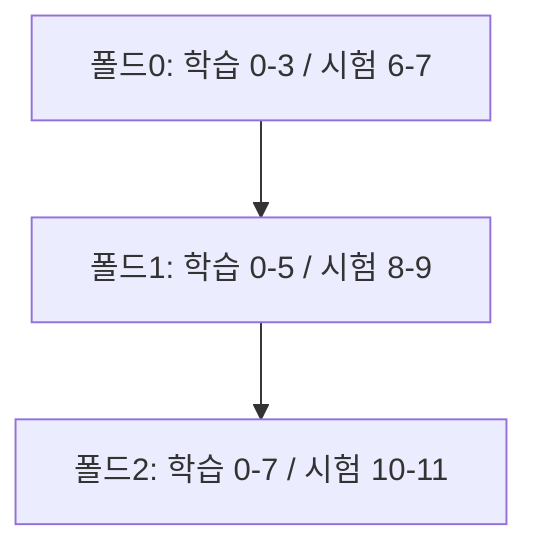

# 시간 기반 분할 규칙

> 데이터를 **시간 순서대로** 나눠 과거로 학습하고 그 이후 시기로 시험하는 규칙이다. 무작위로 섞어 나누면 미래 정보가 학습에 섞여 성능이 부풀려진다.

## 쉽게 말하면
지난달 날씨를 맞히는 연습을 하는데, 훈련 자료에 "다음 주 날씨"가 섞여 있다면 당연히 잘 맞힌다. 실제 서비스에서는 항상 과거만 보고 미래를 예측하므로, 시험도 같은 조건으로 해야 한다. 달력의 앞쪽으로 공부하고 뒤쪽으로 시험 본다.

## 자세히
(scikit-learn `TimeSeriesSplit` 문서 직접 확인.)
- **왜 무작위 분할이 위험한가**: 섞으면 시간 순서가 깨져 미래 행이 학습에, 과거 행이 시험에 들어간다. 시계열이 아니어도 시간에 따라 분포가 변하는(사용자 행동·가격) 서비스 데이터에는 마찬가지다.
- **단순 규칙**: 기준 시각 T를 정해 T 이전 = 학습, T 이후 = 검증·시험. 가장 쉬운 형태는 한 번의 시간순 홀드아웃이다(일반 원칙).
- **여러 폴드: `TimeSeriesSplit(n_splits=5, *, max_train_size=None, test_size=None, gap=0)`**
  - 폴드마다 학습 세트는 특정 시점까지 모든 데이터, 시험 세트는 그 이후. 학습 세트가 점점 커지며 이전 학습 세트의 상위집합이다.
  - `test_size` 기본값은 `n_samples // (n_splits + 1)`. 폴드 간 지표를 비교하려면 **샘플이 등간격**이어야 한다(문서).
  - **`gap`**: 학습 세트 끝에서 시험 세트 직전 몇 개를 **버려** 완충한다(문서 예: 12개, n_splits=3, test_size=2, gap=2이면 폴드 0은 학습 0~3, 시험 6~7).
- **분할만 맞아도 새는 경우**: 이동평균·지연(lag) 특징이 당일 값을 포함하면 분할이 맞아도 누수다(검색 결과의 러시아어 글 사례, 원문 미확인). 특징은 `shift(1)`처럼 과거만 쓰게 만든다.
- **한계**: 첫 폴드는 학습 데이터가 적고, 폴드마다 재학습이 필요해 큰 모델에는 비싸다.
- 시간 기반 분할은 [시점 기준 조인](#point-in-time-join)과 짝이다 — 조인은 특징 쪽, 분할은 데이터 나누는 쪽에서 미래를 막는다(해석).

## 그림으로 보기



## 예시
```python
from sklearn.model_selection import TimeSeriesSplit
tscv = TimeSeriesSplit(n_splits=3, test_size=2, gap=2)
for train_idx, test_idx in tscv.split(X):
    ...  # 항상 train_idx < test_idx
```
- 교육 소재: "내일 주가를 맞히는 AI를 어제 데이터로 검증했다면 믿어도 될까?"

## 헷갈리는 것과 비교
| 개념 | 차이 |
|---|---|
| 시간 기반 분할 | 시간순으로 학습/시험 분리 |
| K-겹 교차검증(섞음) | 순서 무시, 시계열에 부적합 |
| [시점 기준 조인](#point-in-time-join) | 특징을 붙일 때의 시점 규칙 |
| [시점 누수](#point-in-time-leakage) | 이 규칙이 막으려는 문제 |

## 더 읽을거리
- [sklearn TimeSeriesSplit](https://scikit-learn.org/stable/modules/generated/sklearn.model_selection.TimeSeriesSplit) — 파라미터·gap 예제(직접 확인).
