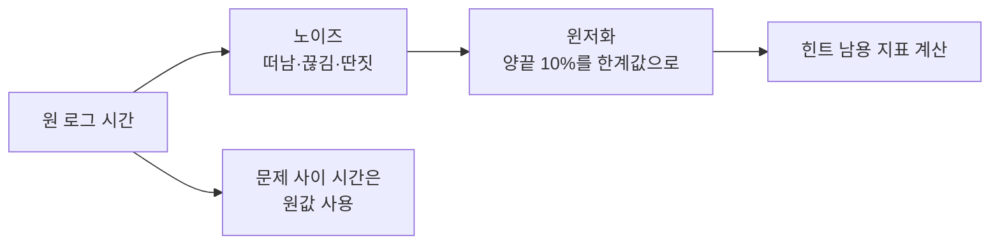
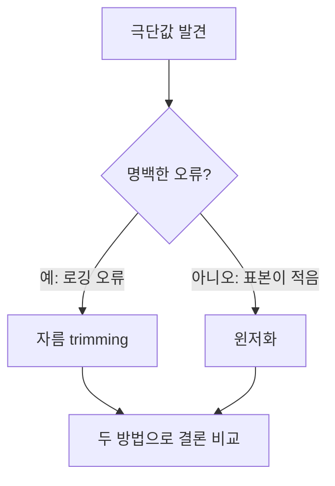

# 체류 시간의 노이즈

> 체류 시간(time-on-task)은 학생이 한 문제에 머문 시간인데, 문제를 열어 둔 채 자리를 뜨거나 접속이 끊겨도 길게 찍혀서 극단값이 많다. 그대로 평균을 내면 왜곡되므로 윈저화 같은 보정이 필요하다.

## 쉽게 말하면
체중계 위에 서서 전화를 받으면 "서 있던 시간 3분"이 찍힌다. 그 값을 모아 "평균 몸무게 측정 시간"을 내면 이상한 숫자가 나온다. 로그의 시간은 "푸는 데 쓴 시간"이 아니라 "화면이 열려 있던 시간"이다.

## 자세히
- **노이즈의 원인**: 힌트 남용을 다룬 연구(PMC6310403, 2026-11 열어 읽음)는 문제당 체류 시간이 최대 4개월에 달하는 값도 있었다고 보고한다. 문제를 연 채 떠난 경우이며, 네트워크 끊김·다른 활동·딴짓·늦은 제출도 섞인다.
- **윈저화(winsorizing)**: 극단값을 지우지 않고 정한 한계값으로 눌러 놓는 방법. 이 연구는 양끝 10%를 적용해 범위를 11~404초로 만들었다(원자료의 80% 유지). 5%로 하면 상한이 10,920초(3시간 이상)로 남아 비현실적이라 기각했다.
- **부작용**: 윈저화는 시각 기록을 바꿔 "문제 사이 시간" 계산이 틀어진다. 그래서 그 지표는 윈저화 전 값을 썼다. 지표마다 처리를 달리해야 할 수 있다.
- **결과에 미치는 영향**: 같은 논문 표에서 윈저화 전후의 중앙값 차이가 달랐다(원값 14.73 vs 13.05, 윈저화 후 11.64 vs 11.86). 보정 방법이 결론을 바꿀 수 있다는 뜻이다. 다만 이 논문은 단위 표기가 표와 본문에서 어긋나 해석에 주의가 필요하다.
- **자름(trimming)과의 비교**: 자름은 값을 버리고, 윈저화는 표본 수를 유지한다. 읽기 시간 데이터 재분석 연구는 둘의 차이가 의미 있지 않았다고 보고하지만 다른 분야 결과다. 학습 로그에서 일반적 승자는 확인되지 않았다.
- **실무 권고**: 처리 방식과 임계값을 보고서에 명시하고, 방법을 바꿔 결론이 유지되는지 확인한다. 학습 분석 발표(Nguyen, LAK 2020)도 이상치 처리가 예측력 같은 발견을 좌우하므로 명시를 권한다.

## 그림으로 보기

## 예시
- AI 튜터 로그에서 "문제당 평균 체류 시간"을 내기 전에 상·하위 10%를 한계값으로 눌러 놓는다. 프롬프트 예: "이 CSV의 체류 시간을 윈저화 10%로 보정한 전후 중앙값을 비교해 줘."
- 교육 활용: 교육 데이터 분석 실습에서 "평균 대신 중앙값, 극단값 처리 명시"를 첫 규칙으로 가르친다.

## 헷갈리는 것과 비교
| 개념 | 차이 |
| --- | --- |
| [힌트 남용 탐지](#hint-abuse-detection) | 부모 주제. 체류 시간은 그 신호 중 노이즈가 큰 하나 |
| 윈저화 | 극단값을 한계값으로 대체, 표본 수 유지 |
| 자름(trimming) | 극단값을 제거, 표본 수 감소 |
| 중앙값 사용 | 극단값에 둔감하지만 분포 정보를 줄임 |

## 더 읽을거리
- [PMC6310403 (힌트 남용 측정 제안 논문)](https://pmc.ncbi.nlm.nih.gov/articles/PMC6310403/) — 윈저화 10% 적용과 11~404초 범위
- [Outliers in L2 research (Cambridge)](https://resolve.cambridge.org/core/journals/annual-review-of-applied-linguistics/article/outliers-in-l2-research-in-applied-linguistics-a-synthesis-and-data-reanalysis/8C91F49ECD92305E3FE63F5592BD961B) — 자름과 윈저화 비교(읽기 시간 데이터; 검색 요약으로만 확인)
