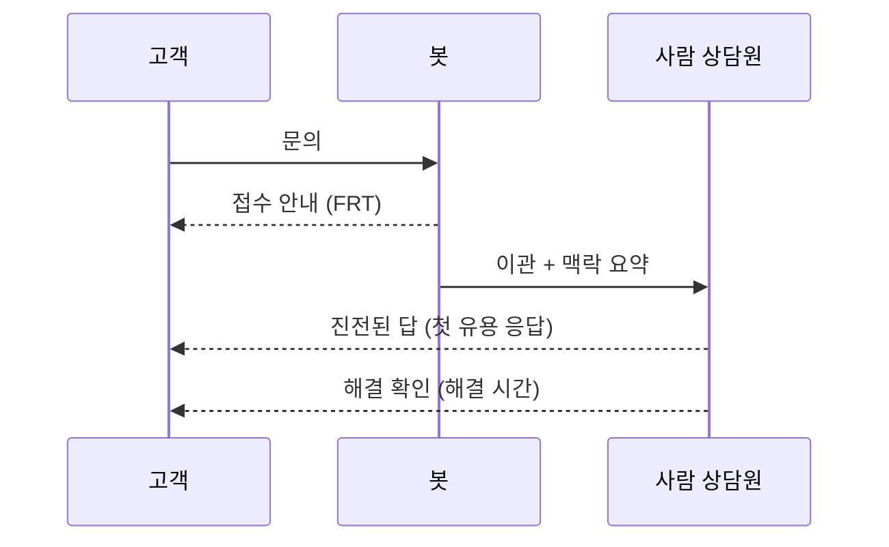
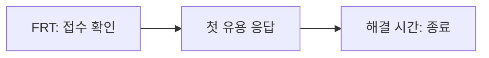

# 첫 유용 응답까지 시간

> 이관(에이전트 → 사람, 또는 에이전트 → 다른 에이전트) 이후 고객이 "접수했습니다"가 아니라 **실제로 도움이 되는 답**을 받기까지 걸린 시간이다. 표준 용어가 아니라 이 지도에서 쓰는 지표 이름이다(제안).

## 쉽게 말하면
식당에서 "주문 받았습니다"(첫 응답)는 금방 나와도, 음식이 나오기까지(해결)는 따로 걸린다. 이관 후에는 새 직원이 처음부터 다시 물으면 "받았습니다"는 빨라도 "쓸 만한 답"은 늦어진다. 이 지표는 그 사이 간격을 본다.

## 자세히
- **표준 지표**(Kustomer 용어집 확인): First Response Time(FRT)은 요청 시점부터 사람이나 봇의 **첫 응답**까지로 문제가 해결됐는지는 보지 않는다. Resolution Time은 케이스 시작부터 종료까지의 전체 시간으로 에스컬레이션·핸드오프 횟수와 무관하다.
- **빈틈**: 봇이 즉시 인사하면 FRT는 좋아 보이지만 이관 후 의미 있는 진전은 없을 수 있다. 그래서 "첫 *유용* 응답"을 별도로 정의한다 — 예: 이관 후 고객에게 같은 질문을 되묻지 않고 진전된 답(해결책·다음 단계·정확한 진행 상황)이 나간 최초 시점(제안 정의).
- **시계 처리는 정해야 하는 선택**: 이관 시 시계를 멈추거나 새로 시작하는 표준 규칙은 확인되지 않았다. 측정 가이드는 시작 시점(할당·이관 시)을 정하고 문서화하라고 한다. 영업시간/달력시간, 재오픈 처리도 숫자를 왜곡한다.
- **같이 볼 것**: FRT와 해결 시간을 함께 보고하고, 이관 비율·이관 품질도 같이 본다(벤더 글 공통 주장).
- 측정 방법 예(제안): 이관 이벤트 → 다음 "유용" 라벨 메시지 사이의 시간. 라벨은 사람이 표본으로 달거나 LLM 판정기를 쓰되 표본을 검수한다.

## 그림으로 보기

## 예시
- 맥락 요약 없이 이관: 상담원이 "무슨 문제세요?"부터 묻는다 → 첫 응답은 빠르지만 유용한 응답은 3분 뒤(가정 예).
- 요약 패킷과 함께 이관: 첫 메시지가 바로 "환불 건 확인했습니다, 오늘 처리 가능합니다" → 지표가 줄어든다.

## 헷갈리는 것과 비교
| 개념 | 차이 |
|---|---|
| First Response Time | 첫 응답(봇 인사 포함), 해결 여부 무관 |
| 첫 유용 응답까지 시간 | 이관 후 진전이 있는 응답까지 (제안 지표) |
| Resolution Time | 케이스 종료까지 전체 |
| [이관 대기 시간](#handoff-wait-time) | 이관 후 사람이 받기까지의 대기 |

## 더 읽을거리
- [Kustomer: 응답 시간 SLA vs 해결 시간 SLA](https://www.kustomer.com/glossary/response-time-sla-vs-resolution-time-sla/) — FRT와 해결 시간의 정의 차이(직접 열어 확인).
- [Voiceflow: 고객 서비스 지표 2026](https://www.voiceflow.com/blog/customer-service-metrics) — FRT·해결 시간·이관율 개요(검색 결과 기준, 벤더 글).
