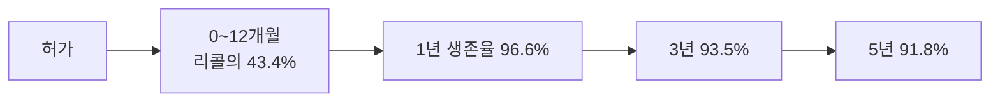

# 리콜까지 걸린 시간

> AI 의료기기가 허가(clearance)를 받은 뒤 처음 리콜되기까지의 시간. 허가 직후 몇 달 안에 리콜이 몰리는지는 시판 전 시험이 얼마나 충분했는지를 가늠하는 신호가 된다.

## 쉽게 말하면
새 차가 출고 후 1년 안에 리콜이 몰린다면, 출고 전 시험이 놓친 문제가 있었다는 뜻이다. 리콜까지 걸린 시간이 짧을수록 사전 검증의 빈틈이 크다고 읽을 수 있다.

## 자세히
출처: Lee 외, JAMA Health Forum 2025;6(8):e253172(PMC 원문을 열어서 읽음).
- **허가 후 12개월 안 집중**: 리콜 182건 중 79건(43.4%)이 허가 12개월 안에 일어났고, 이는 전체 510(k) 기기에서 보고된 비율의 약 2배라고 논문이 서술한다.
- **리콜 없는 생존율**: 1년 96.6%, 3년 93.5%, 5년 91.8%.
- **중앙값 일수**: 이번에 읽은 PMC 판에는 리콜까지의 **중앙값 일수나 IQR이 보고되지 않았다**. 이 지도의 [AI 기기 리콜](#ai-device-recalls) 글에는 "중앙값 458일"이 적혀 있는데, 그 출처는 다른 판본(903개 기기 중 43개 리콜)이라 이번에 대조하지 못했다. 두 수치를 섞어 쓰지 않는다.
- **미해결 리콜**: 리콜의 59.3%(108건)가 연구 종료 시점에 미해결이었다.
- **검증 유무와 리콜**: 임상 검증을 보고하지 않은 기기는 기기당 평균 3.4건, 회고 검증 1.9건, 전향 검증 2.0건. 다변량 분석에서 임상 검증 부재(OR 2.8, 95% CI 1.6~4.7)와 상장사 여부(OR 5.9, 95% CI 2.4~14.6)가 리콜과 독립적으로 연관됐다([임상 검증과 리콜](#clinical-validation-recalls)).
- **한계**: 연관성이지 인과가 아니고, 2022년 이후 허가 기기는 추적 기간이 짧아 생존율 추정이 불안정하다(저자가 밝힌 한계).

## 그림으로 보기

## 예시
- 도입 점검: 최근 1년 안에 허가된 AI 기기는 시판 후 감시를 더 촘촘히 하고, 리콜 이력과 임상 검증 보고 여부를 허가 요약에서 확인.
- 읽기 주의: "리콜 없는 생존율"은 추적 기간이 긴 기기에 유리하게 보이지 않도록 추적 시간 분포를 같이 본다.

## 헷갈리는 것과 비교
| 개념 | 차이 |
|---|---|
| 리콜까지의 시간 | 허가 후 첫 리콜까지의 기간 |
| [리콜 원인](#recall-causes) | 왜 회수됐는가 |
| [AI 기기 리콜](#ai-device-recalls) | 상위 노드 |
| [신뢰구간 읽기](#credible-interval-reading) | 효과 크기 추정의 불확실성 읽는 법 |

## 더 읽을거리
- [Early Recalls and Clinical Validation Gaps in AI-Enabled Medical Devices (JAMA Health Forum, PMC)](https://pmc.ncbi.nlm.nih.gov/articles/PMC12374217) — 리콜 시기·생존율(열어서 확인)
