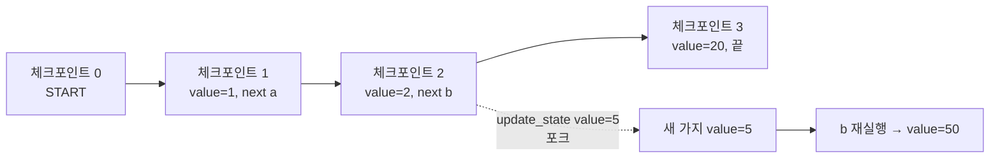

# 타임 트래블

> LangGraph에서 **저장해 둔 과거 체크포인트로 돌아가 그 지점부터 다시 실행(리플레이)하거나, 그 지점의 상태를 고쳐 새 가지(포크)로 실행**하는 기능. 에이전트가 어디서 틀렸는지 디버깅하거나, "다른 선택을 했다면?"을 실험할 때 쓴다. 체크포인터가 필수다.

## 쉽게 말하면
게임의 자동 저장 슬롯 여러 개를 두고, 3번 저장 지점으로 돌아가 "이번엔 다른 아이템을 챙기고" 다시 진행하는 것이다. 원래 진행 기록은 그대로 남고, 새 갈래가 하나 더 생긴다.

## 자세히
(LangGraph 공식 문서 time travel + 직접 실행, langgraph 1.2.24)
- **체크포인트 찾기**: `get_state_history`는 체크포인트를 **최신순**으로 돌려주고, 각 항목의 `next`가 "다음에 실행될 노드"를 알려 줘 되돌아갈 지점을 고를 수 있다.
- **리플레이**: 과거 체크포인트의 설정(config)과 입력 `None`으로 `invoke`하면, 그 **이전 노드는 다시 실행하지 않고**, **이후 노드만 다시 실행**한다. LLM 호출·API 요청·인터럽트도 **다시 실행**되므로 결과가 달라질 수 있다. 마지막 체크포인트에서의 리플레이는 아무 일도 하지 않는다.
- **포크**: 과거 체크포인트에 `update_state`로 값을 고쳐 **새 가지**를 만든 뒤 `None`으로 이어 실행한다. 원래 이력은 **보존**되고 되돌려지지 않는다. `as_node`로 어느 노드가 그 갱신을 한 것으로 볼지 정할 수 있다.
- **직접 실행**(노드 a: `value+1`, 노드 b: `value×10`, 초기 `value=1`):

| 단계 | 결과 |
|---|---|
| 최종 결과 | `{'log': ['a','b'], 'value': 20}` |
| 체크포인트 수 | 4개: `next=()` value 20 / `next=('b',)` value 2 / `next=('a',)` value 1 / `next=('__start__',)` |
| `next=('b',)` 체크포인트(a 직후)에서 `update_state({"value": 5})` 후 `invoke(None, …)` | `{'log': ['a','b'], 'value': 50}` — **a는 다시 실행되지 않고 b만 5×10으로 실행** |
| 같은 스레드의 최신 상태 | `value=50` (포크가 만든 새 갈래가 최신이 됨) |

  첫 결과(20)가 아니라 수정한 값(5)에서 이어진 50이 나왔다. 포크는 **같은 스레드에서 새 체크포인트 가지를 만들고** 그 가지가 최신이 되므로, 원래 가지로 되돌아가려면 해당 체크포인트의 config를 다시 지정해야 한다(내부 동작은 문서·버전 확인).
- **사람 개입(interrupt)과 서브그래프**: 시간 여행 중 인터럽트는 **다시 발동**해 새 재개 값을 기다린다. 서브그래프는 기본적으로 부모의 체크포인터를 물려받아 **부모 수준에서만** 시간 여행이 가능하고, `checkpointer=True`를 주면 자체 이력을 가져 더 세밀하게 포크할 수 있다(문서).
- **쓰임새**: ① 잘못된 도구 호출 직전으로 돌아가 인자를 고쳐 재시도, ② 승인 단계에서 사람이 값을 바꿔 이어 가기, ③ 같은 지점에서 모델·프롬프트를 바꿔 A/B 비교, ④ 장애 후 마지막 정상 지점부터 재개.
- 주의: **외부 부작용**(이메일 발송, 결제)이 있는 노드를 리플레이하면 **다시 실행**되므로 중복 부작용을 막는 설계(멱등성)가 필요하다.
- 한계: 인메모리 체크포인터는 프로세스가 끝나면 사라진다. 운영에서는 영속 저장소를 쓴다([상태와 장기 메모리](#state-vs-memory)).

## 그림으로 보기


## 예시
```python
hist = list(app.get_state_history(cfg))          # 최신순
target = next(h for h in hist if h.next == ("b",))
new_cfg = app.update_state(target.config, {"value": 5})   # 포크
print(app.invoke(None, new_cfg))                 # b만 다시 실행 → value 50
```
- 에이전트 디버깅: 3번째 도구 호출에서 잘못된 쿼리를 만들었다면, 그 직전 체크포인트에서 쿼리 상태를 고쳐 이어 실행.

## 헷갈리는 것과 비교
| 개념 | 차이 |
|---|---|
| 리플레이 | 과거 지점부터 다시 실행(이후 노드 재실행) |
| 포크 | 상태를 고쳐 새 가지로 실행(원래 이력 보존) |
| 되돌리기(롤백) | 이력을 지우고 과거로(LangGraph는 이력을 지우지 않음) |
| [상태와 장기 메모리](#state-vs-memory) | 체크포인터가 저장하는 대상 |

## 더 읽을거리
- [LangGraph: Use time-travel](https://docs.langchain.com/oss/python/langgraph/use-time-travel) — 리플레이·포크 방법.
