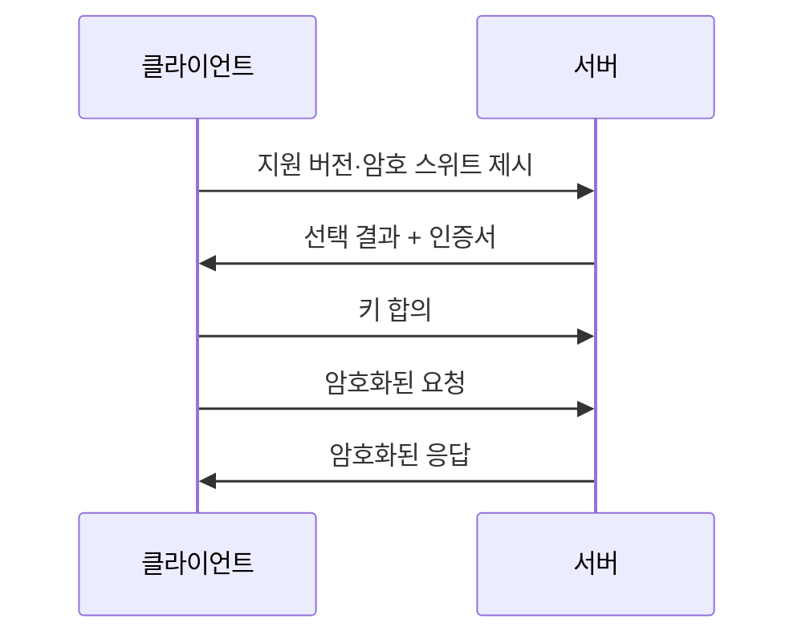

# 전송 중 암호화(TLS)

> 네트워크를 오가는 데이터를 암호화·무결성 검사·상대 신원 확인으로 보호하는 프로토콜. HTTP에 얹으면 HTTPS가 된다.

## 쉽게 말하면
편지를 봉투에 넣고(암호화), 뜯으면 티가 나는 봉인을 하고(무결성), 받는 사람이 진짜 그 사람인지 신분증을 확인하는(인증) 우편 규칙이다. 저장된 데이터를 지키는 [저장 시 암호화](#encryption-at-rest)와 달리 이동 구간을 지킨다.

## 자세히
MDN 문서 기준:
- 제공하는 것: **암호화**, **무결성**(전송 중 변조 탐지), **인증**(웹에서는 보통 서버가 클라이언트에게 신원을 증명).
- 막는 공격: 중간자(MITM) 공격 — 브라우저와 서버 사이에서 트래픽을 읽고 바꾸는 것.
- **핸드셰이크**: ① TLS 버전 합의 ② 암호 스위트(키 합의·인증·암호화·메시지 인증 알고리즘) 합의 ③ 서버 인증(클라이언트 인증은 드묾) ④ 공유 비밀 키 합의. 이후 HTTP 헤더·본문 모두 그 키로 암호화된다.
- **버전**: TLS 1.3(RFC 8446)이 현재 표준이자 가장 널리 사용, 1.2는 일부 사용, **1.1·1.0은 쓰지 말 것**.
- **혼합 콘텐츠**: HTTPS 페이지가 HTTP 하위 리소스를 불러오면 브라우저가 업그레이드하거나 차단한다. 서버는 CSP `upgrade-insecure-requests`로 대응할 수 있다.
- AI 앱 적용: 모델 API·MCP 서버·벡터 DB 연결은 TLS로. 내부망이라도 시크릿이 오가면 TLS를 쓴다([시크릿 관리](#secrets-management)).

## 그림으로 보기


## 예시
```bash
curl -v https://api.example.com   # 핸드셰이크와 TLS 버전 확인
openssl s_client -connect api.example.com:443 -tls1_3
```

## 헷갈리는 것과 비교
| 개념 | 차이 |
| --- | --- |
| TLS | 프로토콜(보안 계층) |
| HTTPS | HTTP over TLS |
| [저장 시 암호화](#encryption-at-rest) | 디스크의 데이터 보호 |

## 더 읽을거리
- [MDN: Transport Layer Security](https://developer.mozilla.org/en-US/docs/Web/Security/Transport_Layer_Security) — 제공 기능·핸드셰이크·버전
