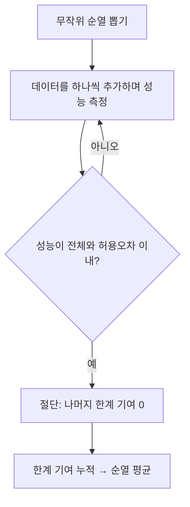
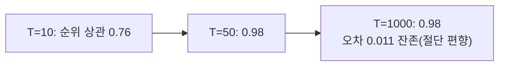

# TMC-Shapley

> 학습 데이터 각각이 모델 성능에 기여한 정도를 샤플리 값으로 매길 때, 모든 순열을 다 보는 대신 **무작위 순열을 여러 개 뽑고, 성능이 이미 포화되면 계산을 중간에 끊는(절단)** 몬테카를로 근사 방법이다(Data Shapley의 TMC-Shapley).

## 쉽게 말하면
팀 프로젝트에서 각 사람의 기여를 재려면 "누가 먼저 합류했느냐"의 모든 순서를 상상해 평균을 내야 하는데, 사람이 많으면 불가능하다. 순서를 무작위로 몇백 번만 뽑고, 팀 성과가 이미 거의 다 나온 시점부터는 더 합류해도 무의미하다고 보고 계산을 멈춘다.

## 자세히
- **배경(Ghorbani & Zou 2019, arXiv 1904.02868 초록 확인)**: Data Shapley는 각 데이터가 예측기 성능에 기여한 정도를 점수로 주고, "공정한 데이터 평가의 여러 자연스러운 성질을 유일하게 만족"한다. 복잡한 모델과 큰 데이터에서 실용적이게 몬테카를로·경사 기반 추정 방법을 제안한다. 활용: ① 무엇이 과제에 중요한지(LOO·leverage보다 효과적) ② 낮은 값의 데이터는 이상치·오염·노이즈 라벨을 잘 포착 ③ 높은 값의 데이터가 어떤 데이터를 더 모을지 시사.
- **정의**: 데이터 i의 샤플리 값은 데이터 순열을 무작위로 뽑았을 때 i를 추가할 때의 성능 증가분(한계 기여)을 평균한 것이다. 정확한 계산은 순열이 n!개라 n이 크면 불가능하다.
- **TMC(절단 몬테카를로)**: ① 무작위 순열 T개를 뽑는다 ② 순열을 따라 데이터를 하나씩 추가하며 성능을 재고 한계 기여를 누적 ③ 현재 성능이 전체 데이터 성능에 충분히 가까워지면(허용오차 이내) **나머지 한계 기여를 0으로 보고 절단** ④ 평균.
- **직접 구현·검증(scikit-learn 로지스틱 회귀, 학습 8개 중 앞 2개의 라벨을 뒤집음, 검증 300개 정확도가 효용)**
  - **정확한 샤플리**(8! = 40,320개 순열, 고유 부분집합 효용 256번): `[-0.007, -0.020, 0.011, 0.031, 0.003, 0.018, -0.020, 0.031]`. **합 0.047 = 전체 효용 − 빈 집합 효용 0.047**로 효율성 공리가 확인됐다. 뒤집은 라벨 2개(점 0·1)는 각각 −0.007·−0.020으로 음수였고, 점 6도 −0.020으로 낮아 하위 3개에 뒤집은 점이 2개 들었다. 학습 8개짜리 아주 작은 설정이라 신호가 약하다.
  - **TMC 근사(허용오차 0.01)**: 순열 T=10이면 정확값과의 순위 상관 0.76, 최대 절대오차 0.023. T=50이면 상관 **0.98**, 오차 0.008. T=200 0.99/0.010, T=1000 0.98/0.011. **T를 늘려도 오차가 0으로 수렴하지 않고 약 0.01에 머문다.** 절단이 만드는 작은 편향 때문이다(허용오차를 줄이면 줄지만 계산이 늘어남).
- **실무 요령(제안)**: 허용오차와 순열 수를 계산 예산에 맞춰 정하고, 순열 수를 늘리며 순위가 안정되는지 확인(수렴 점검). 효용 함수는 매번 모델을 학습해야 해서 비용이 크다. 값이 낮은 데이터는 [라벨 오류 후보](#cleanlab-label-quality-score)로 사람이 검토하되 [자동 삭제](#auto-delete-risk)는 하지 않는다.
- **한계**: 효용 함수(모델·검증 세트)에 의존, 학습 비용, 작은 데이터에서는 값이 잡음에 가깝다(위 8개 실험), 절단 편향.

## 그림으로 보기



## 예시
```python
# 개념 스케치: 효용 = 검증 정확도, 순열마다 데이터를 추가하며 한계 기여를 누적
for _ in range(T):
    perm = rng.permutation(n); prev = U(())
    for j, i in enumerate(perm):
        if abs(full - prev) < tol: break       # 절단
        cur = U(perm[:j+1]); sv[i] += cur - prev; prev = cur
```
- 학습 데이터 중 값이 가장 낮은 50개를 사람이 검토해 노이즈 라벨 비율을 확인.
- 교육: 팀 기여도 배분의 샤플리 값(협력 게임 이론) 개념을 데이터에 적용.

## 헷갈리는 것과 비교
| 개념 | 차이 |
|---|---|
| 정확한 Shapley | 모든 순열, n 작을 때만 가능 |
| TMC-Shapley | 무작위 순열 + 절단 근사 |
| Leave-One-Out | 하나만 뺀 변화(상호작용 놓침) |
| [Beta Shapley](#beta-shapley) | 효율성 공리를 완화해 노이즈를 줄인 변형 |

## 더 읽을거리
- [Data Shapley (arXiv 1904.02868)](https://arxiv.org/abs/1904.02868) — 정의·성질·근사 방법·활용(초록 확인).
